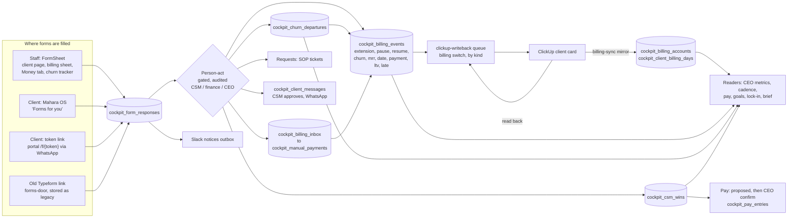

> **Status 2026-11-02:** waves 0-6 are built and live except Stage 4 (native kickoff and onboarding) and the billing agent's own login; see [`HANDOFF-2026-11-02.md`](HANDOFF-2026-11-02.md).

# Every CSM and client form in the cockpit and the client portal: the plan (2026-11-01)

**The answer in one paragraph.** We finish the forms programme you started on 25 October. This time it also covers the money it was missing: bank-transfer payments, MRR, upsells, late payments and refunds. In the end state, every CSM form and every client form lives in the cockpit or in the Mahara OS client portal. Each one writes one system of record in the cockpit's database, and a person's confirm turns that answer into a change on the client's ClickUp card. Every card write is queued, read back and logged. Each answer feeds the numbers that read it: the CEO metrics, the CSM page, pay, goals and the monthly lock-in. Once a form's cockpit version is proven, its Typeform and Make scenarios are switched off and archived. Nothing is deleted, and your subscriptions stay as they are. The base is `docs/forms/PLAN.md` (origin/main `36820707`, D1–D19). This plan carries it forward, joins in the money work, and says plainly where it departs from it (§9).

Audience: the CEO first (sections 1, 2, 6, 7, 10), then the build sessions (sections 3, 4, 5, 8, 9). Team members are named by role. Clients are named where a held row or a live record makes it necessary.

---

## 1. What you need to know

- **Live today:** the 1-1 notes in the cockpit, filled from Fathom (since 2026-11-01 15:31), ticketing for the whole team (since 10-27), task alerts and "Your tasks", the kickoff form inside the CSM cockpit, the cockpit's own Brand Blueprint, the billing sheet with Pending payments, money attribution, the churn tracker, and the review/referral button that pops up in the client portal.
- **Built, but never proven or still switched off:** the kickoff and Blueprint Slack notices (30 kickoff notices were skipped and none posted; the cockpit Blueprint has never been closed for real), four billing edits held back from ClickUp (two extensions, one pause, one date move).
- **Missing:** extension, pause, cancellation, NPS, CSAT and "Log a win" as cockpit forms; any client form inside the portal; one writer per money field on the card; a record of late payments; a way to tell a hand-logged transfer from checked money.
- **The one yes needed today (Q1):** stop the termination form from marking a client Stopped on the card the moment the client submits. Its card comment and Slack post keep working, and Typeform keeps every answer.
- **The waves and their rough size:** 0 this week (small): stop that card write and prove the kickoff and Blueprint path. 1 (medium): safe card writes, the churn confirm, and storing termination answers. 2 (medium): extension, pause, MRR. 3 (large): client forms in the portal and by WhatsApp link. 4 (medium): NPS, CSAT, portal feedback, onboarding. 5 (medium to large): wins, upsell cash, LTV. 6 (large): the rest and Stage 4. The 1-1 notes are live since 2026-11-01.
- **When clients see forms in the portal:** wave 3 (pause consent, exit survey), then wave 4 (NPS, CSAT, feedback).
- **One rule from the 25 Oct plan you will see named:** D11, "the client never changes the card; the CSM decides." §3 onward names tables, switches and codes; it is for the build sessions.

---

## 2. Decisions on one screen

| # | Decision | Why |
|---|---|---|
| E1 | **Client forms open in the portal first, and by a WhatsApp link second, with one page design for both.** Signed-in clients see a card in Mahara OS; anyone not signed in or locked out gets a private link. | Your 11-01 ask names the client portal. The `forms.maharamedia.com` address in the old plan has no DNS and no code. 4 of 15 active and 6 of 8 onboarding clients have no live portal session, and a cancelled client is locked out of the portal, so an exit survey that only works there would fail exactly when it is needed. |
| E2 | **The cockpit holds the record, and the ClickUp card is a copy of it.** Every answer is stored first. A team member's confirm turns it into the right record (billing, churn, wins or payments), and that record makes exactly one card change, which is read back. | It ends the five writers on Next Payment Date and the three on LTV, and keeps D11. |
| E3 | **The client never changes the card (D11).** A client's answer is stored, makes a task for the CSM and posts a notice. Only the CSM's confirm changes the card. | Today the termination form breaks this: it marks a client Stopped the moment they submit. |
| E4 | **Stop the termination form's card write now**, before anything else. Storing its answers in the cockpit follows in wave 1. | It is the only live form that changes the card on a client's submit. Atlantis submitted on 10-31. |
| E5 | **Billing edits get their own on/off switch, by kind of edit and by card**, so turning them on releases nothing else. This programme does not use the general switch. | No billing switch exists today. The general switch would release 59 held items of 5 kinds. The other 55 (team decisions, manual changes, provider actions, tracking backlog, and the Do's & Don'ts card writes) stay held as they are; who re-plans or drops them is Q19. |
| E6 | **The CSM can confirm a churn on their own, in wave 1.** The exit survey becomes optional evidence, sent before or after the confirm, and its WhatsApp link still works after a cancelled client is locked out of the portal. | Your 11-01 words: log churn "even if they haven't finished the form and calls". Only 1 of the 6 October churns filled the form. |
| E7 | **One set of overdue steps (the "ladder"), editable, defaulting to your own 09-19 rule:** a pause review on day 4 and a cancel review on day 15, both as staff tasks, never automatic. Each late payment is also recorded, with its days late. | Three ladders disagree today: the billing agent (day 3 / day 15), the portal (day 4 / day 15) and PLAN (pause at once). |
| E8 | **Only money that arrived counts as cash.** Whop, Tap, Ecom and bank statement lines count. A hand-logged transfer or a client's uploaded receipt is stored as "logged, not checked" until it matches a statement line or finance confirms it with a named reference. Every number says which it shows. | Your 09-21 rule (cash = bank statement + Whop), and portal BILLING-DATA: "a receipt upload is not proof of funds". Today nothing stops a logged transfer from counting: every logged row goes straight into the cash ledger. |
| E9 | **MRR stays the card's MRR field, with one writer** (a new "Set MRR" edit in the billing sheet). The cockpit shows a *suggested* MRR beside it and flags any card where the MRR and the money actually arriving differ. | Your 09-19 words: "calculate it or just look it up on ClickUp". Today the field is typed by hand and one active card has none. |
| E10 | **LTV has one writer:** the cockpit's sum (the card's starting value plus checked payments tied to the client), written daily and read back. The billing agent's direct LTV write is retired, and the portal's LTV sync stays off. | Three writers use three formulas today. Ardon's LTV already lags its 10-27 payment. |
| E11 | **Upsells and the Four Rs (reviews, referrals, testimonials and upsells) go into one new wins record with stages:** quoted, signed, paid, or voided. "Upsells" counts quoted plus signed. "Upsells Cash" and commission count only cash tied to the win, and that cash is always the CSM's back end, never the closer's. | Your 10-26 rule (a win is a qualified quote or a signed project), the contract text (commission needs a signed agreement or a confirmed payment), and 10-30 (drafts are not evidence). |
| E12 | **Pay is proposed, then you confirm it.** A logged win creates a proposed pay line, and one press by you turns it into pay, with the win as its evidence. | Nothing posts pay on its own. This is the default for the open question in PLAN 3.7. |
| E13 | **The extension carries no $50.** Remove the "each extension costs you $50" text and build no pay item, until you say otherwise. | The pay plan has no extension part, and the text reads as a charge to the CSM. |
| E14 | **NPS is named by card and uses a true 0–10 question.** The portal's "Share feedback" is bridged into the cockpit and shown apart from NPS. | PLAN 3.5, plus your 10-23 ask that portal feedback reach the CSM cockpit per client. |
| E15 | **The kickoff and the New Client Form stay on Typeform until Stage 4.** The cockpit records their answers, and the numbers that read them stop depending on the Typeform's id. | The old plan's D2 and D14. A cockpit kickoff would otherwise silently zero kickoff cash in the CEO numbers. |
| E16 | **The portal's own billing stays off** until it reads the cockpit's billing records, with the same overdue steps and the same LTV writer. | Turning it on today would add a second Next Payment Date writer, a second LTV writer and a second pause and cancel path. |
| E17 | **The billing agent gets its own login that can do one thing:** record billing events through one checked door. It loses the master key, makes no direct table writes and no direct ClickUp writes. | The standing rule: every action is gated on the server and every write is audited. Today it uses the master key, so its "who did this" cannot be proven. |
| E18 | **Forms, routing, notices, schedules and the overdue steps are all editable without code** by you, the systems manager or anyone given the right. Each form version can be published, previewed and restored. | The old plan's D17, your 10-25 words. |
| E19 | **Each old form is switched off on its own day.** Its Make scenario is turned off and checked off before the cockpit takes over each card field, the switch happens in the same hour, and an answer that still comes through the old link is kept, never lost. | The old plan's D13 and D16. You said on 11-01 that the Typeform and Make subscriptions stay, so switching off single scenarios is in bounds. |
| E20 | **Every client form has two triggers: its date and the CSM.** The schedule sends it by itself when its day comes, and the CSM can send any client form from the client page at any time. NPS goes out by itself on day 60 after launch. The onboarding survey pops up in the portal once the client is launched, until they fill it. The exit survey and the pause consent are sent by the CSM's action (Client is leaving, the pause). Every schedule is editable (E18), and it skips Paused and Stopped clients and anyone with the same form already open. | Your 11-01 words: "Client forms should trigger based on the date and if the CSM triggers it from his side. On day 60, we send the NPS survey anyway." |

---

## 3. The data spine

*For the build sessions. The plain version is E2 in §2.*

### 3.1 One record per domain

| Domain | System of record | Card fields mirrored | Writer to the card | Read-back | Readers |
|---|---|---|---|---|---|
| Status, pause, resume | `cockpit_billing_events` (kinds `pause`, `resume`) + the form response | Client Status `9368ca9e` (by option id), Paused On `930c49eb`, Resume On `d3c46259` | clickup-writeback, billing kind | yes, per step | cockpit-sync cadence and PAUSE REQUIRED (through `cockpit_client_lifecycle_v`), Make 9686154 resume reminder, board, launch desk, ad-billing guard, CEO `clients.paused` |
| Extension | billing event `extension` + response | Next Payment Date `669ae046`, Current extension `8cb9d308`, the "will not continue" checkbox `9cfdb353` | same | yes | `cockpit_extensions_v` → cockpit-sync, CEO API, ceo-refresh, metric registry, goals, lock-in |
| Churn | `cockpit_churn_departures` (new columns) + billing event `churn` | Status Stopped, Churn Date `42429a6e`, Churn Reason `796f25e7`, Churn Type `a121f39a` | same | yes | cockpit-sync `churnValues()`, pay retention band (through billing days), CEO churn, lock-in, brief, goals |
| MRR | card field, edited through billing kind `mrr` | MRR `48eb6023` | same | yes | CEO projected MRR and collection (unchanged), lock-in, plus a second-source check |
| Payments | rail tables + `cockpit_billing_inbox` → `cockpit_manual_payments` with `check_state` (`logged` / `checked` / `rejected`, piece CK) | Next Payment Date `669ae046`; LTV `11d70e58` (daily job, `checked` rows only) | billing queue; LTV daily job | yes | Pending payments, attribution and Transactions, CEO cash, lock-in cash, pay facts, each stating whether it counts `logged` rows (5.3) |
| Late payments | billing event `late` (new kind), opened when the ladder's day-4 step fires and closed when the payment lands; plus a view `cockpit_late_payments_v` over `cockpit_client_billing_days` giving due date, paid date and days late | none (an optional comment "LATE {n} days" on close) | n/a | n/a | lock-in "late payments", goals, the CSM client page, CEO collection |
| Refunds | `cockpit_manual_payments` kind `refund` (5.3) | none (comment only) | n/a | n/a | CEO refunds metric (`metricRegistry.ts` money section), lock-in "Refunds" |
| Upsells and Four Rs | `cockpit_csm_wins` (new) + `cockpit_payment_ties.win_id` | none (a "WIN" comment; a recurring win proposes an MRR edit) | wins RPC; pay on the CEO's confirm | n/a | csmMoney, goal actuals, lock-in, CEO pay "Proposed from wins" |
| NPS, CSAT, feedback | `cockpit_form_responses` (`nps`, `csat`, `portal_feedback`) | NPS Survey Sent `34b2d7c0`, written on send | form-kind queue | yes | new CEO metric `clients.nps`, "Client voice" card, brief |
| Onboarding | response (Typeform now, native at Stage 4) | Make keeps every write until Stage 4 | Make 8922994 | n/a | prefill, csm-calls, portal gate, `cockpit_client_onboarding` |
| Lifecycle invites | `cockpit_form_invites` + `_events` (new) | none | n/a | n/a | client page "Forms out", guardian |

Hand edits on the card are picked up by billing-sync. A disagreement is shown as "Card says X, cockpit says Y" and is never silently overwritten in either direction.

### 3.2 Flow

---

## 4. The shared base

### 4.1 What exists and is reused

| Piece | Repo | State | Reused for |
|---|---|---|---|
| `cockpit_forms`, `cockpit_form_versions`, `cockpit_form_responses`, `cockpit_form_effects`, `cockpit_form_drafts` | cockpits | Live. 3 forms registered; responses accept `public` and `confirmed` | Every form |
| forms-door `/typeform/{form}` (signed, records only) | cockpits | Live for kickoff only | Legacy capture for every Typeform during cut-over |
| clickup-writeback queue + billing trigger + `cockpit_billing_writeback_writes` | cockpits | Live; billing held in dry run | Every card write |
| `cockpit_billing_write`, the BillingSheet (CEO Billing + CS `/billing`), Pending payments, the inbox and ingest | cockpits | Live | Extend, pause, payments, MRR |
| Churn tracker `cockpit_csm_churn_edit` | cockpits | Live; writes no card field | Churn confirm (extended) |
| Requests (31 types, SOP templates, writer in apply mode), task alerts, Your tasks | cockpits | Live since 10-27 | Pause, relaunch, offboarding, notice and receipt tickets |
| Slack notices outbox + editable routing | cockpits | Built (Stage 1) but **never proven on a real close**: 30 kickoff notices skipped and 0 posted (1 rehearsal posted); all 56 kickoff effects skipped; 0 cockpit Blueprint closes. See "Prove step 1" (PV) | Every notice |
| `cockpit_client_messages` + hermes/client-messages | cockpits | Deployed dark (2b) | WhatsApp invite links |
| Client asks (`cockpit_client_asks`, `portal_client_ask_*`, `ClientAsk.tsx`, push journal) | both | Live, 0 asks sent | The pattern for portal RPCs and push. The table stays for review and referral nudges only. |
| Money attribution, payment ties, Transactions, pay plans | cockpits | Live | Payments, upsells, pay proposals |
| Offer Studio proposals and the CSM invoice desk | cockpits | Live | Upsell quote and invoice |
| Portal onboarding gate, `getting-started`, `MaharaFeedback`, `globals.css` tokens, release lane | portal | Live | Forms surface, feedback bridge |
| CEO kit (`SectionCard`, `StatTile`, `StatusChip`, `EmptyState`, `format.ts`), Geist, `--mahara-teal` | cockpits | Live | FormSheet design |

### 4.2 What is built once

| Code | Piece | Repo | What it is |
|---|---|---|---|
| **B0** | Billing switch, fields and option map | cockpits | **Switch:** `CLICKUP_WRITEBACK_APPLY_BILLING`, `_BILLING_KINDS`, `_BILLING_ONLY_CARDS` in `run.ts:380-383`. **Fields:** add to `clickup-writeback/billing.ts` BILLING_FIELDS `resumeOn` (`d3c46259`, date), `churnDate` (`42429a6e`, date), `churnReason` (`796f25e7`, dropdown), `churnType` (`a121f39a`, dropdown), `mrr` (`48eb6023`, currency written as a number), `ltv` (`11d70e58`, same) and `willNotContinue` (`9cfdb353`), with a new `checkbox` Format (today Format is only dropdown, date or number, so any other field is skipped as "a value ClickUp cannot take"). Rename the `extension` label to "Current extension (weeks)". **Writes:** add `cockpit_billing_writeback_writes` cases for `churn`, `mrr`, `ltv`, `late` (comment only) and a `pause` restart step (it has cases only for method, plan, amount, date, extension, pause, resume and payment today). **Kinds and sources:** add `mrr`, `ltv` and `late` to the events kind CHECK (`churn` is already there); add `system` to the events source CHECK (today ceo, csm, maher, clickup); extend the trigger to queue `churn`, `mrr` and `ltv` from ceo/csm and `(source='system' AND kind IN ('extension','ltv'))`. **Option map:** dropdowns are written by option id from a live field read stored in a map table, never by option name. Register reasons map explicitly: "Completed term" → "Completed term, did not renew"; "Other" → no value; churn type mid-programme → "Mid-programme loss (counts as churn)", completed → "Completed term (does NOT count as churn)". **Tests:** a read-back test per new field against a stubbed ClickUp, including the checkbox and both currency fields. |
| **F0** | Generic forms backend | cockpits | Remove the checkin-only limits in five places (`cockpit_form_access`, `cockpit_form_open`, `cockpit_form_plan_effects`, `cockpit_form_registry_apply`, forms-door `FORM_KEYS`, and the cockpit-forms-api ops). Add a `planner` column on `cockpit_forms`. Move Slack notice kinds and client message kinds into kind tables with foreign keys. Add `cockpit_form_publish` / `cockpit_form_restore`. New form keys write `cockpit_form_responses` directly, not `cockpit_csm_call_forms`, whose CHECKs refuse any new form id or kind. Add `CLICKUP_WRITEBACK_FORMS_KEYS` (an allow-list of form keys, "the forms-key switch") beside `_APPLY_FORMS`. **F0a, a first slice that ships in wave 1, right after wave 0:** an `exit_survey` registry row by migration (today `cockpit_form_registry_apply` refuses any key but checkin); `exit_survey` added to forms-door `FORM_KEYS` (today `["kickoff"]`) and redeployed; a responses writer for it into `cockpit_form_responses` (`typeform_webhook`, state `legacy`); notice kinds `termination.submitted` and `legacy.received` in the notice kind CHECK; request type `client_notice` (team `client_success`). |
| **F1** | Form invites + portal renderer + token route | both | Cockpit: `cockpit_form_invites` (with `context jsonb` of at most 4 KB, checked per purpose; purposes `pause_consent`, `exit_survey`, `nps`, `csat`, `onboarding`, `bank_receipt`, `feedback`, `reactivate_ads`,), `cockpit_form_invite_events`, the seat RPCs `_issue` / `_withdraw` / `_view`, the portal RPCs `portal_form_*` and their token twins, response source `portal`, `invite_id`, `signer`, and one submitted row per invite. Portal: `FormRenderer.tsx`, `/api/forms`, `src/app/f/[token]/page.tsx` + `/api/forms/token` (which never calls `identity()`, with a test that the catch-all does not swallow `/f/*`), the "Forms for you" card and `forms` page, `forms` allowed while locked, and invite pushes in `ask-notifications.ts`. Private bucket `cockpit-form-files` (10 MB, image or PDF, signed URLs). Message kind `form_invite`. `_view` picks the channel from the card mirror, workspace presence and a live session in the last 14 days, never from the sheet status alone. |
| **L0** | Lifecycle confirm | cockpits | `cockpit_client_lifecycle_confirm('churn', …)` and the new churn register columns; `cockpit_client_lifecycle_v`; `cockpit_extensions_v`. Needs only B0 and the register migration, so it ships in wave 1, not behind the client channel. |
| **S0** | Slack channels | Slack + cockpits | The CEO invites the bot to #csm-announcements `C09SNG5BP53` and #nps-survey-feedback `C09TTGBRQ0G`, then each gets a `cockpit_slack_channels` row. Until then those notices fail closed with "Not posted: bot not in #x". |
| **FS** | FormSheet | cockpits (shared folder both apps import) | One Radix sheet that renders a registry schema, shows prefill chips with their source, saves drafts and submits through `cockpit_form_submit(form_key, task_id, answers, request_id)`. Its signature element is the after-send trail (response stored → card queued → card confirmed → notice → ticket), each step a `StatusChip`. It lives in a shared folder so the two apps' copies cannot drift apart (the media buyer's `csmLinks.ts` still links retired forms). |
| **LD** | Overdue ladder | cockpits | `cockpit_billing_ladder` settings row (editable): pause review day 4, cancel review day 15. The billing agent's SOP and the portal BillingPreview both read it. |
| **WL** | Wins ledger | cockpits | `cockpit_csm_wins` + `cockpit_payment_ties.win_id` + `cockpit_csm_win_log`. Documented as separate from `cockpit_upsell_wins`, which records the client's own win. |
| **AG** | Billing agent login | cockpits + VPS skill | A dedicated Postgres role `billing_agent`, reached through its own JWT (or an edge function with its own secret), granted EXECUTE on `cockpit_billing_agent_write` only. The identity comes from the role or claim, never from a parameter. The function applies the same validations, writes an audit row, and is queued like `csm` when the kind changes the card. The agent moves to that credential and the service key is removed from its env on the VPS. **The service_role grants on the billing tables stay** (billing-sync, inbox ingest and the writeback worker need them; service_role is the only writing grantee today). |
| **CK** | Checked-money state | cockpits | `cockpit_manual_payments` gains `check_state` (`logged` / `checked` / `rejected`), `checked_by`, `checked_at`, `checked_ref` and `statement_line_id`; the inbox carries `check_state` through. Ingest writes CSM, agent and portal rows as `logged`; a CEO entry with a named reference is `checked`. A new `cockpit_manual_payment_check(id, verdict, ref, statement_line_id)` (finance or CEO) moves a row to `checked` or `rejected`. Every `logged` row raises a `payment_receipt_check` request. Readers per 5.3. |
| **PV** | Prove step 1 | cockpits | One end-to-end proof of your first 25 Oct ask: a kickoff close replayed from a recorded payload (never a Typeform submit) and the cockpit Blueprint closed on test card `86eywg1cq`. **Pass:** the #csm-general notice posts; every ClickUp field the old path set reads back on the test card; the Blueprint link on `1b7a4a74` points at the cockpit Blueprint; each effect row reads `delivered` or `make` with a reason. The result, or a written waiver of the old D1 proof gate, is recorded in §9. |
| **ED** | Form editor screen | cockpits | D17 screen over publish and restore, with preview and "Go back to version n". It refuses to delete a field that an effect reads. |

**Rules every new table follows**, in the same migration: row security on; revoke from PUBLIC, anon, authenticated and service_role, then grant service_role exactly what it needs; browser access only through `SECURITY DEFINER … SET search_path=''` functions with the gate first; an audit trigger; delete and truncate blocked on invites and wins; `NOTIFY pgrst`; applies twice without error.

**Design rules for every new screen:** load `mahara-context/skills/frontend-design/SKILL.md` and write the design plan first. Use the CEO kit, Geist, and IBM Plex Sans Arabic inside `<bdi>` for client names. In the portal, use the `globals.css` tokens (`--teal #08766f`), Arabic first, RTL. Run the Hallmark slop test on screenshots before shipping. Every client-facing line is drafted under `aziz-kuwaiti-voice` (marked **TODO Arabic** below). No message quotes leads or CPL. No client form, notice or invite promises results; the 7-day satisfaction guarantee appears only as contract section 3, and only where the CSM uses it as the answer to an objection.

**Tests every form shares:** PGlite SQL tests (the gate, with a CSM on another client refused and anon refused; the CHECKs; idempotence on a repeated `request_id`; the audit row), a planner unit test, a writeback read-back test against a stubbed ClickUp, the layout harness, and the migration applied twice. The canary is test card `86eywg1cq` under `_BILLING_ONLY_CARDS` or `_FORMS_ONLY_CARDS`: one event, read it back, reverse it, then clear the card list. No test ever submits a Typeform.

---

## 5. Every form

Each section follows the same order: Today · Target · Fields · Data written · Card · Notices / tickets / WhatsApp / pay · Readers · Retirement · Tests · Size · Open. Facts were checked on 11-01 unless a line says otherwise.

### Staff and money forms

#### 5.1 Client extension (`gqBcyK6g`) → "Give more time"

- **Today:**
  - The Typeform has 2 responses ever, both tests from 09-14. Webhooks `WHTP4022911` and `WHTP4371922` are on.
  - Make `9805665` would move the date and comment. It needs the hidden id and has 0 runs. Make `9000763` (a sheet row plus #csm-announcements) and `8069181` (OLD) are active with 0 runs.
  - The billing sheet's Extend tab writes a billing event. The 2 real grants, Liwan and Marble on 10-19 (both to 2026-11-02), are **held in dry run**.
  - Five readers still read only the Typeform, so the cockpit's grants are invisible to them. `ceo-extensions-sync` (:47) is a second writer of `8cb9d308`. The field is empty on all 70 cards.
- **Target:**
  - One action with two doors: client page → Actions → "Give more time", and the billing sheet's Extend tab. Both call `cockpit_billing_write('edit',{kind:'extension'})`, extended with the new fields.
  - Who: the CSM on own clients, finance or the CEO.
  - It is offered when an invoice is due within 7 days or past due, and as a prefill when a 1-1 transcript mentions "extension".
  - Prefill: the card's date, amount and plan; the latest call (from `cockpit_csm_calls` and Fathom); the current grant (from `cockpit_extensions_v`).
  - Only one open grant per card: a second is refused with "Extend the current one instead".
- **Fields:**

  | Field | Rule |
  |---|---|
  | Weeks | required: 1, 2 or 4 |
  | Reason | required, at least 4 characters |
  | In or out of our control | required |
  | Client limitations | optional, pick from 8 |
  | "Will not continue if billed on schedule?" | required; maps to `9cfdb353` |
  | Call | pick one, or tick "No call" with a reason |
  | What would prevent this | optional |
  | Dropped | CSM name, company, and "is the ClickUp date updated?" (the cockpit does it) |

- **Data written:**
  - The response `extension`.
  - A billing event `extension` with `detail {weeks, reason, ours, limitations, at_risk, call_id, prevent, new_date, response_id}`.
  - The new date moves from the later of the card's date and today.
- **Card** (billing kinds `date,extension`):
  - Writes `669ae046`, `8cb9d308` and `9cfdb353`, plus a silent comment listing "CLIENT EXTENSION", the weeks and date, why, ours, limitations, at risk, the call and the seat role.
  - A daily clear-on-end step writes its own billing event `extension` with `source='system'`, `weeks=0` and `detail.reason='grant ended'` the day after the grant ends, which sets `8cb9d308` to 0. It queues because B0 adds `system` to the source CHECK and to the trigger.
- **Notices / tickets / WhatsApp / pay:**
  - #csm-announcements: "{client}: {n}-week extension to {date}".
  - No ticket, no WhatsApp, no pay (E13).
- **Readers repointed to `cockpit_extensions_v`** (billing events only; the 2 Typeform rows are both 09-14 tests, so they are imported as `void` "test, 09-14" and the view leaves `void` out):
  - `hermes/cockpit-sync/csmProviders.ts:153-160` and `csmCadence.ts:82`, keyed by card id
  - `cockpit-ceo-api/extensions.ts:18`
  - `hermes/ceo-refresh/native/extensions.js:4` and `metrics.ts:933`
  - `metricRegistry.ts:883` and `SOURCES.md:202`
  - goal `extensionsGiven.actual_source`
  - lock-in "Client Extensions Given"
- **Retirement (C1):**
  - Turn on the `date,extension` kinds.
  - In the same hour: switch off Make `9805665`, `9000763` and `8069181` and read each back off; switch off Make `9585358` ("Confirm Charge", +1 month on a clicked link) and remove the billing agent's `log_payment.py --next`, because kind `date` goes live here and they write the same Next Payment Date; remove both webhooks; close the Typeform with the bilingual "message your account manager" line (**TODO Arabic**); unschedule `mahara-ceo-extensions-auto`.
  - Repoint the links: `csmLinks.ts:221-222` (and remove the $50 text), media buyer `:189-190`, `csm_assistant.py`, and mahara-context `client-comms/csm-templates.md`.
  - Field `538b6c6a` stays as history.
  - Archive the scenarios in Make after 14 days with no `legacy` response.
- **Tests:**
  - Shadow: replay the 2 events through `cockpit_form_plan_extension`. Assert that `cockpit_extensions_v` returns exactly the 2 real 10-19 grants and neither 09-14 test.
  - Canary: a 1-week grant on `86eywg1cq`, read back all three fields, reverse it, then run clear-on-end with a fake clock.
  - Held rows: **Liwan**'s grant is the CSM's recorded decision, so once B0 ships it is written as history on a fresh plan (the date it moved to, 2026-11-02, has passed by then) and clear-on-end runs at once, unless you or the CSM say it was withdrawn (Q2). **Marble** is voided as "churned".
- **Size:** M. Depends on B0, F0, FS and S0.
- **Open:** Liwan (Q2). The $50 (E13).

#### 5.2 Pause and resume (`CTUjv6l3`: the CSM half and the client consent)

- **Today:**
  - The Typeform has 1 test response (09-14); webhook `WHTP4371898`. Make `9805613` writes Paused, Paused On and Resume On **when the client submits** (against D11). It has 0 runs. The consents are yes/no, so "No" is accepted.
  - The billing sheet's Pause takes a reason only and never writes Resume On, so Make `9686154` (resume reminder, 34 runs, live) cannot fire for cockpit pauses. Alkhalil's pause (10-27, reason "cancelled") is held in dry run.
  - `client_pause` and `client_relaunch` have `set_request_type=false`.
  - Three ladders disagree (E7).
- **Target:**
  - Client page → "Pause this client" / "Resume", and the billing sheet's Pause/Resume tab. Both call `cockpit_billing_write('edit',{kind:'pause'|'resume'})`, extended.
  - Who: the CSM, finance or the CEO.
  - **When the client asked:**
    1. The CSM opens the pause after the agreeing call.
    2. That automatically issues a `pause_consent` invite (portal admin, or the token link) carrying the proposed start, restart and call id in `context`.
    3. "Confirm pause" stays disabled until a submitted consent less than 14 days old exists. This is enforced in SQL.
  - **For non-payment:** the ladder raises a staff review task on day 4, and the CSM confirms with no client page.
- **Staff fields:**
  - Kind (client request or non-payment); start (today or within 14 days); restart (required for a client request, after the start); reason (the 5 choices plus detail); call (required for a client request); the consent shown read-only.
  - Resume: the date (default today) and an optional new Next Payment Date, suggested by shifting it by the pause length.
- **Client fields:**
  - Reason and details (required). The dates are shown from the CSM's proposal with a "These dates are wrong" box that goes to the CSM.
  - Consent 1, the 90-day term keeps running: a **required tick**. Consent 2, a pause over 14 days ends the engagement: a **required tick**, shown in bold when the pause is longer than 14 days.
  - Anything else (optional). The contact block is dropped. Admin only. **TODO Arabic.**
- **Data written:**
  - The responses `pause` (staff) and `pause_consent` (client).
  - A billing event `pause` with `detail {kind, start, restart, consent_response_id, call_id, response_id}`, and `resume`.
- **Card** (kinds `pause,resume`):
  - Pause writes Status Paused by option id, Paused On, and **Resume On** (the fix), plus a silent comment "PAUSE AGREED {start} to {restart}" with the kind, reason and consent.
  - Resume writes Active, clears Paused On and Resume On, optionally sets `669ae046`, and adds the comment "RESUMED {date}".
- **Notices / tickets / WhatsApp / pay:**
  - #csm-announcements on "Pause agreed" and on "Resumed".
  - Tickets: `client_pause` ×2 (teams `tech` and `ads`; `client_pause` is routed to `tech` today, so the `ads` copy needs a routing target) carrying the start date; `client_relaunch` on resume. Set `set_request_type=true` once the options exist.
  - The consent link goes by WhatsApp only when the portal cannot reach the client.
  - **The cockpit never opens an ad hold.** That stays with the media buyer's Pause & offboard. No pay.
  - On day 14 of a pause, the CSM gets "Restart or confirm churn for {client}" as a prompt, never automatic.
- **Readers:**
  - cockpit-sync cadence and PAUSE REQUIRED read `cockpit_client_lifecycle_v` by card id.
  - Make `9686154` starts working, because it reads by name.
  - The board, launch desk, ad-billing guard and CEO `clients.paused` are unchanged; they follow the card status.
  - The billing agent's SOP and the portal BillingPreview read the ladder.
- **Retirement (C2):**
  - Ship the Resume On fix (B0), then turn on the `pause,resume` kinds.
  - In the same hour: switch off Make `9805613` and read it back; remove `WHTP4371898`; close the Typeform with the same bilingual line (**TODO Arabic**).
  - Repoint `csmLinks.ts:216`, media buyer `:184` and `csm_assistant.py:39`. Field `3a04c8a1` stays as history.
  - Alkhalil's held pause is voided and becomes a churn confirm (5.12).
- **Tests:**
  - Confirm is refused without a consent for a client request and allowed for non-payment. The ticks are enforced in SQL.
  - Ladder test with a fake clock: a task on day 4, a task on day 15, no card change.
  - Canary: pause, then resume, on `86eywg1cq`.
- **Size:** M. Depends on B0, F0, F1, LD, S0 and the request-type options.
- **Open:** the media buyer of record; whether 3 business days' notice is a block or a warning (default: a warning the CSM can override with a reason).

#### 5.3 Log a payment: bank transfer, cheque, cash and refunds

- **Today:**
  - CSM route: `cockpit_billing_write('payment')` puts the payment in `cockpit_billing_inbox`, where a bank transfer needs a receipt link. Ingest then writes `cockpit_manual_payments`. There are 4 inbox rows and 8 manual payments (7 transfers and 1 cheque, $21.2k).
  - CEO route: straight to `cockpit_ceo_manual_payment_add`.
  - The billing agent inserts rows over REST, and `log_payment.py` writes LTV and Next Payment Date straight to ClickUp.
  - **No client bank transfer is seen from a bank source.** Both uploaded statements are the expense card `…4348`, ending 10-02, with 0 client lines. LTV has three writers. There is no refund route.
- **Target:**
  - Billing sheet → Log a payment, also opened from the client page and the Money tab.
  - Who: the CSM (own clients), finance or the CEO. The billing agent uses its own login (AG).
  - Prefill: the card's amount and method; open Pending payments parts; the part this payment most likely settles.
- **Fields:**
  - Method: bank transfer, cheque or cash only. Tap, Whop and card are refused with "These arrive by themselves; use Confirm paid".
  - Amount and currency (USD or KWD; KWD is shown with its USD value at the stored rate).
  - Paid on (today or earlier, within 120 days).
  - Bank reference (required for a transfer).
  - Receipt file (required for a transfer; stored in `cockpit-form-files` at `{task_id}/staff/{sha}`).
  - Settles plan part (prefilled); move next payment date (optional).
- **Refund** (CEO or finance only): amount, date, original payment, reason and evidence, all required.
- **Data written:**
  - Inbox, source `csm`, `maher` (through AG) or, from 5.17, `portal` (a CHECK change; today csm, maher, other). Ingest writes `cockpit_manual_payments` with the duplicate check and the Tap guard, and **as `check_state='logged'`** (piece CK). Today `cockpit_billing_ingest_inbox` takes every `pending` inbox row whatever its source, and neither table has a checked state, so a logged transfer or a client receipt becomes cash on the next billing-sync run. CK closes that.
  - A `logged` row raises a `payment_receipt_check` request. Finance or the CEO moves it to `checked` (a statement line, or the receipt plus a named reference) or `rejected`.
  - A CEO entry through `cockpit_ceo_manual_payment_add` with a named reference is `checked` at once; without one it is `logged`.
  - Ties follow the MONEY-ATTRIBUTION rules: the closer's until the contract amount or 120 days, then the CSM's back end. The CEO's tie wins. A tie with `win_id` is always back end (5.6).
  - A refund writes `cockpit_manual_payments` kind `refund` plus a billing event `note`.
  - **One date write per save.** If the save both settles a plan part and fills "move next payment date", the explicit date wins and the settle-part shift is not queued.
- **Card:**
  - Next Payment Date through billing kind `payment` (a schedule fact, so a `logged` payment may move it).
  - LTV through the daily billing kind `ltv`, running the `ceo.ltv.apply` sum over **`checked` rows only** (E10).
  - A refund adds a comment only ("REFUND {amount} on {date}, reason"). No refund field is added.
- **Notices / tickets / WhatsApp / pay:** the `payment_receipt_check` request above. Pay follows the existing attribution facts (closer or CSM) and reads `checked` rows only.
- **Readers, and whether each counts `logged` rows:**

  | Reader | Counts `logged`? | Shown as |
  |---|---|---|
  | CEO cash and `money.book.collected` | no | a separate line "Logged, not checked: $X" beside the total |
  | Lock-in "Total new cash" | no | the same separate line, so October's $15,906 hand-logged stays visible |
  | LTV sum (card field) | no | the CEO Billing tab lists cards waiting on a check |
  | Pay facts (closer and CSM) | no | a pay line waits as "cash not checked yet" |
  | Attribution and Transactions | yes, marked | a "Not checked" chip on the row |
  | Pending payments | yes | the part reads "Receipt in, not checked", not "Paid" |
  | Lock-in "Refunds", CEO refunds metric | refunds are entered by finance or the CEO with evidence, so they count | — |

  - The screen line: **"Bank transfers since 2 Oct are not checked against a statement"**, shown until the client-income statement is uploaded.
  - **The 8 rows already in the ledger** (7 transfers and 1 cheque, $21.2k; logged before this rule, several with receipts) are Q20. Default: marked `checked` in the migration with `checked_ref='logged before the check rule, 2026-11-01'`, so today's numbers do not move.
- **Retirement (C8):** move the billing agent to its own login (AG) and remove the service key from its env; remove the `log_payment.py` LTV write (its `--next` write already went in the C1 window, 5.1); freeze the Google Sheet "Payments" tab. The service_role grants on the billing tables stay. The portal LTV sync stays off.
- **Tests:**
  - A transfer without a receipt is refused; Tap is refused; KWD converts correctly; ingest is idempotent; the agent login can call only `cockpit_billing_agent_write` and writes as `maher` from its claim.
  - A `portal` inbox row lands as `logged`, raises one `payment_receipt_check`, and does not change CEO cash, LTV or pay until it is checked.
  - A save that settles a part and moves the date queues exactly one `date` write.
  - LTV dry run on all 26 cards. Under the Q20 default the diff shows only Ardon (+$2,000, its 10-27 transfer, grandfathered as checked) and Al Ula (rounding). If you say no to Q20, Ardon shows no change and its row waits as `logged`. Then apply on `86eywg1cq`.
- **Size:** M. Depends on B0 (`payment,ltv`), CK, the bucket and AG.
- **Open:** Q20 (the 8 existing rows); the monthly client-income statement upload (Q12); replacing Al Ula's round LTV with the exact tied total (default yes).

#### 5.4 Pending payments and Confirm paid

- **Today:**
  - `cockpit_billing_balance_write` is a person's word on Whop, Tap or Ecom. It writes no payment, LTV, pay or ClickUp. There is 1 confirmation (ARCWANI, $3,000).
  - Due dates come from the closer form and the kickoff's "Payment Amount" (5 of 70 filled, typed).
  - Make `9585358` "Confirm Charge" adds a month to the date when someone clicks a link.
- **Target:**
  - The same section in both billing sheets.
  - New effect: Confirm paid on a recurring or split part queues billing kind `date`, moving `669ae046` by one period (`detail.confirm_id`). A §5.3 payment that settles a part does the same, unless that save also sets an explicit date (one date write per save).
  - The UI shows "Next payment moves to {date}", then "Confirmed; next payment {date}".
- **Money rules:** the kickoff remainder stays "typed, not money" and is credited to the closer under the 10-18 rule. A rail confirms it through `manualMatch.js` (within 3 days and 5%). No LTV and no pay from a confirm.
- **Readers kept on the read model:** `hermes/ceo-refresh/native/adapters/growth.js:832-854` and Pending payments keep reading `cockpit_client_onboarding.forms.kickoff` (`payment` filled on 5 of 70 rows). Only the hard-coded `form_id='tG7dnxBn'` filter is dropped, so a future native kickoff writes the same read model. They are **not** repointed to `cockpit_form_responses`: its 8 kickoff rows hold only a pointer (`formId`, `source`, `token`; 89 bytes, no answers), so the repoint would zero kickoff cash. A later repoint needs the full answers (ref `75e97e7d`) backfilled first and all 5 typed amounts matched.
- **Retirement:** Make `9585358` and the billing agent's `--next` go off in the C1 window (5.1), when kind `date` goes live, so no cockpit date move is followed by a +1-month click. Make `9356423` stays, registered as the `make`-owned first-launch date.
- **Tests:** a confirm on a monthly part moves the date exactly one month and reads it back. Withdraw queues the reverse.
- **Size:** S. Depends on 5.3 and B0.

#### 5.5 MRR changes (price, plan, amount, upsell, downgrade)

- **Today:**
  - MRR `48eb6023` is typed by hand on 26 cards. The active "Performance $3k/$3k" card has none.
  - Projected MRR is $11,333, which equals the sum over the 7 active Monthly cards.
  - `cockpit_sales_deals.new_mrr` is null on all 55 rows. The plan, amount and method edits are held.
- **Target:**
  - Billing sheet → a new "Set MRR" edit beside plan, amount and method.
  - Who: the CEO, finance, or the CSM on own clients.
  - The row flags "MRR missing" or "Card {x}, suggested {y}".
  - **Suggested MRR** = Monthly plan × Next Payment Amount + recurring wins at stage `paid`. It is shown as a chip and never written by itself.
  - New clients get a suggestion derived at card creation from Payment Structure plus Second Payment Amount. The New Client Form is not touched (D14).
- **Fields:** new MRR in USD (0 or more; 0 needs a reason); reason (price change, plan change, upsell with the win picked, downgrade, correction); effective from. A plan change writes plan, amount and next date as three events in one save.
- **Data written:** billing event `mrr` with `detail {from, to, reason, win_id?, effective}`.
- **Card:** `48eb6023` through kind `mrr`, plus the comment "MRR {from} → {to} from {date}, reason".
- **Second source:** projected MRR *is* the sum of `mrr_usd` over active recurring cards (both mirror the hand-typed field), so comparing them can never fail. The real check compares each recurring card's MRR with two independent numbers: its rail cash over the last two months (Whop, Tap and Ecom recurring charges plus `checked` transfers), and Next Payment Amount × plan period. A card that differs from either by more than a set tolerance (default 10%, editable) is flagged "MRR {x}, money in {y}" and raises a guardian incident. The sum check stays only as an integrity assertion. A missing value shows as "missing", never 0.
- **Readers:** CEO projected MRR and collection (unchanged), lock-in "Projected MRR". The CEO Billing tab gets a tile row: "MRR on the books", "Suggested", "Cards that differ".
- **Retirement:** none. Make `8979157` keeps writing plan and amount at signing until Stage 4.
- **Size:** S–M. Depends on B0 (`mrr`) and 5.6 for upsell-driven changes.
- **Open:** may a CSM lower MRR without you? Default: yes, with a required reason, and every downgrade listed on the CEO Money tab.

#### 5.6 Upsells: a new service sold to an existing client

- **Today:**
  - Offer Studio has 10 proposals, all `draft`. Drafts are not evidence (10-30).
  - `cockpit_upsell_wins` (0 rows) records the client's own success.
  - The upsell Typeforms `cKItPZVI`, `VP3zmaj2` and `IVHO9BMC` have had nothing since May.
  - The CSM invoice desk has issued 2. The October lock-in says "0 sold, $0 [typed]".
- **Target:** an upsell is a `cockpit_csm_wins` row of kind `upsell_website`, `upsell_smm`, `upsell_backend`, `upsell_seo_geo` or `upsell_second_campaign`, moving through these stages:

  | Stage | Set when | Evidence required |
  |---|---|---|
  | `quote_given` | "Mark as quoted" on a **sent** proposal, or Log a win with a proof link | proposal sent or `proof_url`; `quoted_usd`; `below_list_reason` when below list |
  | `signed` | the agreement is uploaded or linked | `agreement_url` |
  | `paid` | a back-end payment is tied with `win_id`. The CSM proposes "This payment is for the upsell" and the CEO confirms | the tie |
  | `void` | the CSM or CEO, with a reason | the reason |

- **Invoicing:** "Invoice this" opens the CSM invoice desk (Ecom by default, Whop as backup) prefilled and carrying `win_id`. The paid invoice lands in the rail tables and raises a tie suggestion.
- **MRR:** a recurring win at `paid` proposes "Add {monthly} to MRR?" (a 5.5 edit with `win_id`).
- **Card:** a "WIN" comment only.
- **Attribution:** a payment tied with `win_id` is always `side='back_end'` for the card's CSM and is left out of the deal's running contract total, even inside a deal's 120-day term. Without this, MONEY-ATTRIBUTION rule 2 ("a card match inside a deal's term is that deal's money") would credit an upsell sold early to the closer, and the CSM's 10% would be paid on the same cash. This goes into the attribution engine and `cockpit_deal_payments`, and into MONEY-ATTRIBUTION.md as a new rule for you to approve (Q23).
- **Pay:** at `paid`, a **proposed** line: 10% of tied cash, or 20% of the first month for a recurring service. The CEO confirms it through `cockpit_ceo_pay_entry_save` with `evidence_ref = win:{id}`. The 5% residual stays on the monthly pay run, which reads recurring wins.
- **Lock-in:**
  - "Upsells" counts quoted plus signed.
  - "Upsells Cash" counts tied cash only.
  - "Potential upsells / why we missed them" comes from voided wins with a reason, and from proposals that ended `not_now`.
  - A proposal marked `accepted` creates a CSM Today row "Client accepted: send the agreement". It stays `quote_given` until an agreement exists.
- **Tests:** a draft cannot become `quote_given`; a tie sets `paid`; no pay entry exists before the CEO confirms; a recurring win proposes an MRR edit; an upsell paid on day 30 of a deal's term is back end for the CSM and does not reach the closer or the deal's contract total.
- **Size:** M. Depends on WL, the ties column and 5.5.
- **Open:** may the CSM tie an upsell payment? Default: the CSM proposes, you confirm. Does a signed project without payment count in "Upsells"? Default: yes (your 10-26 rule); commission waits for cash.

#### 5.7 Four Rs: "Log a win" (replaces five Typeforms)

- **Today:**

  | Form | Responses / newest | Webhook | Make |
  |---|---|---|---|
  | Review `ETEynRgb` | 4 / 05-05 | `WHTP4096883` | 9169735 |
  | Referral `bAmbMKM2` | 8 / 05-06 | `WHTP4105426` (+ phoenix, off) | 9188441 |
  | Backend upsell `cKItPZVI` | 8 / 05-11 | `WHTP4105956` | 9190294 |
  | Website upsell `VP3zmaj2` | 12 / 05-11 | `WHTP4108828` | 9195843 |
  | SMM upsell `IVHO9BMC` | 3 / 05-11 | `WHTP4112950` | 9205789 |

  `cockpit_pay_entries` has 0 rows, the CSM types his counts by hand, and the goal actuals are null.
- **Target:**
  - Client page → "Log a win"; Money tab → "Log a win"; and `ClientAsks.tsx` "Log it", which replaces the dead `ETEynRgb` link at `:35` and `:268`.
  - RPC: `cockpit_csm_win_log` (gated and audited). Who: the CSM or the CEO.
  - A done ask pre-picks the kind; a proposal prefills the upsell.
- **Fields** (one form, show-if on kind):

  | Kind | Proof required |
  |---|---|
  | review | Google review link or screenshot |
  | video_testimonial | file or link |
  | podcast | link |
  | referral | the referred person's deal row |
  | renewal / reactivation | `agreement_url` or a tied payment |
  | upsells | as in 5.6 |

  Also a date (within 30 days) and an optional note. Dropped: the typed client and id, the CSM picked from two names, "closed Y/N", and cash as text.
- **Data written:** `cockpit_csm_wins` + the response `win`.
- **Card:** the comment "WIN: {kind} on {date}, proof, seat role", through the form queue.
- **Notices:** #csm-announcements: "{client}: {kind} logged".
- **Pay (proposed, then CEO confirm):** review $75, video testimonial $150, podcast $250 (when proof exists); referral $250 (when the referred deal has a rail payment); renewal or reactivation $300 (with an agreement or payment). Review asks are never gated on NPS or happiness (`csmHotList.ts:17-19`).
- **Readers:** `csmMoney.ts` in both apps ("From your wins" in place of typed counts); goal actuals `googleReviews`, `referrals`, `testimonials`, `upsells`, `upsellCash`, `upsellRate`; the lock-in; the EOD count (`CsmPage.tsx:1777`).
- **Retirement (C7):**
  - Close the five Typeforms; remove the five webhooks and phoenix; switch off the five Make scenarios and read them back; freeze the sheet tab "04: Referrals, Upsells, Reviews".
  - Repoint the links: `csmLinks.ts:184-205`, `csmMoney.ts:131,162,170,178`, `ClientAsks.tsx:35,268`; media buyer `csmLinks.ts:152-173` and `csmMoney.ts:131-178`.
  - Import the 35 historical rows as `void` "imported, pre-cockpit" wins, which pay nothing.
- **Tests:** proof required per kind; a duplicate review on the same card within 30 days is warned; no pay entry is posted by itself.
- **Size:** M. Depends on F0, WL and S0.
- **Open:** import the 35 old wins (default: yes, as unpaid history).

#### 5.8 Cancellation: termination survey (`knIe4eF3`) + "Client is leaving"

- **Today:**
  - 4 responses; the newest is **Atlantis, 2026-10-31**. Webhook `WHTP4371873` goes to Make `9805538`. On submit it writes Churn Date (the submit time), Churn Reason = Cancelled, Status = Stopped and Churn Type = Mid-programme, adds a comment and posts in #csm-announcements. **That breaks D11.**
  - `WHTP4007438` still feeds the inactive `8962418`.
  - Nothing is stored in the cockpit.
  - The Atlantis card shows an unexplained Paused On 10-31 and Churn Date 10-18. Neither is mapped by `9805538`, and who wrote them is unknown.
  - The churn register has 6 rows (10-30) and writes no card field. Only 1 of the 6 filled the form.
  - The cards show 32 Stopped, 21 of them with no Churn Date or Reason.
  - The per-card link `24a77b61` is missing on the 6 cards made after 09-12. A bare link is filtered out, so nothing happens.
- **Target, client side (the exit survey):**
  - A portal card (admin signs), or the token link. The token is the default when the workspace is Cancelled or locked, has no live session in 14 days, or has no workspace.
  - Sent from the churn tracker row or from "Client is leaving", before or after the confirm.
  - A confirmed departure with `survey_state = not_sent` puts "Send the exit survey to {client}" on the CSM's Today.
- **Target, staff side (the churn confirm):**
  - Client page → "Client is leaving", and churn tracker → "Confirm churn" / "Send exit survey" / "Attach a survey that came in". All call `cockpit_client_lifecycle_confirm('churn', …)`.
  - Who: the CSM (own clients) or the CEO. Removing a row stays CEO or admin.
  - It is offered when a termination response arrives, when a pause passes day 14, on the ladder's day-15 review, or on your word.
- **Client fields:**

  | Field | Rule |
  |---|---|
  | Notice line (welcome text) | shown at the top |
  | Reasons (5) | required |
  | Ads, leads and communication ratings, 1–10 | required |
  | Recommend | **changed** from yes/no to 0–10 |
  | "What would have kept you with us?" | **new**, optional |
  | Final comments | optional |
  | Contact block | dropped |

  **TODO Arabic.**
- **Staff fields:**
  - Left on; notice on (prefilled from the survey); reason (the 8 register reasons).
  - Churn type, prefilled by the day-90 rule: a loss before day 90 or before term end is mid-programme; "Completed term" only when the term finished.
  - Why, in detail (required); how we stop it next time (required); MRR lost (prefilled from the card); exit call (optional); survey state (not_sent, sent, filled or declined).
- **Data written on a client submit:**
  - The response `exit_survey` (source `portal`, `public`, or `typeform_webhook` as `legacy`), with `answer_meta.notice_on` set to the submit date in Kuwait time.
  - A request `client_notice` ("Confirm or answer {client}'s notice", owned by the CSM, due in 2 business days).
  - The departure row gets `survey_response_id` and `survey_state=filled` when it already exists.
  - **No card field changes.**
- **Data written on the CSM's confirm:**
  - `cockpit_churn_departures` with the new columns (`notice_on`, `exit_call_id`, `survey_response_id`, `survey_state`, `why_detail`, `how_to_stop`, `churn_type`, `confirmed_by`, `confirmed_at`).
  - A billing event `churn`.
  - Future ladder items on the card are closed.
- **Card:**
  - On submit: a comment only, "CONTRACT TERMINATION SURVEY (notice received {date})" with the reasons, ratings, what would have kept them, comments and a link to confirm.
  - On confirm (kind `churn`): Stopped by option id, Churn Date = left on, Churn Reason (mapped by a live option map; "Other" writes no reason and explains in the comment, since the field has no "Other"), Churn Type, and the comment "CHURN CONFIRMED" with every field and the seat role. Every field is read back.
- **Notices / tickets / WhatsApp / pay:**
  - On submit: #csm-announcements "{client} sent the termination survey", and #csm-general mentioning the CSM seat.
  - On confirm: #csm-announcements "{client} has left: {reason}", and `client_offboarding` (request type 10), deduplicated against the media buyer's.
  - WhatsApp only if the CSM sends the survey that way.
  - No direct pay: the card's churn fields flow into `cockpit_client_billing_days.churn_type`, which moves the retention band.
- **Readers:**
  - `cockpit-sync churnValues()` (`csmProviders.ts:284-294`): from the old sheet's tab 01 to the register.
  - csm-calls `sources.ts:54-60` adds `exit_survey`.
  - Lock-in "Cancellation form sent / why / how to stop" reads `survey_state`, `why_detail` and `how_to_stop`.
  - Goals `clientsChurned` and `churnRate` get an `actual_source`.
  - A nightly register-versus-card check.
- **Retirement:**
  - **C4a-1 (wave 0, needs your yes, size S):** stop Make `9805538` writing the card, and nothing else. First save its current blueprint. Then, through the blueprint API, block the route into module [7] `editATask` with an always-false filter (or remove the module), so [6] the comment and [5] the Slack post keep working. Read back by fetching the blueprint and checking that [7] cannot run; the scenario stays active, so an on/off read-back proves nothing here. Keep the saved blueprint so the change can be undone. Both webhooks stay as they are; Typeform still holds every response, so nothing is lost. From that hour, D11 holds.
  - **C4a-2 (wave 1, right after the F0a slice, size M):** remove `WHTP4007438` (it feeds the inactive `8962418`); add a signed cockpit webhook into `forms-door/typeform/exit_survey` that stores the response (F0a's registry row, forms-door key and writer), sets `notice_on`, raises `client_notice` and posts the `termination.submitted` / `legacy.received` notices. Backfill the 4 Typeform responses as `legacy` rows. None of this works before F0a: forms-door accepts only `kickoff`, `cockpit_form_registry_apply` refuses every key but checkin, the old writer's table refuses `knIe4eF3`, no termination notice kind exists, and no `client_notice` request type exists.
  - **C4b (wave 3):** native exit-survey page live; `WHTP4371873` removed; Make `9805538` fully off; the Typeform closed with the bilingual "message your account manager" line (**TODO Arabic**) once the portal exit survey ships.
  - Links: `csmLinks.ts:231`, media buyer `:199`, `csm_assistant.py:42`, mahara-context `csm-templates.md:524-533`, `_RESOURCES.md:44`, `_LINK_AUDIT.md:23`. The "Client Exit Process" doc is edited once you say yes. Field `24a77b61` stays as history.
- **Tests:**
  - Shadow: replay the 4 responses. The expected diff is no card write, with the comment matching field by field.
  - Token tests: expired, used and withdrawn tokens are refused; the open rate limit is 30 a minute per browser and 120 per network; a member cannot sign; the portal is refused on a Cancelled workspace while the token works there.
  - Canary on `86eywg1cq` (wave 3): token submit (native, never the Typeform), comment read back, then the confirm.
- **Churn confirm and backfill (wave 1, right after B0; it needs only B0 and the register columns, not the client channel):**
  - L0 ships: the register columns, `cockpit_client_lifecycle_confirm('churn', …)` and kind `churn` on under the billing switch. Canary on `86eywg1cq`: confirm, all four fields read back, reversed by a resume.
  - Then, on your word (Q5):
    - The 6 October register rows queue `churn` events.
    - Alkhalil's held pause is voided; its register row is the record.
    - Atlantis reads back "Card says Paused On 2026-10-31, cockpit says none" and is cleared in the same write, with a comment.
    - The other 21 Stopped cards without a date go to a CSM review list, never a bulk write.
- **Size:** C4a-1 S (wave 0); C4a-2 M (wave 1); churn confirm and backfill M (wave 1); the exit-survey page and C4b L (wave 3). The page depends on F0, F1 and S0; the confirm on B0 and L0 only.
- **Open:** Q1 (stop the card write), Q5 (the backfill), Q15 ("Other"), Q14 (whether a submit still starts the notice period); the recommend score is kept out of NPS.

#### 5.9 "Send a form to the client" (the staff side of invites)

- **Today:** bare Typeform links are pasted into WhatsApp (1 termination send ever). There is no invite object.
- **Target:**
  - Client page → Actions → "Send a form to the client" (NPS, CSAT, pause consent, exit survey, bank receipt, reactivate), plus the inline buttons in 5.2, 5.8 and 5.17.
  - RPCs: `cockpit_form_invite_issue(task_id, form_key, purpose, channels, note, request_id)`, `_withdraw` and `_view`.
- **Fields:** the form; the channel (portal, WhatsApp link, or both; the default comes from `_view`); a note.
- **Problems in plain words:** "no workspace", "workspace closed: send the link by WhatsApp", "onboarding gate: send the link by WhatsApp".
- **Data written:**
  - The invite and its events. Only one open invite per card, form and purpose.
  - The raw token is shown once to the seat for the message and never stored (only its sha256).
  - WhatsApp goes through `cockpit_client_messages` kind `form_invite`, and the CSM approves the preview before it sends. The body template lives in the registry. **TODO Arabic.**
- **Tests:** the token never appears in a log or a query string; a second open invite is refused; withdraw kills the token.
- **Size:** M (cockpit side). Depends on F0 and F1.

#### 5.10 1-1 call notes (`fRokTITH`): its place in the spine only

- **Today:**
  - 36 responses; the newest is 10-27. Make `9209179` was edited 10-28 after 14 errors and now runs on Claude modules. No doc records that.
  - **Live since 2026-11-01 15:31 Kuwait** on your word ("just get everything done and launch it"): the registry is native with all 8 effects owned by the cockpit, `fRokTITH` is closed with its webhook off, Make `9209179` and `9523861` are off, the card writer and the client-messages worker are in apply for every card, and "Move it here" is on. The test-card canary was not run (no cockpit sign-in); the CSM's first real send is watched instead. Log: `notes/stage2/deploy/2b-cutover-20261101.md`. In this plan, G-numbers mean only the STAGE2B gates.
- **Target:**
  - Unchanged from STAGE2B. The response becomes the "call" that the extension, pause, churn confirm and Log a win point to (`call_id`, `response_id`).
  - Commitments (5.11) read its stored answers.
  - The form queue writes Happiness `4e3924e3`, Last POC `e183f2ce` and Last Check-in Call `032203ad`. No date-act comment (11-01).
- **Retirement (2b cut-over):** Make `9209179` and `9523861` off and read back, then the owner flips; remove `WHTP4114295`; repoint `csmLinks.ts:77`, `csmTemplates.ts:37`, `onboardingCore.ts:106`, and media buyer `csmLinks.ts:45` and `csmTemplates.ts:34`. Re-baseline the shadow diff against the 10-28 mapping.
- **Order:** you put this form second on 25 Oct, right after kickoff and Blueprint. It went live on 2026-11-01, ahead of the 7 Nov gate date, on your word. What remains is the links follow-up (11.4) and watching the first real sends.
- **Client recaps:** the WhatsApp recaps after a check-in, kickoff and Blueprint (`recap_checkin`, `recap_kickoff`, `recap_blueprint`) and the phase-5 message are owned by hermes/client-messages, with the CSM approving each one, from the 2b cut-over. Today no client receives an automatic kickoff or Blueprint recap: the kickoff's `postcallsummary` webhook to Make 06 was switched off on 10-26 (A3), and the recaps were then moved out of 2b without a new owner. Until the cut-over the CSM sends the recap by hand from the client page (Q22).
- **Size:** S here. Depends on the STAGE2B gates.

#### 5.11 Client-page acts and commitments

| Act | Today | Target | Card |
|---|---|---|---|
| booked ("They booked, save it to ClickUp") | decisions only; **nothing reaches ClickUp** | add to `CLICKUP_ACT_KINDS` (`useCsmSnapshot.ts:378`); label "Save the booking" → "Booking saved to the card" | Next POC `c48c1323` |
| touchpoint | decisions only | add | Last POC `e183f2ce` |
| report | decisions only | add; look the field up by id, not by name (`core.ts`) | Last report sent `a7f4ecf5` |
| service | decisions only | add | Service `fccfc09c` (option id) |
| Log a call | 2 real acts (10-14, 10-17) stuck in `reconcile` | **settle both first**: read the card, then mark each confirmed or failed with a reason | Last POC + Last Check-in Call |
| left | decisions only | unchanged | none |
| Commitment handled | decisions only | stores `{response_id, commitment_index}` from the stored check-in; also offers "Close the task" through the requests `task_action` writer | none |

Size S, with no dependencies (commitments wait on 2b). Until 2b, Last POC has two writers (Make 9209179 and the act). Both write "today", so they do not conflict.

#### 5.12 Other team forms

| Form | Decision | Size |
|---|---|---|
| Tickets (`/requests`, 31 types) | Live. Set `set_request_type=true` on `client_pause` and `client_relaunch`. Add a new type `client_notice` (team `client_success`, in F0a) and `payment_receipt_check`. The team CHECK allows only tech, ads, call_center, client_success and creative, so `payment_receipt_check` either adds `finance` to that CHECK with its routing and assignee rules in the same migration, or (the default) is team `client_success` with the finance seat as assignee. The hard-coded `REQUEST_TYPES` in `cockpit-csm-api/core.ts` read `cockpit_request_types` (D17). | S |
| Kickoff `tG7dnxBn` (the CSM types it on the call) | Stays Typeform plus Make `8925654` until Stage 4 (D2). Now: `growth.js` and Pending payments stay on `cockpit_client_onboarding.forms.kickoff` and only lose the hard-coded Typeform id (5.4); widen the `cockpit_csm_form_sends` CHECK. Recaps: owned per 5.10; none go out automatically today. Its proof run is PV (wave 0). Stage 4: native in FormSheet, porting every `8925654` effect. | S now, L at Stage 4 |
| CSM end-of-day | Never filed from the cockpit (EODs come from the Sheet). When it is switched on, its counts read wins, extensions, logged payments and churn confirms, not raw decisions. | S, later |
| Make-a-change / client update (media buyer cockpit) | Out of this programme. Check which runtime serves it first (Convex is off). Its sent updates join the brief timeline only. | S |

### Client forms

#### 5.13 NPS (`fuPgs85S`)

- **Today:**
  - 2 responses. The newest is 10-28: anonymous, sent after a bare link was posted in one client group 7 minutes after the form was edited by an unknown person.
  - Make `8962328` only posts in #nps-survey-feedback. The recommend question is 1–10, which is not NPS.
  - NPS Survey Sent `34b2d7c0` is set on that card only and has no writer in code. Nothing is stored.
  - Legacy Make `8068892` is still active according to the audit (not re-checked).
- **Target:**
  - A portal card (members may fill it), with the token link as fallback.
  - **Sent by itself on day 60 after the first Launch Date `2e744484`** (your 11-01 words: "On day 60, we send the NPS survey anyway"), then every 90 days by default (editable). A daily schedule step issues the invite: a portal card and pop-up for signed-in clients, and the WhatsApp link through `hermes/client-messages` for clients with no live session in 14 days. It skips Paused and Stopped cards, cards with no launch date, and cards with an open NPS invite.
  - **The CSM can also send it at any time** from the client page ("Send a form to the client", 5.9). A manual send resets the 90-day clock.
  - The CSM's Today shows "NPS sent: {client}" on the day it goes, and "NPS not answered: {client}" after 7 days, with one tap to resend.
- **Fields:** recommend, **true 0–10** (required); results so far, 0–10 (optional, the 10-28 question); communication, 1–10 (optional); "What should we start or stop doing?" (optional, retitled). **TODO Arabic.**
- **Data written:** the response `nps`, named by card. The 2 old responses are imported with no card, and the 10-28 response is **not** guessed onto a card by timing.
- **Card:** NPS Survey Sent = the issue date, through the form queue (opened for `nps` by the forms-key switch in F0), read back.
- **Notices / tickets:**
  - #nps-survey-feedback: "{client}: {score}/10 recommend, {results}/10 results".
  - A score of 6 or less posts in #csm-general mentioning the CSM seat, and raises a request "Low score: call {client}" (due in 1 business day). This fires once per response.
- **Readers:**
  - `cockpit_client_voice_v` feeds a new CEO metric `clients.nps` (promoters minus detractors, with n and the date range, and "No scores yet" when empty). Add it to `metricRegistry.ts` and as a SOURCES.md row.
  - The client page gets a "Client voice" card, `clientBrief.ts` a line, and csm-calls an `nps` entry.
  - Never gate review asks on it. Do not touch the unrelated lead `csat` in `csmProfileCalculations.ts`.
- **Retirement (C5):** remove `WHTP4007419`; switch off Make `8962328` and `8068892` (check `8068892` first); close the form; repoint `csmLinks.ts:143` and media buyer `:111`.
- **Tests:** 0 and 10 accepted, 11 refused; n = 0 shows "No scores yet".
- **Size:** M. Depends on F0 (including the forms-key switch), F1 and S0.

#### 5.14 CSAT onboarding (`KbcbPA73`)

- **Today:** 1 response (03-30), anonymous. Make `8962387` posts to Slack only.
- **Target:**
  - **It pops up in the portal once the client is launched** (first Launch Date `2e744484` set), and keeps showing on each visit until they fill it (your 11-01 words: "after they get launched, would pop up if they haven't done it already"). "Not now" hides it for 3 days; there is no "No thanks". Clients with no live portal session in 14 days get the WhatsApp link once, 3 days after launch.
  - The CSM can send it at any time from the client page; a client who has filled it is never asked again.
  - It skips Paused and Stopped cards.
  - `forms` is allowed while the workspace is locked, so the onboarding gate does not block it.
- **Fields:** onboarding 1–10 (required); liked (optional); did not like (optional). The name block is dropped. **TODO Arabic.**
- **Data written:** the response; #nps-survey-feedback; the same low-score request at 6 or less. No card field.
- **Readers:** "Client voice", shown apart from NPS.
- **Retirement (C5):** remove `WHTP4007430`, switch off Make `8962387`, and repoint `csmLinks.ts:138` and media buyer `:106`.
- **Size:** S once NPS exists.

#### 5.15 Portal "Share feedback" (bridge)

- **Today:** `MaharaFeedback` stores type, topic, text and an optional 1–5 rating in B2B `mahara_portal_documents` (1 release-test item). Nothing reaches the cockpit, so your 10-23 ask is unmet.
- **Target:** keep the B2B document, and also call the service-role `portal_feedback_record(...)`, which writes `cockpit_form_responses` (`portal_feedback`, source `portal`).
- **Notices:** #csm-general, mentioning the CSM seat.
- **Readers:** "Client voice" and the brief. The rating is never mixed into NPS.
- **Size:** S. Depends on F0 and the portal release lane.

#### 5.16 Client onboarding (`KFRCXPFx`)

- **Today:**
  - 46 responses (16 in 90 days, newest 10-18).
  - It reaches clients through the Arabic WhatsApp welcome from Make `8979157` [40], the cockpit's Copy link, and the portal's "Getting started" embed, which locks the portal.
  - Make `8922994` does everything: card fields, the Client Data sheet row (read by four scenarios), phase 3 WhatsApp, the Brand DNA task and a GitHub dispatch.
  - The cockpit polls every 10 minutes. The portal's signed receiver `/api/onboarding/typeform` is not registered on the form.
- **Now (C6):**
  - A registry row with every effect owned by `make`.
  - A signed webhook into `forms-door/typeform/onboarding` stores the response and starts a one-card onboarding refresh. `cockpit_client_onboarding.forms.onboarding` becomes a read model of the response.
  - The portal's `onboarding-policy.ts` also accepts `portal_form_status(clickup_id,'onboarding')`.
  - **Do not** register the portal's own receiver as well: one receiver only.
  - For 14 days, compare webhook receipts against the poll.
- **Stage 4:**
  - A native page in the portal renderer, prefilled from the New Client Form, keeping the onsite logic. It ports every `8922994` effect.
  - It runs after `cockpit_client_groups` replaces the Client Data sheet. Make `8979157` [40] then sends the invite in place of the Typeform link. **TODO Arabic.**
- **Size:** S now, L at Stage 4.

#### 5.17 Bank transfer receipt (new; purpose `bank_receipt`)

- **Trigger:** "Ask for the receipt" on a Pending payments row or in Log a payment. It goes to the portal (admin) or a token link, with `context` = the plan part and the expected amount.
- **Fields:** amount (above 0); currency (USD or KWD); date paid (not in the future); bank reference (optional); receipt file (required, image or PDF, at most 10 MB). The payment it refers to is prefilled. **TODO Arabic.**
- **Data written:**
  - `cockpit_billing_inbox` with `source='portal'` (a CHECK change) and status pending. Ingest takes it in only as `check_state='logged'` (CK). **It is not cash, LTV or pay** until it is checked.
  - #csm-general: "Receipt to check".
  - A request `payment_receipt_check` (team per 5.12, assigned to the finance seat).
- **What happens next:**
  - Finance or the CEO matches it to a statement line, or confirms it with the receipt plus a named reference.
  - That moves the ledger row to `checked`; only then do CEO cash, LTV (the daily job) and pay count it. The date moves through billing kind `payment`.
  - The client sees: "Thanks. We'll check it against our bank and confirm." (**TODO Arabic**)
- **Size:** M. Depends on F1, the bucket, CK and B0 (`payment`).

#### 5.18 Reactivate your ads (`ecJQ5Z5C`)

- **Today:** 2 responses (08-27). English only. **No webhook, so a submit does nothing.**
- **Now (no CEO needed):** remove the three bare links: `csmLinks.ts:226`, media buyer `:194` and `csm_assistant.py:41`.
- **Target (last in the order):**
  - The media buyer or the CSM issues an invite (`reactivate_ads`) from the payment-failure state, with `context` = the payment id and the minimum spend.
  - Fields: what was done (3 choices); bank statement file (required when "called the bank"); "I will call my bank today" tick; new-card statement (optional); acknowledgement tick; typed name. **TODO Arabic.**
  - Data written: a `client_relaunch` request (Media), a #media-general post and a card comment. No status change: `hermes/ad-billing-guard` stays the decider.
- **Size:** M. The guard's payment-id table has not been checked.

#### 5.19 New Client Form (`BTzMwXiw`, the closer)

- **Today:**
  - 55 responses (19 in 90 days). Four webhooks: Cortana (signed), `WHTP4014052` → Make `8979157`, `WHTP4096881` → the inactive `9169732`, and HighLevel.
  - There is no MRR question.
- **Target:**
  - A registry row, provider typeform, every effect owned by `make` (D14).
  - A signed cockpit webhook that records only. Import the 3 `cockpit_sales_client_forms` rows and backfill through `typeform_sync`.
  - At card creation, a suggested MRR is shown in the billing sheet (5.5).
  - Your 09-21 words asked for new MRR "on the closer, on the form". This plan does not add that question now, because Make, Cortana, HighLevel and B2B all read this form and a submission must never be imitated to test it (a departure, §10). Default (Q21): add a "New MRR" question at Stage 4; until then the billing sheet suggests it.
  - **Never imitate a submission.** Tests use recorded payloads only.
- **Retirement (C8):** disable `WHTP4096881`.
- **Size:** S.

#### 5.20 Retire or leave (C9)

| Form | Decision |
|---|---|
| Site Design `PjfTJypg` (`WHTP4149695` → Make 9282377) | Retire. The request type "Create Landing Page" replaces it. |
| Lead list `uXtImBuZ` (`WHTP4077499` → Make 9122691) | Retire. The request type "WhatsApp Reactivation Campaign" replaces it. |
| Old onboarding `Aa6nUPOs`, `uUEp9YwJ` | Remove the links and close the forms. |
| Old kickoff `BbJy6xg4` (media buyer `csmTemplates.ts:35`) | Remove the link and close the form. |
| Card Info `Uju17Z13` (retired 10-26) | The CEO clears the sheet and the DM that hold card data. |
| Old Blueprint `oYZKtogO` (field `1b7a4a74` still points at it) | A1, after the first native Blueprint close. |
| Sandbox ticket form `o0ULXQhD` (webhook on, pointing at the inactive 9783436) | Remove the webhook. |
| HighLevel's own client forms (0 submissions) | Leave them. |
| Free Gift Survey `P1xP4r24` (webinar, owned by hermes/webinar-pull), Team Onboarding `Cef2QGBh` (new hires), Opt In Form `gBpJpsLi` (dead ad funnel), and three empty drafts `QfUYKESO`, `Y9WssKTT`, `lIEzKhcj` | Out of scope; left as they are. |

The Typeform inventory lists 43 forms. This plan covers every CSM and client lifecycle form among them (§5.1–5.20); the rest are sales, webinar, hiring, ad-funnel or internal forms, not CSM or client lifecycle forms.

---

## 6. Build order in waves

| Wave | What | Depends on | Unlocks | Size |
|---|---|---|---|---|
| **0: today or tomorrow** | C4a-1 (block Make 9805538's card write; comment, Slack and both webhooks kept); **PV, prove step 1** (a recorded kickoff payload and a cockpit Blueprint close on `86eywg1cq`, with the pass condition in §4.2); settle the 2 `reconcile` call acts; remove the reactivate links; Liwan written as history once B0 ships (Q2) | your yes on Q1; PV needs no yes (Q18 default) | D11 holds from that hour; your first 25 Oct ask proven or its gap named | S |
| **1: the rails and the churn confirm** | B0 (billing switch by kind and card; Resume On, churn, MRR, LTV and checkbox fields; `system` source; option map), canary on `86eywg1cq`, then the held rows on fresh plans; CK (checked-money state); F0 starting with **F0a**, then **C4a-2** (termination answers stored, `client_notice` raised); **L0 churn confirm** + kind `churn` + the 6-row backfill canary (Q5); the honest client-page buttons (5.11); S0 rows once the bot is in | Wave 0 | Churn marked in the cockpit and on the card without the form (your 11-01 ask); every card write after this | M |
| **2: the CSM's money acts** | Extension native + C1 (with Make 9585358 and `--next` off in the same window) + `cockpit_extensions_v` + clear-on-end; the staff side of pause + the ladder (LD) + late-payment records; MRR edit + suggestion + the rail-cash check; FormSheet (FS) shared folder | B0, F0, S0 | Liwan-style grants count everywhere; resume reminders fire; MRR has one writer; late payments logged | M |
| **2b: done 2026-11-01** | 1-1 notes cut-over and commitments; client recaps owned by hermes/client-messages with CSM approval (5.10) | the STAGE2B gates only; not blocked by waves 3–5 | Your second 25 Oct item, Fathom-filled notes | S |
| **3: the client channel** | F1 in both repos (invites, renderer, `/f/{token}`, bucket, `form_invite` kind, portal release); pause consent + C2; exit-survey page + C4b | B0, F0, portal release lane | Client forms in the portal and over WhatsApp | L |
| **4: client voice and onboarding** | NPS + CSAT + C5; feedback bridge; onboarding webhook C6 + portal gate evidence; New Client Form registry; the editor screen (ED) | F1, S0 | CEO NPS metric; your 10-23 feedback ask; onboarding stored at once | M |
| **5: wins and cash** | Wins ledger (WL) + Log a win + upsell stages + back-end rule for `win_id` ties + pay proposals + C7; one LTV writer + the agent login (AG) + Confirm paid moving the date + C8; bank receipt invite | B0, CK, F0, F1 | Pay and goals from data, not typing; upsell cash; LTV correct | M–L |
| **6: tail** | Reactivate; C9 retire list; Stage 4 kickoff and onboarding native (and the New MRR question, Q21); archive scenarios after 14 quiet days | earlier waves | Make and Typeform fully retired for CSM work | L |

---

## 7. What waits on the CEO (one batch, each with a default)

| # | Question | Default if you say nothing |
|---|---|---|
| Q1 | Stop the termination form changing the card when a client submits, today? | **Yes.** Its card-edit step is blocked (a saved copy kept for undo); its card comment and Slack post keep working; Typeform keeps every answer. |
| Q2 | Liwan's extension (ends 2026-11-02): record it? | **Yes, as given.** It was the CSM's decision, so it is written as history once the billing switch ships and cleared at once, unless you or the CSM say it was withdrawn. |
| Q3 | Void the held Marble extension and the held Alkhalil pause (both churned)? | Yes. Alkhalil becomes a churn confirm. |
| Q4 | Invite the bot to #csm-announcements and #nps-survey-feedback. | (Your action. Until then those notices say "Not posted".) |
| Q5 | Write card churn fields for the 6 October register rows? | Yes, those 6 only, in wave 1. The other 21 Stopped cards go to a CSM review list. |
| Q6 | Clear Atlantis's unexplained Paused On at the confirm? | Yes, in the same write, with a comment. |
| Q7 | The $50 per extension: a deduction, pay, or nothing? | Nothing. Remove the text. |
| Q8 | Should a logged win create pay at once? | No. It is proposed, and you confirm with one press. |
| Q9 | Who is the media buyer of record for pause tickets? | The ads team's default owner rule in `/requests`. |
| Q10 | The overdue steps. | Pause review day 4, cancel review day 15 (your 09-19 words). The billing agent moves from day 3 to day 4. |
| Q11 | Portal first with a WhatsApp link, instead of `forms.maharamedia.com`? | Yes (E1). |
| Q11b | **Answered 11-01:** client forms trigger by date and by the CSM (E20). NPS goes by itself on day 60; the onboarding survey pops up after launch until filled. Open detail: repeat NPS every 90 days after the first? | Yes, every 90 days, editable. |
| Q12 | Upload the client-income bank statement every month. | By the 3rd. The CEO Money tab nags until then. |
| Q13 | May a CSM lower MRR without you? | Yes, with a reason; every downgrade is listed for you. |
| Q14 | Does submitting the termination survey still start the notice period? | Yes. The notice date is the submit date; the card waits for the CSM. |
| Q15 | "Other" churn reason on the card? | Leave Churn Reason blank and explain in the comment; add no option. |
| Q16 | Import the 35 old Four Rs Typeform wins? | Yes, as unpaid history. |
| Q17 | How are old forms switched off? | **One rule, approved once:** each form's switch-off runs when its test-card check and its 14 days side by side pass, and you get a one-line report after. Only two get a separate ask: stopping the termination card write (Q1) and the 6-row churn backfill (Q5). |
| Q18 | Run the kickoff and Blueprint proof (the old plan's A6), and sign the built-in browser into the cockpit? | **Yes, run the proof on the test card this week** (a recorded payload, never a Typeform submit). The browser sign-in stays open; nothing in waves 0–2 needs it. |
| Q19 | The 55 other held ClickUp edits (team decisions, manual changes, provider actions, tracking backlog, Do's & Don'ts card writes)? | They stay held, untouched by this programme. The systems manager reviews them by kind within two weeks and proposes re-plan or drop; nothing is released as it stands. |
| Q20 | The 8 hand-logged payments already in the ledger ($21.2k, logged before the "checked" rule)? | Marked checked as "logged before the check rule", so today's cash, LTV and pay do not move. New ones start as "logged, not checked". |
| Q21 | Add a "New MRR" question to the New Client Form? | Yes, at Stage 4. Until then the billing sheet suggests MRR at card creation. |
| Q22 | Kickoff and Blueprint WhatsApp recaps to the client? | Keep them off until the 1-1 notes switch-over; the CSM sends the recap by hand from the client page. |
| Q23 | Upsell cash is always the CSM's back end, even inside a new deal's 120 days? | Yes. It goes into MONEY-ATTRIBUTION.md as a new rule. |

**What waits on people or time:**

- The 1-1 notes went live on 2026-11-01; its first real sends are being watched.
- Each old form's scenarios need 14 days with no answer through the old link before they move to the Make 09 Archive.
- The onboarding webhook needs 14 days of receipts against the poll.
- The first native Blueprint close is needed before A1.
- The client-income statement is needed monthly before any bank transfer counts as checked.
- Request Type options must be created on the pause, relaunch and offboarding lists before `set_request_type=true`.
- The billing agent's move to its own login (AG) is made on the VPS.

---

## 8. Risks, and how we never fire twice or lose data

| Risk | Guard |
|---|---|
| Make and the cockpit both write the same field | The rule is **per card field, not per form**: every Make scenario or script that writes a field (for Next Payment Date: Make 9805665, 9585358, the billing agent's `--next`; Make 9356423 stays as the registered first-launch writer) is switched off and read back off through the API **before** the cockpit kind that writes that field goes live (D16). Each effect group has its own window. The owner is re-checked when a delivery is claimed. |
| A double submit or a retry fires twice | One effect row per `response_id:effect_key`, and each outbox is keyed the same way. A repeat `request_id` returns the first result. One submitted response per invite (partial unique index). ClickUp is read back before any retry. Slack and WhatsApp never resend an `unknown`. |
| Turning on billing releases unrelated held edits | A billing-only switch with a kinds allow-list and a card allow-list. This programme does not use the general switch (it holds 59 items); the other 55 are Q19. Held rows are re-planned fresh, never released as they are. |
| An old Typeform link is used after the switch | forms-door stores it as `legacy` and posts in #csm-general: "{form} came in through the old link for {client}. Open it in the cockpit." Nothing is lost. A closed form shows a bilingual "message your account manager" line. |
| A client signs after a Cancelled lockout | The token page needs no session, and the exit survey's token defaults when the workspace is closed. |
| Writing a status by orderindex picks the wrong option | Option ids come from a live field read stored in a map table. "Other" writes no reason. |
| The card and the cockpit drift apart | billing-sync reads hand edits. Nightly checks compare the churn register, the extension view and MRR (field, suggestion and projected sum) against the cards, and show "Card says X, cockpit says Y". |
| A receipt or hand-logged transfer is counted as cash | Ingest writes every CSM, agent and portal row as `check_state='logged'` (CK); CEO cash, the lock-in total, LTV and pay read `checked` rows only, and show logged money on its own line. A row becomes `checked` only on a statement line or finance's named reference. A test proves a portal receipt changes none of those numbers. |
| A token leaks | 32 random bytes stored as sha256; single submit; 14 days; per card, form and purpose; never in a query string; never logged; withdrawn when answered elsewhere; rate-limited opens. |
| A native kickoff or onboarding zeroes a number or strands a client | `growth.js` and Pending payments stay on `cockpit_client_onboarding.forms.kickoff` and only drop the hard-coded Typeform id, so a native kickoff writes the same read model; they are never pointed at the pointer-only rows in `cockpit_form_responses`. The portal gate accepts cockpit evidence before Stage 4. |
| A notice posts to a channel the bot is not in | It fails closed with "Not posted: bot not in #x". The doctor refuses the save. |
| A field an effect reads is deleted in the editor | Refused, naming the effect. Responses keep the version they were filled on. |
| A new path breaks silently | Guardian checks: invites open over 14 days, the forms-door last receipt per form, billing queue dry-run age, register versus card, extension view versus card, a `legacy` response in the last 24 hours. |
| A Make scenario edit cannot be undone | The blueprint is saved before any module change (C4a-1); the read-back fetches the blueprint and checks the module cannot run; the saved copy restores it. |
| A Typeform test fires Make, which messages clients | No test submits a Typeform. Tests use recorded payloads, native pages on `86eywg1cq`, and the portal `/preview` fixtures. |
| The portal billing ledger switched on early | Kept off until it is a view over the cockpit billing tables (E16). |

---

## 9. Where this plan differs from `docs/forms/PLAN.md`, and why

| PLAN item | This plan | Why (amend PLAN.md) |
|---|---|---|
| D10 / §4.4: token pages at `forms.maharamedia.com` (`sites/forms` + `forms-door/public`), `cockpit_form_links` | The portal's "Forms for you" first, plus `portal.maharamedia.com/f/{token}` from the same renderer; `cockpit_form_invites` replaces `cockpit_form_links`. Per card, 14 days, Arabic first, rate limits, CSP and no-index all kept. `sites/forms` stays only as a fallback host using the same RPCs. | Your 11-01 ask names the portal; no DNS or code exists; one renderer and one release. |
| §4 `cockpit_client_messages` kinds `survey_ask`, `page_link` | One generic kind, `form_invite`, with its template in the registry | Fewer constraint rewrites; editable text (D17). |
| 3.1 assumes `CLICKUP_WRITEBACK_APPLY_BILLING` exists; it names only Make 9805665 | A new switch scoped by kind and card; Next Payment Date writers named in full (Make 9356423, 9585358, 9805665, the billing agent, the cockpit); `9cfdb353` added; five extension readers repointed; `ceo-extensions-sync` retired; the $50 is not pay | The switch does not exist; PLAN missed the readers and the second writer. Your 09-21 "tie it to the extension Make scenario" is replaced by one writer, because 9805665 has 0 runs and two writers caused the drift. |
| 3.2: non-payment pause confirmed at once; over 14 days ends the engagement | One editable ladder: a pause review on day 4 and a cancel review on day 15, both as staff tasks; "paused past 14 days" stays a separate prompt and churn reason; Resume On fix named | Three ladders disagree; your 09-19 answer. |
| 3.4: the survey only after the exit call; card change after the survey and the confirm | The confirm stands alone and ships in wave 1; the survey is optional and works after a lockout; C4a split into C4a-1 (wave 0, card write blocked) and C4a-2 (wave 1, answers stored after F0a); a `client_notice` request on submit | Your 11-01 words; 1 of 6 October churns filled the form; Make 9805538 still breaks D11. |
| 3.5: NPS/CSAT as a new token page | Also bridges the portal's "Share feedback" into the cockpit, kept apart from NPS | Your 10-23 ask; the portal never appears in PLAN. |
| 3.6 / C6: a new signed webhook into forms-door | Same, plus the portal gate reads cockpit evidence, and the portal's unwired receiver stays unregistered | One receiver; it avoids stranding clients at Stage 4. |
| 3.7: Four Rs "closed yes/no, cash collected"; pay "reads the stored wins (csmMoney.ts)" | A new `cockpit_csm_wins` with stages; pay is proposed and the CEO confirms it into `cockpit_pay_entries`; not `cockpit_upsell_wins` | Pay reads `cockpit_pay_entries`; your two win definitions; drafts are not evidence. |
| 3.9 Reactivate | Remove the bare links now (a submit does nothing); build last | Nothing reads it. |
| Scope: forms only | Adds payments and bank transfers (with a checked-money state), refunds, late payments, Confirm paid, MRR, LTV, the billing agent, the portal billing ledger and upsell cash | Your 11-01 ask bundles them. |
| D1–D16 order: kickoff + Blueprint, then 1-1 notes from Fathom, then extension, pause, ticketing, cancellation… | The 1-1 notes cut-over runs on its own track from 2026-11-07, beside waves 2–3, instead of second; the termination card write and churn confirm come first | Your order is kept for the 1-1 notes in spirit: it is gated only by time and real shadow runs, and waves 3–5 never block it. The termination form moved ahead because it is the only live form changing the card on a client submit, and because of your 11-01 churn ask. |
| D1: Stage 1 proved by the A6 test kickoff before later stages | A6 never ran, yet 2a and 2b were built and deployed; this plan adds PV (prove step 1) in wave 0 and records the result here | Kickoff notices: 30 skipped, 0 posted; kickoff effects: 56 skipped; cockpit Blueprint closes: 0. **Result: pending wave 0** (or the waiver, if you decline Q18). |
| Status text (ticketing "not deployed", the register "empty", GPT-4.1 in Make 06, `csmLinks.ts:236`, `csm_daily.py:38,600`) | Ticketing live since 10-27; register has 6 rows; Make 06 runs on Claude since 10-28; links at `csmLinks.ts` 77, 138/143, 184-205, 216-231 | Drift since 10-26. HANDOVER.md and the forms-program memory note need the same correction. |

---

## 10. What you already said, and how it is carried through

| When | Your words | How this plan honours it |
|---|---|---|
| 2026-11-01 | "Client forms should trigger based on the date and if the CSM triggers it from his side. On day 60, we send the NPS survey anyway." | E20: every client form has a schedule and a CSM send; NPS goes by itself on day 60 after launch (5.13). |
| 2026-11-01 | "the onboarding survey, after they get launched, would pop up if they haven't done it already" | 5.14: it pops up in the portal from launch until filled, with a WhatsApp link for clients who never sign in. |
| 2026-11-01 | "One-to-one notes: just get everything done and launch it." | 5.10 and wave 2b: the 1-1 notes switch-over is run now, not held for the 7 Nov date. |
| 2026-10-25 | "Make sure that all of the brand blueprint form and the kickoff form, once submitted, completely work and trigger everything they should trigger" | Not yet proven: PV in wave 0 runs one kickoff and one Blueprint close end to end on the test card, with a named pass condition, and records the result in §9. |
| 2026-10-25 | "start working on them one by one so we can move them and embed them into the Cockpit with all of the backend features" | One form per section, one window each, every old effect kept (§5, §6), including the client recaps, which now have a named owner (5.10). |
| 2026-10-25 | "you can tie all the forms in together to a backend" | One responses table, one invite object, one queue to the card (§3). |
| 2026-10-25 | "giving client extensions, the client extension form, the pause request form, the entire ticketing form" | 5.1, 5.2; ticketing is live and gains notice and receipt types (5.12). |
| 2026-10-25 | "Even external forms such as: the cancellation form that we send to the clients, NPS, onboarding" | 5.8, 5.13, 5.16 in the portal or by a private WhatsApp link. |
| 2026-10-25 | "make these forms easily editable as well, and we can change the routing easily" | E18, the editor (ED), publish and restore; routing and ladder rows editable. |
| 2026-10-26 | "connected to a task with the sop template" | Pause, relaunch, offboarding, notice and receipt checks all create SOP tickets. |
| 2026-10-26 | "everyone sgould have an alerts section for taks" | New CSM tasks (confirm notice, low score, NPS due) land in task alerts and Your tasks. |
| 2026-11-01 | "Everything is embedded into the cockpit, even the client-facing one." | E1: client forms render inside Mahara OS, with a token fallback. |
| 2026-11-01 | "make sure they actually feed into the data that we have and they update the client's card" | §3: every form has a record, a card mirror and named readers. |
| 2026-11-01 | "log the chured clients and mark them in the cockpit and clickup even if they havent finished the form and calls" | E6: the standalone churn confirm writes the card; the survey is optional. |
| 2026-11-01 | "Log the extensions and late payments s well" | Extensions in `cockpit_extensions_v` and the lock-in; each late payment is a recorded `late` event with due date, paid date and days late, read by the lock-in, goals and the CSM page (§3.1). |
| 2026-11-01 | "we will keep typeform for now ... we will keep make the same" | Subscriptions untouched; only the individual scenarios are switched off; kickoff and New Client Form stay on Typeform. |
| 2026-09-19 | "For MRR, I think we should just find a way to calculate it or just look it up on ClickUp." | E9: the card field stays the number; the cockpit calculates a suggestion beside it. |
| 2026-09-19 | "Bank transfers and checks, which I have to do manually and show you. I have to upload them." | 5.3 Log a payment with a receipt; 5.17 the client uploads the receipt; the statement upload checks it. |
| 2026-09-21 | "Tap Payments and WAP, or the bank transfer, just to confirm" | E8: only a rail is money; the kickoff remainder is confirmed by `manualMatch.js`. |
| 2026-09-21 | "write the current extension to a ClickUp field on the card" | 5.1 writes `8cb9d308` and clears it when the grant ends. |
| 2026-09-21 | "the contracted revenue; the cash collected; new MRR as well, on the closer, on the form" | **Departure:** no New MRR question is added to the New Client Form now, because Make, Cortana, HighLevel and B2B read that form and a submission must never be imitated to test it. The billing sheet suggests MRR at card creation; Q21 offers the question at Stage 4. **2026-11-02 (waves 5-6 contract X16):** at Stage 4 the New MRR question goes on the native kickoff, not on the New Client Form, for the same reason; the Q21 default "Yes, at Stage 4" is met on the kickoff. |
| 2026-10-30 | Lock-in projections include "Refunds" | Refunds are logged by finance or the CEO in 5.3 and read by the lock-in and the CEO refunds metric. |
| 2026-09-21 | "you can tie it to the extension Make scenario" | **Departure:** the cockpit is the one writer, and Make 9805665 (0 runs) is retired, because two writers caused the drift. |
| 2026-09-21 | "every attributed payment adds to the client's LTV table and the ClickUp LTV field" | E10: one daily LTV writer from tied payments. |
| 2026-09-23 | "It's tied to ClickUp, and it updates in a two-way sync." | The billing sheet stays ClickUp-first; billing-sync reads hand edits; the queue writes and reads back. |
| 2026-09-23 | "if it doesn't know which client it's for, we can add it as well" | The inbox and the Transactions tab keep unmatched payments; the CEO ties them. |
| 2026-10-18 | "It's for the closer himself." | New-deal cash, including the kickoff remainder, credits the closer; back-end cash and upsells credit the CSM. |
| 2026-10-23 | "people who have pending payments in oboarding" | Pending payments kept; Confirm paid now moves the next payment date (5.4). |
| 2026-10-23 (portal) | "whatever feedback the client gives on their portal to be pulled into the CSM cockpit" | 5.15 feedback bridge. |
| 2026-10-26 | "Don't put a set price yet, and make it easily changeable." | The CSM sets the quote; below list needs a logged reason (5.6). |
| 2026-10-29 | "have the CSM be able to press a button on the cockpit" | The same pattern: one button issues a form invite that pops up in the portal (5.9). |
| 2026-10-30 | "Cancellation form sent / Why they churned exactly / How we can stop it next time" | New register columns `survey_state`, `why_detail`, `how_to_stop` feed the lock-in. |
| 2026-10-30 | "Upsell drafts: ignore it." | A draft can never become a win (5.6). |
| 2026-09-19 (portal) | "Pause on day 4; cancel on day 15" | E7: the default ladder, as staff review tasks. |
| 2026-09-20 (portal) | "make sure that the client billing has a table in supabase as well" | The billing tables in Creative Triage are the one ledger; the portal ledger becomes a view over them (E16). |

---

*Sources: `docs/forms/PLAN.md` at origin/main `36820707`; `/Users/abdulazizwaheedi/mahara-cockpits/notes/forms-status/2026-11-01-remaining.md`; the six read-only maps from 11-01 (CSM forms, money, client forms, portal, card and backend, readers); portal repo `/Users/abdulazizwaheedi/mahara-worktrees/client-portal` at origin/main `d6ab3cc`. The portal map counted sign-ins by reading the B2B project, which was outside the named Creative Triage scope (counts only). Nothing was written, submitted or sent while making this plan.*
