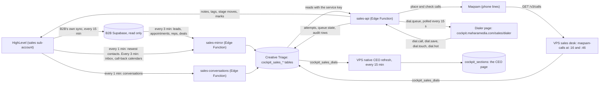

# Setter dialer: how it works and how to change it

For the systems manager: the person who keeps the cockpits running and improves them.

- **Written:** 6 November 2026, the day the setter's one queue went live (PR #209 in the mahara-cockpits repo).
- **Code version:** every `file:line` below is exact on main `9e12eac6` (7 Nov 2026, PR #222: Did the intro now and the closer picker) with the softphone fix on top (branch `held-softphone-1107`, 7 Nov, not merged or shipped yet). That fix moved lines in `D`, `I`, `P`, `S`, `dialerUi.ts` and `harness.tsx`; the references here follow it. Later commits move lines, so if a line looks wrong, search for the function name next to it.
- **Live versions on 7 Nov:** sales-api v131, sales-mirror v72, sales-conversations v31, migration `20261107a` applied, app bundle `index--RqMN7vY.js` (Vercel `dpl_BKPYGau147xytD3VKsD49N8iY7up`), CEO native release `spd1106a`. On 6 Nov it was sales-api v130 and bundle `index-ja8AYF0K.js` (PR #209), then `index-D6J1s94u.js` (PR #220).
- **For the setter:** an SOP (Google Doc) and a narrated video (11:19). PR #219 links both on the sales cockpit's Links page and adds this handbook to the repo as `docs/setter-queue/HANDBOOK.md`. The links are in section 11, "Where else to look".

Read section 1 first. It is the whole system on a few pages. Sections 3 to 6 are reference. Section 7 has the step-by-step recipes you will use most.

## Contents

1. [The system in ten minutes](#1-the-system-in-ten-minutes)
2. [Where the code lives](#2-where-the-code-lives)
3. [Every queue rule in one table](#3-every-queue-rule-in-one-table)
4. [The server: sales-api](#4-the-server-sales-api)
5. [The screen: the Dialer page](#5-the-screen-the-dialer-page)
6. [The data: tables, workers and jobs](#6-the-data-tables-workers-and-jobs)
7. [Recipes: changing things safely](#7-recipes-changing-things-safely)
8. [Running it on your machine: the practice cockpit](#8-running-it-on-your-machine-the-practice-cockpit)
9. [Watching it in production](#9-watching-it-in-production)
10. [Limits and the improvement backlog](#10-limits-and-the-improvement-backlog)
11. [Appendix: tests, traps, house rules, working through Codex](#11-appendix-tests-traps-house-rules-working-through-codex)

## Conventions

**Paths** start at the repo root. Short names used in the tables:

| Short | File | What it is |
|---|---|---|
| `D` | `supabase/functions/sales-api/dialer.ts` | The queue rules. Pure functions, no database, no network. |
| `I` | `supabase/functions/sales-api/index.ts` | The server: reads the tables, builds one candidate per lead, runs the actions. |
| `T` | `supabase/functions/sales-api/dialer.test.ts` | Rule tests, one describe per rule. |
| `F` | `supabase/functions/sales-api/setter_queue_fix.test.ts` | One describe per finding of the 6 Nov review. |
| `R` | `supabase/functions/sales-api/setter_queue_router.test.ts` | End to end through the real handler on a fake database. |
| `P` | `apps/sales-cockpit/src/pages/DialerPage.tsx` | The Dialer page. |
| `S` | `apps/sales-cockpit/src/lib/setterDay.ts` | The screen's words for each item, the day strip, re-alerts. |
| `V` | `apps/sales-cockpit/src/lib/voiceNote.ts` | The voice-note script. |

A bare `lib.ts` means `supabase/functions/sales-api/lib.ts`. A bare `harness.tsx` or `fixtures.ts` means the file in `apps/sales-cockpit/src/dev/`.

**`$W`** is the repo's top-level folder for the VPS workers (the sales desk, the CEO refresh, the guardian). Its name is on the house deny list for team documents, so this handbook writes `$W`. Set it once, from the repo root:

```sh
W=$(git ls-files -- '*/sales-desk/desk.py' | cut -d/ -f1)
```

**Times** are Kuwait time (UTC+3) unless they say UTC. Friday is the day off.

**Roles, never names:** the setter, the closer, the sales manager, the CEO, the systems manager. Test fixtures and some code comments use real first names. Do not copy them into anything the team sees (section 11).

---

## 1. The system in ten minutes

### What the setter does now

Before 6 Nov the setter worked four Slack channels: new leads and texts, call confirmations, follow-up, and email opened. Now he works one list in the sales cockpit's Dialer, at `cockpit.maharamedia.com/sales/dialer`.

The server looks at every lead and gives each one at most one item. The setter takes the top item, calls, saves an outcome, and the next item comes up. The page never reorders the list. It only hides leads the setter skipped or just saved.

The list has four tiers:

| Tier | On screen | What goes in it |
|---|---|---|
| 0 | Call now | His own intro at its minute (always first). A call-back due now. A lead who called or wrote in the last 10 minutes. A new lead under 10 minutes old that nobody dialed. The lead's own intro booking from the last 30 minutes. The burst's second try. A hot lead's follow-up. A confirmation in its last 2.5 hours. |
| 1 | Today | A voice note owed. New leads nobody reached (under an hour old first). His intro to mark. The day-before confirmation. Missed calls and replies from today. A call-back missed today. A fresh intro no-show. |
| 2 | Due | Replies still waiting after a day. No-shows and cancelled intros to rebook. Overdue call-backs. Retries on the ladder. |
| 3 | Never called | Sales leads of the last 30 days that nobody ever dialed. |

Inside a tier the order is: pin first, then heat (a score from the form answers), then time.

### How the data flows



The same diagram as a picture, drawn top to bottom: [data-flow.png](data-flow.png).

### The parts

| Part | What it does | Runs | Code |
|---|---|---|---|
| HighLevel | The CRM: contacts, pipeline stages, calendars, conversations. | Always | (outside) |
| B2B Supabase | The older copy of HighLevel, kept by B2B's own sync. Read only for us. | Every 15 min | (outside) |
| sales-mirror | Copies B2B's leads, appointments, reps and deals into Creative Triage every 3 minutes. A second mode copies HighLevel's newest contacts every minute. | pg_cron, every 3 min and every 1 min | `supabase/functions/sales-mirror/` |
| sales-conversations | Copies HighLevel conversations (who wrote and is waiting for a reply). | pg_cron, every 1 min | `supabase/functions/sales-conversations/` |
| VPS sales desk | Reads Maqsam's call log for every sales seat into `cockpit_sales_dials`. | crontab at :16 and :46 | `$W/sales-desk/` |
| sales-api | Builds the queue, places calls through Maqsam, saves outcomes, writes notes, tags and stage moves to HighLevel, writes audit rows. | On request (verify_jwt on) | `supabase/functions/sales-api/` |
| Dialer page | Draws the queue, the call pane, the voice-note card and the day strip. | In the browser | `apps/sales-cockpit/src/` |
| CEO refresh | Works out speed to lead from `cockpit_sales_dials` for the CEO page. | VPS, every 15 min | `$W/ceo-refresh/native/adapters/growth.js` |

### One new lead, start to finish

1. **The lead fills in the form.** HighLevel creates the contact. Within a minute the minute job (`mahara-sales-new-contacts`) copies it into `cockpit_sales_leads`. The worst case to reach the screen is about 95 seconds: 60 s for the cron, 20 s for the server's cache, 15 s for the page's poll.
2. **`new_lead`, tier 0.** For 10 minutes, while nobody has dialed, it sits in Call now. The page counts down 2 minutes and chimes.
3. **The setter presses Call.** `dial.call` asks Maqsam to place the call from the setter's line.
4. **No answer.** While the call is open the page checks it (`dial.status`). When Maqsam's record shows a no-answer, the server saves it on its own (or the setter saves No answer). This is the burst's first miss, so the lead comes back in 2 minutes as `second_try`, and the retry step does not move.
5. **The voice note.** The save's answer carries `next_step: voice_note`. The card shows a 20 to 30 second script built from the lead's form answers, in English or Arabic. The setter records it on WhatsApp from his own phone (the cockpit sends nothing) and presses "I sent the voice note" (`dial.touch`).
6. **`second_try`, tier 0,** 2 minutes after the miss. If nobody answers again, the retry ladder takes over: 17:00 the same day if that is at least an hour away, else 09:00 the next working morning, then two more 09:00 tries. After the fourth miss on the ladder the lead is closed as unreachable.
7. **The lead books an intro.** If they booked it themselves, it is `just_booked`, tier 0, for 30 minutes. The setter tries to hold the intro there and then.
8. **The confirmations.** If the lead has not confirmed, `confirm` comes up 2.5 hours before the call. If nobody answers, a voice note is owed, and `confirm_last` comes up 60 minutes before. A call booked more than a day ahead also gets `confirm_early` the evening before (morning calls) or that morning.
9. **The intro on the confirmation call (since 7 Nov).** If the setter gets them on the phone and they have time, he does the intro there and then. He presses **Did the intro now** (needs a note): the intro is marked held at once, in HighLevel too, and the held step opens with **Book the demo**, the hot list, Not ready yet, a call-back and the 1-to-10 rating. He tells them the booked time is no longer needed. It works for an intro up to a day ahead, on the dialer's own call for that confirmation or, since the softphone fix of 7 Nov, on a Maqsam softphone call with the lead (the server asks Maqsam while he saves). The call must have started after the intro was booked and gone at least 3 minutes: Maqsam's talk time once its record is in, or 3 minutes since it started while Maqsam says it is still going (up to an hour). A dialer call must also have connected and still be open. Until he presses it, the Script tab's Book the demo shows a line above its picker: "Did the intro on this call? Press Did the intro now under "Are they coming?" first, so the intro counts as held. Or book the demo now and mark the intro at its time." The picker still books. The band says "Got them now? Do the intro, press Did the intro now, then Book the demo." on an intro's confirmation. The button, the band's line and the Script tab's line show only to the intro's host or a manager.
10. **The intro.** `intro_now` is pinned first from 5 minutes before the start to 20 minutes after. An intro already marked held (step 9) does not come up.
11. **Marking it.** From 20 minutes after the start, an unmarked intro is `mark_call` (tier 1) for up to 7 days. Showed opens "What next?": book the demo in the soonest time, or pick the closer (recipe 7.14), put the lead on the hot list, or save Not ready yet (long-term nurture). Didn't happen marks a no-show after a 5-second hold, then offers "Book it again".

### Three facts that explain most surprises

1. **The server decides everything.** The page draws each item's `code` (for the label and the button) and `why` (the sentence). To change what the setter sees and when, change `D` and its tests. The page changes only when the words or the buttons change.
2. **Data arrives at different speeds.**
   - New leads: about a minute.
   - Bookings made in HighLevel: through B2B, up to about 15 minutes late.
   - Calls made from the Maqsam softphone: with the desk's run at :16 and :46, so up to about 30 minutes late.
   - Calls placed from the dialer: at once.
3. **Missing is never zero.** When a read fails, the screen says "not known" and names what failed. It never shows 0 or "nothing to do" for something it could not read (section 9).

---

## 2. Where the code lives

| Area | Files |
|---|---|
| Queue rules | `D` (2,157 lines). The setter's queue is `rankForSetter` D:1249-1285; its contract is the doc comment at D:1219-1248. |
| Server | `I` (9,614 lines): `candidates` I:4053, `dialQueue` I:4674, `dialCall` I:4885, `saveOutcome` I:5041, `dialTouch` I:5811, the router I:9523-9614. Helpers in `supabase/functions/sales-api/lib.ts`. The demo's closer picker: `supabase/functions/sales-api/closers.ts` (recipe 7.14). |
| Server tests | `T`, `F`, `R`, plus about 210 other files in the same folder. |
| Dialer page | `P` (4,274 lines). |
| Screen words and rules | `S`, `V`, `apps/sales-cockpit/src/lib/dialer.ts`, `apps/sales-cockpit/src/lib/dialerUi.ts`. |
| Components | `apps/sales-cockpit/src/components/`: `VoiceNoteCard.tsx`, `DayStrip.tsx`, `DialerSteps.tsx` (`MarkStep`, `HeldNext`), `MarkControls.tsx`, `AfterCall.tsx`. |
| Speed to lead | `apps/sales-cockpit/src/lib/calls.ts`, D:2064-2157, `$W/ceo-refresh/native/adapters/growth.js`. |
| Practice cockpit | `apps/sales-cockpit/src/dev/harness.tsx`, `apps/sales-cockpit/src/dev/fixtures.ts`, `apps/sales-cockpit/harness.html`. |
| Copies of HighLevel and Maqsam | `supabase/functions/sales-mirror/`, `supabase/functions/sales-conversations/`, `$W/sales-desk/desk/maqsam_calls.py`. |
| Migrations of this build | `supabase/migrations/20261105s_setter_speed_line.sql`, `20261105w_sales_setter_queue.sql`, `20261105x_sales_rooms_sweep_not_ready.sql`, `20261105s_setter_speed_intake_cron.sql`. Did the intro now adds `20261107a_sales_early_held_intro.sql` (applied on 7 Nov 2026 at 13:42 UTC): the calendar view and the funnel count "after the intro" from the mark for a call marked held more than 10 minutes before the time it was marked against (a mark the Calls card can make keeps the booked start), and the funnel counts a held call as due. **Apply it before the sales-api that sends `held_now`**: without it a demo booked on the confirmation call reads "no demo after it" and the end of day asks the setter for a reason that is not true. On its own it changes no row today. |
| Monitoring | `$W/cockpit-guardian/checks/` (`pg_cron.py`, `syncs.py`, `edge_functions.py`), `supabase/migrations/20261031b_sales_watchdog_slack_bot.sql`. |
| Operations notes | `RUNBOOK.md`, sections "Sales cockpit" and "Sales desk". |

---

## 3. Every queue rule in one table

Each lead gets at most one item: `{ tier, pin, code, why, sort }`. The first rule that applies wins, in this order:

1. Leave the lead out if it must never be called.
2. Appointment work: the intro at its minute, or a confirmation.
3. The hot-list follow-up.
4. Lead work, but only for leads in the setter's scope (the owner rule).
5. The call to mark replaces the result when that result is tier 2 or 3 (or there is none). When the result is tier 0 or 1, the mark rides along on it.

`place()` (D:936-947) fills the defaults and `order()` (D:964-976) sorts.

| Rule | What it does | Value (constant or inline) | Where | Tests |
|---|---|---|---|---|
| Sort order | Tier, then pin (0 first), then heat (not in tier 0, not for pin 0), then `sort`, then contact id. Lead items sort newest first; appointment and hot items soonest first. | pin defaults to 1 | D:964-976, D:936-947, `Ranked` D:507-523 | T:135, T:179, T:623, T:884 |
| Always left out | Do not disturb, a signed client, a won stage, a number the dialer cannot route, claimed by another rep, an intro waiting after a ring-out. Clients and leads held by a video room are dropped earlier. | | D:1264-1269; clients I:4300; rooms I:4286-4299 | T:152, T:166, T:606 |
| Intro at its minute (`intro_now`) | The setter's own intro, or one with no host. Tier 0, pin 0, so always first. | 5 min before to 20 min after (inline) | `introWindow` D:552-554; branch D:663-676 | T:405, T:623, T:643 |
| Intro ring-out wait | An intro that rang out leaves the queue, then comes back while its window is open. | `INTRO_RETRY` = 5 min | D:614, `introWaiting` D:622-625 | T:411 |
| First confirmation (`confirm`) | An unconfirmed intro (the setter's) or demo (the closer's). Tier 0. | `CONFIRM_FROM` = 150 min | D:628; path D:677-708; `confirmFrom` D:546-549 | T:764-800 |
| Second confirmation (`confirm_last`) | After a missed try, back 60 minutes before the call. A try inside the last hour leaves it to the call itself. | `CONFIRM_AGAIN` = 60 min | D:630, D:691-708 | T:772 |
| Short notice | A call booked less than 3 hours before its start gets no confirmation. The just-booked call covers it. It is `CONFIRM_FROM` plus `JUST_BOOKED` on purpose: keep it so (recipe 7.1). | `SHORT_NOTICE` = 3 h | D:632, D:681 | T:780 |
| Day-before confirmation (`confirm_early`) | Booked more than a day ahead. From 18:00 the evening before for a call before noon, otherwise from 09:00 on the day. 2 hours between tries. Tier 1. | inline | D:546-549, D:711-715 | T:428 |
| Night rule | A confirmation never shows outside 09:00-21:00 on any of the lead's clocks. An unknown country keeps Kuwait's. | `hoursRefusal` | D:687-689; `supabase/functions/sales-api/sendrules.ts:263` | `supabase/functions/sales-api/stress2_time_r5_night_link.test.ts:66-88` |
| What counts as confirmed | A confirmation saved in the cockpit, or the CONFIRMED stage entered after this booking. HighLevel's own "confirmed" status never counts, because every calendar confirms on booking. | | `stageConfirms` D:1933-1941; wired I:4523-4528 | T:783, F:262 |
| Closed after booking | A lead the setter closed (not ready, not interested, disqualified, wrong number) after the intro was booked gets no confirmation and no pinned intro. The mark still comes later. | `ENDING_CLOSES` | D:1202, D:1210-1217, D:1275-1276 | F:140-175 |
| Hot follow-up | `hot_due` (tier 0) for the first 10 minutes after its planned time, then `hot_planned` (tier 1). For its owner or a manager. | 10 min (inline) | D:950-962 (D:953) | T:197 |
| Owner rule | A manager sees all. Otherwise another rep's call-back, another host's demo and another rep's lead stay hidden. A closer's lead still at the intro stage is the setter's. | `DEMO_STAGES`, `AFTER_DEMO_NAME` | D:978, D:986, `introStage` D:989-995, `setterScope` D:1008-1014 | T:512-530, T:821-845, F:294-306 |
| Closed in the cockpit | A lead the dialer closed (booked, unreachable, not interested, not ready, disqualified, wrong number, handled) gets no lead work. One exception: the voice note after a missed confirmation call, for a call booked from the dialer (the lead stays closed "booked" until then). A reply, a missed call from them, a call-back booked or their own intro booking after the close opens the lead again; a "booked" close ends once the booked call has passed. | | D:1047-1050; reopening I:4384-4404 | F:177-197 |
| Tier-0 lead work | A call-back due (5 min before to 10 after), a missed call from them (10 min), a reply (10 min), a new lead never dialed (10 min). The first one listed wins. | inline | D:1052-1082; `missedCall` D:437-441; `callbackSoon` D:447-449 | T:135, T:148, T:551-585, T:652 |
| Just booked (`just_booked`) | The lead's own new intro booking, tier 0, until someone calls. A booking made from the cockpit, or while the lead was on the phone, does not count. | `JUST_BOOKED` = 30 min | D:750, D:1020-1026, D:1084-1093; input I:4367-4383 | T:660 |
| The burst (`second_try`) | A new lead or the lead's own booking starts a 60-minute burst. The first no-answer brings the lead back 2 minutes later. The second hands it to the ladder. Talking to the lead ends the burst. A night or weekend lead (up to 3 days old) starts its burst at its first call. | `BURST` = 60 min, `SECOND_TRY` = 2 min, `FIRST_CALL_NEW` = 3 days | D:746, D:748, D:759; `burstAnchor` D:769-789; `secondTry` D:814-823; `quickRetryDue` D:906-913; save I:5100-5101; `burstNow` I:5280-5332 | T:651-707, F:81-138, R:240-262 |
| One missed call counts once | The dialer's save and Maqsam's record of the same call count as one miss. A save pairs with the latest Maqsam call that started up to 10 minutes before it (5 s of drift allowed). | `SAME_CALL` = 10 min | D:867, D:877-899 (drift D:884); used I:4441-4444 | F:216-241 |
| Voice note owed (`voice_note`) | After a burst call or a confirmation call that rang out, when no voice note went since and nobody spoke to the lead since. Never asked for when the voice-note table cannot be read. Tier 1, pin 0. | Confirmation window follows `CONFIRM_FROM`; cut-off 5 min before the start (D:857) | `voiceNoteDue` D:832-864; `voiceItem` D:1029-1039; `VOICE_CODES` I:4581-4590 | T:709-762, F:177-197, F:243-292, R:271 |
| Missed call today | Tier 1 `missed_call_today`, before any retry timing. | | D:1106-1107 | T:556 |
| Replies | Up to 1 day old: tier 1 (`reply_booked` with a call booked ahead, else `reply_today`). Up to 7 days: tier 2 `reply_waiting`. A call, an outcome or a written reply clears it. | inline | D:1117-1136 | T:802-819 |
| Gates before the rest | Left out while a retry is ahead, a call is booked ahead, the lead rests in a stage (disqualified, paused, long-term nurture, won, lost, deposit) or the softphone ladder is not due. | `RESTING_ROLES` | D:217, D:1137-1147 | T:191, T:204 |
| Call-back late | Same Kuwait day: tier 1 `callback_today`. Older: tier 2 `callback_late`. | | D:1149-1159 | T:879 |
| Intro no-show | Tier 1 for its first day, tier 2 to day 7, then gone. | inline | D:1161-1165 | T:212, T:841 |
| Intro cancelled | Tier 2 for 7 days after the cancelled start. | inline | D:1167-1169 | T:872 |
| New, not reached | Up to 2 days old, not reached. Tier 1; under an hour old gets pin 0. `new_not_reached` if ever dialed, else `new_never_called`. | inline | D:1170-1183 | T:884 |
| Retry (`retry`) | Tier 2 once the ladder's time has come. | | D:1184-1192 | T:204 |
| Never called | Tier 3. A sales lead of the last 30 days nobody reached or dialed. | inline | D:1196-1197 | |
| Mark the call (`mark_call`) | The rep's own intro (setter) or demo (closer), from 20 minutes after the start to 7 days, not marked. A call with no host is a manager's. | inline | D:725-743 (D:733); input I:4415-4426; mark rule D:1281 | T:847-869, F:199-214 |
| Retry ladder | 17:00 the same day if at least an hour away, else 09:00 the next working morning; then two more 09:00 tries; the fourth miss closes the lead "unreachable". | try count D:69; 17:00 D:71; 09:00 D:57; Friday D:58 | `nextWorkingNine` D:56-60, `nextTry` D:68-76, `afterOutcome` D:134-154 | T:71-100, T:498-510 |
| Softphone misses | Maqsam's unanswered calls move the same ladder when the dialer has no state for the lead. | `min(misses, 4)` | D:1142-1147 (D:1145) | T:204 |
| Talk in a video room | Lifts an "unreachable" close and moves the retry to the next working morning. | | `afterTalk` D:86-100; I:4397-4404 | `supabase/functions/sales-api/stress2_journeys_r6_dialer.test.ts:152-174` |
| Heat | The order inside a tier. Points for: on the hot list, qualified, revenue, ready to invest, wrote today, came in this hour or day, in the Hot Leads stage. Minus one for 3 or more misses. | | D:256-294 (`revenueOf` D:225, `readyOf` D:245) | T:351-372, T:179 |
| The closer's queue | Same shape, own demos only, no owner rule. Adds `showed_not_signed` (30 days, tier 1) and demo no-show or cancel (14 days, tier 2). | | `rankForCloser` D:1303-1323, `closerLeadWork` D:1325-1355; filter I:4705-4716 | T:222-246, T:794, T:864 |
| Outcomes | Which outcomes fit which item and what each does (table in section 4). | | `OUTCOMES` D:102-114, `appointmentEffect` D:1615-1640, `targetRoles` D:1890-1910, `tagsFor` D:1913-1918 | T:455-496, T:899-912, R:299-330 |

### The item codes

The screen keys on `code`, never on the `why` sentence. The server's list is `ItemCode` (D:473-502). The screen's words are `CODES` (S:28-146). Both hold the same 29 codes today, but no test checks that they match (section 10).

| Code | Tier | Screen label | Button | Made at |
|---|---|---|---|---|
| `intro_now` | 0 | Your intro, now | call | D:663-676 |
| `confirm` | 0 | Confirm, 2.5 h before | call | D:701-708 |
| `confirm_last` | 0 | Confirm, 60 min before | call | D:701-708 |
| `confirm_early` | 1 | Confirm, the day before | call | D:711-715 |
| `hot_due` / `hot_planned` | 0 / 1 | Hot lead, follow up now / Hot lead | call | D:950-962 |
| `callback_now` | 0 | Call back now | call | D:1052-1082 |
| `missed_call_now` | 0 | Called us, call back now | call | D:1052-1082 |
| `reply_now` | 0 | Wrote back, call now | call | D:1052-1082 |
| `new_lead` | 0 | New lead, call now | call | D:1052-1082 |
| `just_booked` | 0 | Just booked, call now | call | D:1084-1093 |
| `second_try` | 0 | Second try now | call | D:1095-1104 |
| `missed_call_today` | 1 | Called us today | call | D:1106-1107 |
| `voice_note` | 1 | Send a voice note | voice | D:1029-1039 |
| `reply_booked` | 1 | Wrote back, has an intro | call | D:1117-1131 |
| `reply_today` | 1 | Wrote back today | call | D:1132 |
| `reply_waiting` | 2 | Still waiting on you | call | D:1135-1136 |
| `callback_today` / `callback_late` | 1 / 2 | Call back today / Call-back overdue | call | D:1149-1159 |
| `intro_noshow` | 1, then 2 | Missed the intro, rebook it | call | D:1161-1165 |
| `intro_cancelled` | 2 | Cancelled the intro, rebook it | call | D:1167-1169 |
| `new_not_reached` / `new_never_called` | 1 | New lead, not reached yet / New lead, never called | call | D:1170-1183 |
| `retry` | 2 | Next try | call | D:1184-1192 |
| `never_called` | 3 | Never called | call | D:1196-1197 |
| `mark_call` | 1 | Mark the intro (or Mark the demo) | mark | D:725-743 |
| `showed_not_signed` | 1 | Showed, not signed (closer) | call | D:1325-1355 |
| `demo_noshow` / `demo_cancelled` | 2 | Missed the demo / Cancelled the demo, rebook it (closer) | call | D:1325-1355 |

### Confirmations in detail

- **Who:** the setter's own intros and any call with no host; the closer's own demos only (D:678-679). A manager seat with no HighLevel user sees them all.
- **What counts as a try:** a confirmation saved as no answer or "message sent". Only no answer is a miss. A saved intro try counts as both (I:4225-4247).
- **The clock in the sentence:** `theirClock` adds "(it is 10:05 there)" for a lead abroad (D:923-934).

### The burst in detail

- **The anchor** is the later of the lead's arrival in the last hour (step "new") and their own intro booking in the last hour (step "booked").
- **A night or weekend lead** (up to 3 days old) has neither, so the anchor is its first call, if that call rang out within the last hour.
- **First miss:** the save sets `due_at` to now plus 2 minutes and does not move the ladder (`quickRetryDue`, I:5100-5101).
- **Second miss:** `afterOutcome` moves the ladder as usual.
- **In all:** a new lead nobody answers gets 2 burst calls, then 3 ladder tries over about 3 working days, then closes unreachable on the fourth ladder miss. That is 5 unanswered calls in all.

---

## 4. The server: sales-api

### The door

One Deno server, `Deno.serve` at I:9523-9614, deployed with verify_jwt on (I:3). Every request goes through these checks in order:

1. CORS against the allowed origins (`supabase/functions/sales-api/lib.ts:14-25`). Anything else gets 403.
2. POST only, a bearer token, a JSON body.
3. The action must be in `ACTIONS` (I:9367-9448) or `DESK_ACTIONS` (I:9451-9461).
4. **The person door:** `whoami` (I:393-406) calls the database function `cockpit_sales_whoami` with the person's own token. It returns the seat (`Who`, `lib.ts:27-41`): role (setter, closer, both, manager), manager, HighLevel user id, Maqsam address. No sign-in gives 401, no seat gives 403 (I:9587-9596).
5. **Two machine doors:** the service-role token (the VPS sales desk, `DESK_ACTIONS` only, as the made-up seat "sales-desk"), and the `x-cron-secret` header (cron actions only).

The seat check is the only gate on dialer actions. There is no CEO gate. A manager may act on another rep's call.

A refusal is one plain sentence with a status, sent as `{ ok: false, error }`. Anything else becomes a 500 with "That did not work: ..." and the text redacted.

### The shared helpers

| Helper | What it does | Where |
|---|---|---|
| `svc` | PostgREST with the service key, 20 s deadline. An empty or non-JSON answer to a read is an error, never "no rows". | I:296-343 |
| `svcAll` | Pages of 1,000 rows (Creative Triage's cap), up to 50,000. | I:349-358 |
| `ghl` | HighLevel with the secret `SALES_GHL_TOKEN`, 25 s deadline, a browser user agent (Cloudflare refuses requests without one). | I:439-490 |
| `maqsam` | Maqsam with `SALES_MAQSAM_ACCESS_KEY` and `SALES_MAQSAM_SECRET`. A 429 becomes "Maqsam asked us to slow down". No deadline (plain `fetch`, I:3873). | I:3868-3892 |
| `audit` | One `cockpit_audit_log` row per write (`source_app = 'sales'`). A failed audit write is logged and the change stands. | I:408-437 |
| `setting` | Reads one `cockpit_sales_settings` row. | I:492-495 |

### The dialer's actions

| Action | Function | Who may call | Writes | Outside calls | Audit |
|---|---|---|---|---|---|
| `dial.agent` | `dialAgent` I:3921-3929 | any seat | nothing | Maqsam agents list | none |
| `dial.queue` | `dialQueue` I:4674-4854 | any seat; `as` picks the setter or closer view | nothing (read only) | none | none |
| `dial.call` | `dialCall` I:4885-4995 | a seat with a Maqsam address | `cockpit_sales_attempts` | Maqsam `POST /v3/calls` | `dial.call` |
| `dial.status` | `dialStatus` I:5739-5789 | the call's rep or a manager | the attempt's call state; an automatic No answer | Maqsam `GET /v3/calls` | `dial.auto_save` when it saves |
| `dial.save` | `dialSave` I:5588-5693, then `saveOutcome` I:5041 | the call's rep or a manager | attempts, queue state, confirmations, marks | HighLevel note, tags, stage move, mark | `dial.save` or `dial.save_manual` |
| `dial.release` | `dialRelease` I:5791-5803 | the call's rep or a manager | the attempt becomes `released` | none | `dial.release` |
| `dial.resync` | `dialResync` I:5493-5504 | the save's rep or a manager | `crm_note`, `crm_error` | HighLevel again | `dial.resync` |
| `dial.resync_stuck` | `dialResyncStuck` I:5541-5568 | the VPS desk only | `crm_tries` | HighLevel again | none of its own |
| `dial.touch` | `dialTouch` I:5811-5874 | any seat | `cockpit_sales_touches` (nothing is sent to the lead) | none | `dial.touch` |
| `dial.hot` | `dialHot` I:5882-5893, then `hotSave` I:8488-8535 | any seat; `hotSave` checks the owner | `cockpit_sales_hot` | none | `hot.save` |

**Repeat safety.**
- `dial.call`: two unique indexes allow one open call per lead and one per rep (`supabase/migrations/20260924j_sales_dialer.sql:36-39`). A double click within 3 seconds gets "That call is already on its way." (I:4921-4922). A call Maqsam could not confirm holds the lead for 2 minutes. A call nobody looked at for 10 minutes is let go (`STALE_CALL_MS`, I:4866).
- `dial.save`: a repeated save with the same outcome returns `{repeated: true}`. A manual save carries a `request_id` with a unique index. `saveOutcome` writes the attempt only while it is open and unsaved (I:5128), so the rep's save and Maqsam's automatic save never both stand.
- `dial.touch`: the same `request_id`, or a voice note for the lead in the last 10 minutes, returns the first row.

### `dial.queue`: what it reads and returns

`candidates(now)` (I:4053-4543) reads in parallel: the queue state, waiting replies (two copies), open calls, the heavy read, confirmations, the hot list, the stage roles, the working seats, intro tries, video rooms, the burst's misses, voice notes and cockpit bookings. It builds one candidate per lead.

- **The heavy read** (`readHeavy`, I:4011-4041) is cached for 20 seconds per function instance: leads of the last 30 days, the calendar from 60 days back, outbound Maqsam calls of 60 days, live deals, inbound calls nobody answered in the last day.
- **Waiting replies** (`waitingReplies`, I:3968-3997) come from two copies: `cockpit_sales_conversations` (every minute) and `cockpit_sales_inbox` (every 3 minutes). If one fails, the other stands. If both fail, the read fails.

The answer holds `counts` per tier, `undialable`, `speed` (the day strip), `messages` (replies only Messages can answer), `voice_notes_known`, `saved_work` (saves HighLevel has not taken), `open`, `today` and `queue`. Each queue item carries `code`, `why`, `tier`, `due_since`, `voice_step`, `voice_note`, `just_booked` and `mark_call` (I:4791-4853).

### Saving an outcome: `saveOutcome`

`saveOutcome` (I:5041-5256) is called by `dial.save`, by the automatic No answer in `dial.status`, and by `book.create` and `book.move`. Its steps:

1. **The effect:** `appointmentEffect(kind, outcome)` (D:1615-1640). No effect means the save is refused.
2. **"Not ready yet" gate:** refused until the 5 November database update is in (`setterUpdateIn`, I:5259-5268).
3. **The mark first** (`markAppointment`, I:656). If HighLevel or the rules refuse the mark, nothing is saved. A held mark more than 10 minutes before the start is refused (`refuseMark`, `lib.ts:72`), with two exceptions judged at the start: the lead joined a video room for the call (`joinedForCall`), or Did the intro now (`heldNow`, below).
4. **The ladder:** the burst's quick retry for a lead's first miss (I:5100-5101), otherwise `afterOutcome` (I:5102-5109).
5. **The attempt row**, then the **confirmation row** for confirm items, then the **queue state** upsert (I:5159-5203).
6. **HighLevel in the background** (`syncCrm` I:5428-5479): the stage move (only for a person's save, not "booked"; `autoMove` I:8433-8461 skips it when the `pipeline` setting's `auto_moves` is `false`, so a missing key means on, and never moves an active client), the tags, the note.
7. **The audit row** (I:5223-5236).
8. **What comes next** (`nextSteps`, I:5341-5400): `next_step` (the voice note) after a No answer, `hot_offer` after a held intro.

An automatic No answer never writes a note, tags or a stage move (I:5112, I:5207).

**Did the intro now (`held_now`, 7 Nov 2026; softphone calls since the fix of 7 Nov).** The dialer sends `held_now: true` with a confirm item's showed when the lead did not join a video room for this miss (`heldNowAsked`, `apps/sales-cockpit/src/lib/dialerUi.ts`). `dialSave` (I:5588, the check at I:5637-5673) reads it only for a confirm item's showed and checks it before anything is saved. Every refusal is one sentence with a 403, so the page never takes it for a save that may have landed.

- The intro starts 10 minutes away or less, or has started: `held_now` changes nothing. The save goes as it does without it.
- First the intro itself, whatever the call (`heldNowCheck`, D:1712-1753):
  - the call is an intro: "Only an intro can be marked held on its confirmation call. Mark a demo at its time.";
  - it starts at most 24 hours ahead (`HELD_NOW_AHEAD`): "This intro is more than a day away, so it cannot be marked held from this call. Save Confirmed, and mark it at its time."
- Then the call. **The dialer's own call** for this confirm item (an attempt, not manual, `item_kind` confirm, the same appointment) is judged on its own record, as before the fix:
  - Maqsam's record does not say no answer, busy, failed, blocked or abandoned, and Maqsam did not refuse to place the call (state failed without `uncertain`): "Maqsam's record says this call did not connect, so the intro cannot be marked held from it. Save No answer, and mark the intro at its time.";
  - the call is still the open one: not let go (`released`, when its page closed) and placed in the last 2 hours (`HELD_NOW_CALL_AGE`): "This call is no longer open, so the intro cannot be marked held from it. Save Confirmed, and mark the intro at its time.";
  - the call is long enough for an intro (`HELD_NOW_MIN_CALL`, 3 minutes): 3 minutes since it was placed while Maqsam's record is not in, or 3 minutes of talk once it is (a call whose start is not known never counts): "Under 3 minutes on this call is too short for the intro. Do the intro, then press Did the intro now, or save Confirmed and mark the intro at its time." A record with no talk time at all (a zero-second answer, which can also be a record not complete yet) says so: "Maqsam's record shows no talk time on this call, so the intro cannot be marked held from it. If you did talk, press Save again in a minute, once the record is complete."
- **No dialer call for this confirmation** (a save by hand, or the dialer's call for another item or another call): `heldNowCheck` answers `elsewhere` with `softphone: true`, and `softphoneHeldNow` (I:5707-5730) asks Maqsam instead of refusing. The `elsewhere` sentence is no longer shown. This is the setter's normal case: on 7 Nov production had 96 attempts, 94 of them saves by hand and 2 dialer calls (13 Oct) that failed, so before the fix every press was refused. In order:
  - the seat has a Maqsam address (`maqsam_email` on the seat): "Your seat has no Maqsam address, so this call cannot be checked. Save Confirmed, and mark the intro at its time.";
  - the lead has a phone number of 8 digits or more in `cockpit_sales_leads.phone`: "This lead has no phone number in the cockpit, so this call cannot be checked. Save Confirmed, and mark the intro at its time.";
  - Maqsam answers: the seat's calls from 2 hours ago to a minute from now, read live with `maqsamCalls` (I:5009, GET `/v3/calls`, the reader `dial.status` uses) in its checked form, shaped like the desk's proven reader (`$W/sales-desk/desk/maqsam_calls.py`): it sends `end_time`, stops at a page under 100 calls (`MAQSAM_PAGE`, I:4999), so one page is one request, and waits at most 10 seconds for all of it (`HELD_NOW_MAQSAM_MS`, I:5695). `dial.status` still reads without these. Not connected, a 429, no answer in 10 seconds, an answer with no list of calls in it (missing is never zero) or any error: "Maqsam could not be read just now, so this call cannot be checked. Try again in a minute." It never accepts without Maqsam's word;
  - `softphoneHeld` (D:1809-1866, pure) judges the list. A candidate is a call of this seat (its agents include the seat's address, as `matchCall` reads it) with this lead (the last 8 digits of the lead's number: `calleeNumber` on an outbound call, `callerNumber` on an inbound one, `callee` and `caller` as fallbacks, either side when the call does not say its direction), started in the last 2 hours, at most a minute ahead, and not before the intro was booked (the appointment's `booked_at`: the call the intro was booked on is not the intro). It passes when any candidate is answered (`completed` or `serviced`) with at least 3 minutes of talk, or Maqsam says it is still going (`in_progress`, the only live word in 60 days of the dial log) and it started from 3 minutes to an hour ago (`HELD_NOW_LIVE_MAX`; an intro takes about 15 minutes, so a call "going" for longer is a record that never finished). Otherwise the newest candidate says why: none at all, "Maqsam shows no call between your seat and this lead in the last two hours. Do the intro on a call with them, then press Did the intro now."; going or answered under 3 minutes, the "Under 3 minutes" sentence above; not connected (no answer, busy, failed, blocked, abandoned), the "did not connect" sentence; connected with no talk, a state Maqsam has not finished that is not `in_progress`, or `in_progress` after an hour, the "no talk time" sentence.
- A refused `held_now` whose lead joined this call's video room (the page had not caught up) is not refused: `held_now` is dropped and the room's join passes the save, as without it (`joinedForCall`). This holds for every refusal above, the softphone's included.
- Then `markAppointment` gets `heldNow`, reads the call again, and judges the 10-minute rule at the start only if it is still an intro at most a day ahead (else at now, so the mark is refused). The host rule and a call being moved still refuse. The mark is written to HighLevel like any other (with its automations), and the `mark` and `dial.save` audit rows carry `held_now: true` (`dial.save_manual` for a save by hand). The save's row also says which call: `held_now_via: "dialer"`, or `held_now_via: "softphone"` with Maqsam's `maqsam_call_id` (the v3 id, which `cockpit_sales_recordings` keys as `maqsam:<id>`), `maqsam_ref` (Maqsam's reference id, which `cockpit_sales_dials.call_id` keys by), `maqsam_state` and `maqsam_seconds` (talk seconds; no phone number). On the dialer path the row's `before` keeps the call (Maqsam's state, talk seconds, when it was placed). The sentences are `HELD_NOW_LINES` (D:1664-1682); the practice cockpit's copy (`heldNowFake.ts`) is tested equal to them.
- A save without `held_now` never asks Maqsam and goes exactly as before.

The `mark` action (the lead page's Calls card, Today, the Calendar, Mark the intro) never reads `held_now`, so it refuses an early held mark as before. Tests: `supabase/functions/sales-api/held_now_router.test.ts` (the rule and the softphone rule on their own, and both paths through the handler with Maqsam faked behind its URL).

### What each outcome does

| Item | Outcome | Mark in HighLevel | Ladder or state | Stage role it moves to | Tag |
|---|---|---|---|---|---|
| lead | no_answer | none | burst retry, or the next ladder step; unreachable after the fourth | at unreachable: short-term nurture (from new, hot or unknown), else long-term | none |
| lead | callback | none | due at the agreed time | none | none |
| lead | booked | none (`book.create` books it) | closed "booked" | none here | none |
| lead | not_interested | none | closed | long-term nurture | "not interested" |
| lead | not_ready | none | closed | long-term nurture | none |
| lead | disqualified | none | closed | disqualified | "disqualified" |
| lead | wrong_number | none | closed | none | "wrong-number" |
| lead | handled | none | keeps a call-back or retry still ahead, else closed | none | none |
| intro | showed | showed | last outcome only | none | none |
| intro | noshow | noshow | last outcome only | none (HighLevel's automation moves it) | none |
| intro | no_answer | none | none (the intro waits 5 minutes) | none | none |
| intro | disqualified | invalid | closed | none | "disqualified" |
| intro | not_ready | showed | closed | long-term nurture | none |
| intro or confirm | rescheduled | none (`book.move` moves the call) | last outcome | none here | none |
| confirm | confirmed | none | last outcome | intro confirmed (an intro only; a demo stays) | none |
| confirm | showed: "Did the intro now" (an intro's confirmation only; the intro had on this call, sent with `held_now`, or on video in the confirmation call's room). The page then opens the held step with Book the demo | showed, written with HighLevel's automations, even before the booked time (`held_now`, above) | last outcome; also saved as confirmed | none (booking the demo moves it to Demo Booked) | none |
| confirm | no_answer | none | last outcome | none | none |
| confirm | cancelled | cancelled | due again at 10:00 the next working morning, to rebook | intro or demo cancelled | none |
| confirm | not_interested, disqualified, not_ready | cancelled | closed | long-term nurture or disqualified | as above |

### Settings in `cockpit_sales_settings` that change the dialer

| Key | What it switches | How to change it |
|---|---|---|
| `pipeline` | `auto_moves` (stage moves on or off), the record pipeline, and `roles`: HighLevel stage ids pinned to roles. An unpinned stage falls back to its name (`stageRole`, D:194-214). | SQL only (no action writes it). Merge so the other keys stay: `update cockpit_sales_settings set value = value \|\| '{"auto_moves": false}'::jsonb, updated_by = '<your email>', updated_at = now() where key = 'pipeline';` |
| `crm_writes` | Whether marks (showed, no-show, cancelled, invalid) go to HighLevel, and how many days back they still run HighLevel's automations. It does not govern notes, tags or stage moves. | The sales cockpit's Team page (`setting.save`, managers, I:1464-1476). It writes only `dispositions` and `backlog_days`, so a `quiet_backlog` set by SQL is lost on the next save. |
| `zoom_links`, `rooms`, `live`, `followups` | Video links, video rooms, follow-up drafts. Not the queue's order. | Guarded keys: turning one on needs an active sales manager named in the same transaction (`set local mahara.actor = '<email>'`). Turning off needs no one. |
| `calendars` | What kind of call each HighLevel calendar holds (intro, demo, follow-up, callback), so the cockpit can tell a lead's calls apart. It does not choose where a new call is booked: a new demo always goes on "Demo" and a new intro on the intro calendar for the lead's class, both hard-coded (`BOOKING_CALENDARS`, D:1467-1471, `calendarFor` D:1481-1494). Only the Follow up call calendar is read from this setting. "Demo 2" is typed demo here, so its calls count as demos, but the cockpit never books on it. | SQL. |
| `booking` | `reach_days` (60 when the row is absent, 15 to 120): how far past the calendar's own booking page `book.slots` and `book.create` reach (Another day, far-out and custom times). Live value 60 on 7 Nov. | SQL. |

Read them all at once (read only):

```sql
select key, value, updated_by, updated_at
from cockpit_sales_settings
where key in ('pipeline', 'crm_writes', 'zoom_links', 'rooms', 'live', 'followups', 'calendars', 'booking')
order by key;
```

The `zoom_links` value holds an email address. Do not paste it into documents.

### Things that surprise people

- **Every cache is per function instance.** Two instances can answer a few seconds apart.
- **`dial.call` does not check the client tag itself.** Clients never reach the queue (I:4300, D:1264), so it does not matter from the Dialer, but a direct call with a client's id is not refused.
- **The CONFIRMED stage counts by `opp_updated_at`** (D:1933-1941). HighLevel's stage-change time is not copied, so any later edit to the opportunity also counts as "after the booking".
- **Some refusal sentences name the CEO by first name** (I:3910, I:3912, I:4889, I:9596, `lib.ts:65`). The setter sees them. See the backlog.

---

## 5. The screen: the Dialer page

### The page (`P`)

| What | Where |
|---|---|
| The `Queue` type the server returns (`speed` and `messages` are new) | P:246-265 |
| `readQueue` throws on a garbled answer, so the last good queue stays on screen | P:294-326 |
| The read: `dial.queue` with `limit: 80` | P:714-717 |
| Polling: every 15 s in front, every 30 s in a background tab | P:736-758 |
| The visible list: the server's order, less skips (30 min) and leads saved since the read | P:762-771 |
| The lead on screen: the open call, else the setter's pick, else the first visible | P:775 |
| First alert for a new Call now item: a chime, plus a desktop notice when the tab is behind | P:797-829 |
| Re-alerts: a chime only, 30 s before and at each deadline, never during a call | P:837-852 |
| The tab title "(N) call now" | P:855-868 |
| Tier names and dots | P:336-350 |
| Outcome buttons per item kind (lead, intro, confirm) | P:359-408, P:411-500 |
| Queue row icons (mic, clipboard, calendar, missed call) and the teal dot for `intro_now` | P:1493-1538 |
| `save()` reads `next_step` and `hot_offer` | P:2282-2415 |
| Not ready yet saves on its own | `saveNotReady` P:2586-2607 |
| Which step leads the pane: the voice card or the mark | P:2613-2671 |
| Did the intro now on a confirm item: the grid shows it for an intro only, to its host or a manager (`outcomeOffered`, `mayMarkCall`), the save sends `held_now` (`heldNowAsked`), the held step follows (`afterSave`) and the lead's calls are read again. Its hint says it works on the dialer's call or the Maqsam softphone, after at least 3 minutes. Until then the Script tab's Book the demo shows a line above its picker advising Did the intro now first, and still books (`introHeldFirst` with `mayMarkCall` for the intro's host → `ScriptRunner` → `BookDemoBlock`'s opt-in `heldFirst`; the call page never sets it). The band's line (`CallBand` `mayMark`) and the item's words (`itemWords(item, mayMark)`, S:168) say Did the intro now only to the intro's host or a manager | P:411-500 (the confirm grid), P:1815, P:2158, P:2331, P:2357, P:2706, P:3700-3701, P:4163-4168 |
| After a held intro (or Did the intro now): `HeldNext` | P:2790-2808 |
| Book the demo from the held step or Booked → Demo: `DialerBooking` passes `closerPick` on a demo (never on a reschedule), so "Who takes the demo" shows (recipe 7.14) | P:3373-3492, `closerPick` at P:3474 |
| After a mark other than showed: "Book it again" | P:2809-2846 |
| The band at the top of the call pane | `CallBand` P:3653-3872; coded items P:3774-3788 |

### The words (`S`)

- `CODES` (S:28-146) gives each code a label, one primary action (call, voice or mark) and an optional detail.
- `itemWords` (S:168-207) returns null for an unknown code. The page then shows the item the old way. That is the rollout safety net: an old page and a new server, or the other way round, never break.
- `missStepWords` (S:222-232): with the voice card on screen, the WhatsApp step reads "Or write from the official line". One message, not two.
- The tab title and re-alerts: S:239-278 (`REALERT_BEFORE_MS` = 30 s at S:255).
- The day strip's words: S:291-442. `speedSegs` returns no line for an old server, and "not known right now" when the read failed.

### The voice-note script (`V`)

The script is built in the browser from facts the server sends (`voiceFacts`, D:1996). No AI and no network.

- **The lead's name:** `greetName` V:63-74 drops non-names (company words, titles, digits).
- **The country:** `countryWords` V:105. An unknown country is left out of the Arabic script.
- **The challenge:** `challengeOf` V:129-150 maps only the form's five choices. Free text is never pasted into a script.
- **The call time** on the lead's own clock: `callTime` V:188-201, with Arabic-Indic digits.
- **The lines:** English `english()` V:267-360, Arabic `arabic()` V:368-447. One array per step: new, booked, confirm.
- **The length:** 20 to 30 seconds (V:56-57).

### Components

| Component | What it does |
|---|---|
| `VoiceNoteCard.tsx` | The script with the form's facts underlined. Open WhatsApp is a plain `wa.me` link with no text, so nothing is sent from the cockpit. "I sent the voice note" calls `dial.touch` (lines 117-145), with one request id reused on retries. |
| `DayStrip.tsx` | Speed to lead today, the "Oldest waiting" clock (lines 93-124), the line to Messages. |
| `DialerSteps.tsx` | `MarkStep` (lines 22-72) and `HeldNext` (lines 74-271): Book the demo, Add to hot list (`dial.hot`, line 115), Not ready yet, the 1-to-10 rating. |
| `MarkControls.tsx` | Showed, Didn't happen, Disqualify. A no-show runs HighLevel's no-show automation, which messages the lead, so the mark waits 5 seconds (`UNDO_MS`, line 26) with Undo. Shared with Today, Calendar and the lead page's Calls card. |
| `AfterCall.tsx` | The 1-to-10 rating and why no demo, saved through `call.outcome`. Nothing goes to HighLevel. |
| `CallPicker.tsx`, `CloserChoice.tsx` | The one booking picker, shared with the lead page's Calls card, Today and the Calendar. With the opt-in prop `closerPick` (the dialer's demo booking and the script's Book the demo only) it shows "Who takes the demo" (recipe 7.14). The Calls card never sets it. |

### Client-side countdowns

`urgentEvents` (`apps/sales-cockpit/src/lib/dialer.ts:144-215`) builds the Call now strip from tier-0 items. An intro is due at its start (pinned), a confirmation 30 minutes before the start, `just_booked` 2 minutes from its `due_since`, `second_try` at its time (lines 166-184), and a new lead or reply 2 minutes from arrival.

### The links and guides registry

`apps/sales-cockpit/src/lib/cockpits.ts` lists every cockpit's SOPs and videos. The same file exists in all five apps and must stay byte-identical: `scripts/check-shared.sh:104-110` checks it, and `scripts/ship.sh:58` refuses to ship when the copies drift. The setter's SOP and narrated video are there since PR #219: `COCKPIT_GUIDES.sales.sops.setter`, `COCKPIT_GUIDES.sales.howTo.setter` and `SOP_VIDEOS.sales.setter` (Wistia `meweo5l2k9`). `apps/sales-cockpit/src/lib/salesGuides.ts` turns them into one card on the Links page (`/links#setter-day`) and into search results (`GUIDE_HITS` in `SearchBox.tsx`). Recipe 7.11 says how to change them.

---

## 6. The data: tables, workers and jobs

### Tables (Creative Triage, counts at 14:31 UTC on 6 Nov)

Every table here has row security on, one policy that lets a seat SELECT, and writes by service_role only. The exceptions are noted.

| Table | Rows | Written by | How fresh |
|---|---|---|---|
| `cockpit_sales_leads` | 5,168 | sales-mirror from B2B; the minute job inserts new contacts; sales-api writes the owner and the stage at once | New contacts within about a minute; edits to older contacts 15 min (B2B) plus 3 min |
| `cockpit_sales_appointments` | 2,732 | sales-mirror from B2B; Follow Up and Callback calendars straight from HighLevel; sales-api writes a booking at once | HighLevel-made bookings about 15 minutes late |
| `cockpit_sales_calendar` | (view, `security_invoker=true`, so its tables' row security applies) | nobody: appointments plus marks plus reschedules | as its tables |
| `cockpit_sales_dials` | 3,500 | sales-mirror from B2B (2,912 rows, stopped on 7 Oct); the VPS desk (588 rows, insert only) | Softphone calls up to about 30 minutes late |
| `cockpit_sales_conversations` | 4,874 | sales-conversations | Every minute |
| `cockpit_sales_inbox` | 940 | sales-mirror | Every 3 minutes |
| `cockpit_sales_attempts` | 94 | sales-api only | Live |
| `cockpit_sales_queue_state` | 56 | sales-api `saveOutcome` | Live |
| `cockpit_sales_confirmations` | 18 | sales-api | Live |
| `cockpit_sales_bookings` | 66 | sales-api `bookCreate` | Live |
| `cockpit_sales_touches` | 0 (the first working day is Saturday 7 Nov) | sales-api `dialTouch`. No policy: browsers cannot read it. | Live |
| `cockpit_sales_people` | 6 seats, 5 active | the portal Admin page, the sales Team page. Its policy is narrower: a manager reads every seat, any other seat only its own row. | At the change |
| `cockpit_sales_reps` | 9 | sales-mirror from B2B's roster | Every 3 minutes |
| `cockpit_sales_worker_status` | 22 | each worker's heartbeat | |
| `cockpit_sales_mirror_runs` | 25,181 | sales-mirror (`mode = 'scheduled'`) and sales-conversations (`mode = 'conversations'`); kept 30 days | |

### Workers

**sales-mirror, the 3-minute run.**
- pg_cron `mahara-sales-mirror` (jobid 14) posts with the `x-cron-secret` header. verify_jwt must stay off.
- It holds the lock `sales-mirror` for 300 s. Steps run in order and a failed step does not stop the others.
- A drop that would remove more than a fifth of what was read is refused (`dropLooksWrong`, `supabase/functions/sales-mirror/lib.ts:208`).

**sales-mirror, the minute intake (`{"mode":"new_contacts"}`).**
- pg_cron `mahara-sales-new-contacts` (jobid 518), migration `20261105s_setter_speed_intake_cron.sql`.
- One HighLevel search for the 50 newest contacts, keeps those added in the last day, inserts with ignore-duplicates (so B2B's fuller row wins), then patches a ROAS tag that landed late.
- Lock `sales-mirror-contacts`, 55 s. It reports only in `cockpit_sales_worker_status` (sales-mirror / new_contacts), never in `cockpit_sales_mirror_runs`.
- If it stops, the 3-minute run still copies new contacts, so intake only slows to 3 minutes.

**sales-conversations.**
- pg_cron `mahara-sales-conversations` (jobid 505), every minute, 45 s of work, a full pass every 20 minutes.
- HighLevel allows the sub-account about 100 requests per 10 seconds, shared with the reps' sends. A 429 ends that minute's reading.

**The VPS sales desk.**
- `$W/sales-desk`, crontab `16,46 * * * *` under `flock`: `python3 desk.py --quiet maqsam-calls`.
- It reads Maqsam `GET /v3/calls` for every seat address in `cockpit_sales_people` and `cockpit_sales_reps`, and inserts into `cockpit_sales_dials` keyed by Maqsam's reference id.
- `cockpit_sales_dial_checks` keeps Maqsam's count beside the copy's, per seat and day, as a second source. Only managers can read it (policy `cockpit_sales_dial_checks_manager_read`).
- The live copy on the VPS is updated file by file. Never `git pull` on the VPS.

**The CEO refresh** (VPS native release, every 15 minutes under a shared lock).
- `firstCallsSql` (`$W/ceo-refresh/native/adapters/growth.js:93`) reads the first call per lead from `cockpit_sales_dials`.
- If the read fails, or returns zero rows over 365 days, it throws and the last good numbers stay (growth.js:1316-1330).
- `callsCopyStale` (growth.js:173) warns when the newest call is over 26 hours old (48 hours on a Friday or Saturday).

### Cron jobs (pg_cron on Creative Triage)

| Job | jobid | Schedule | In the guardian's expected list? |
|---|---|---|---|
| `mahara-sales-mirror` | 14 | every 3 min | yes |
| `mahara-sales-new-contacts` | 518 | every minute | yes (since PR #211) |
| `mahara-sales-conversations` | 505 | every minute | no |
| `mahara-sales-rooms-sweep` | 103 | every minute | no |
| `mahara-sales-watchdog` | 104 | every 5 min | no |

A run marked "succeeded" in `cron.job_run_details` only means pg_net queued the HTTP call. The proof that the function ran is its status row changing.

### Speed to lead: one rule, three copies

**The rule:**
- The leads counted are the ROAS-tagged ones (qualified or unqualified) created in the window. A lead nobody called yet is counted beside the median ("not called yet"), never in it.
- A call counts when it carries B2B's `sales_rep_id`, or its `agent_email` (trimmed, lower case) is a sales seat's or a roster rep's Maqsam address.
- Either direction and any outcome count. A call-centre agent's call never counts.
- A call linked to a contact counts for that contact. An unlinked call counts by the last 8 digits.
- The first such call must be at or after the lead's creation.

**Where it lives:**

| Copy | Where | Shown on |
|---|---|---|
| App | `apps/sales-cockpit/src/lib/calls.ts:95` (`lineAddress`), `:111` (`salesLineCall`), `:127` (`speedToLead`) | the Numbers page |
| Server | D:2064 (`lineAddress`), D:2078 (`salesLineCall`), D:2103 (`speedToday`) | the Dialer's day strip |
| CEO | `$W/ceo-refresh/native/adapters/growth.js:93` (`firstCallsSql`, as SQL); `BY_SALES_REP` at growth.js:69 for leads older than the copy | the CEO page |
| Address list | the database function `cockpit_sales_line_agents()` (`20261105s_setter_speed_line.sql:23-45`) | feeds the app's copy, which row security would otherwise blind |

T:964-975 fails if the server copy and the app copy drift apart. Nothing ties the CEO copy to them automatically.

### The migrations of 5 and 6 November

| File | What it does | Check that it is in |
|---|---|---|
| `20261105s_setter_speed_line.sql` | Creates `cockpit_sales_line_agents()` | anon cannot execute it, authenticated can |
| `20261105w_sales_setter_queue.sql` | Creates `cockpit_sales_touches` (row security on, service_role only); adds `not_ready` to `cockpit_sales_attempts_outcome_check` | the check lists `not_ready` |
| `20261105x_sales_rooms_sweep_not_ready.sql` | The rooms sweep's "they spoke" list learns `not_ready` (line 968) | `pg_get_functiondef` of `cockpit_sales_rooms_sweep` contains `not_ready` |
| `20261105s_setter_speed_intake_cron.sql` | Schedules `mahara-sales-new-contacts` | jobid 518 is active |

The order mattered: `w` and `x` before sales-api, and sales-mirror deployed before the cron. An older sales-mirror ignores the body and would run the whole copy every minute.

---

## 7. Recipes: changing things safely

### 7.0 Before any change

1. **Work in your own worktree,** never in someone else's checkout. Several sessions commit into the same checkout at once, so never reset it or move its HEAD.
   ```sh
   git fetch origin
   git worktree add -b dialer-change ../dialer-change origin/main
   cd ../dialer-change && scripts/prepare-worktree.sh --apply
   ```
   `prepare-worktree.sh --apply` installs the dependencies of seven folders, which `ship.sh` needs. To only change and test the dialer, less is enough: the server tests need no install at all (bun runs them as they are), and the app needs `cd apps/sales-cockpit && bun install --frozen-lockfile`. The checkout itself is about 105 MB.
2. **Change the rule in `D` only, when you can.** It is pure: no database, no network. Touch `I` only when a rule needs a new fact. Add the fact to `Candidate` (D:336-425) and to the builder in `candidates` (I:4300-4541).
3. **Expect literal numbers in tests.** Only `CONFIRM_FROM` and `FIRST_CALL_NEW` are imported by tests. Every other time is a literal (`2 * MIN`, `61 * MIN`, `60 * MIN`), so search `T`, `F` and `R` for the old number after changing a constant.
4. **Keep the doc comments true.** The comment on `rankForSetter` (D:1219-1248) and on `ItemCode` (D:459-472) is the contract the screen and the setter's SOP were written from.
5. **Run the fast loop:**
   ```sh
   bun test supabase/functions/sales-api/dialer.test.ts supabase/functions/sales-api/setter_queue_fix.test.ts supabase/functions/sales-api/setter_queue_router.test.ts
   ```
6. **Mind the freeze (the one rule; recipes 7.12 and 7.14 point here).** The CEO, for the WhatsApp reactivation that starts Sunday 8 November 2026 at 12:00 Kuwait: "Don't change Messages, Needs reply, booking or the Calls card before Sunday without telling me." So a change to any of them is told to the CEO, with what would change, and waits for his go. Any sales-api or sales-mirror deploy counts, even when its diff is elsewhere, because it redeploys the code behind those screens. The mark controls and the booking picker are shared with the Calls card. Ask the CEO whether the rule still holds while the campaign runs (Sunday 8 to Thursday 12 November).
7. **Ship with recipe 7.12.**

### 7.1 Change the confirmation times

The values: `CONFIRM_FROM` = 150 min (D:628), `CONFIRM_AGAIN` = 60 min (D:630), `SHORT_NOTICE` = 3 h (D:632). The day-before rule (18:00 or 09:00) is in `confirmFrom` (D:546-549); the 2 hours between day-before tries is at D:713.

1. Change the constant in `D`.
2. **Keep `SHORT_NOTICE` at least `CONFIRM_FROM` plus `JUST_BOOKED` (30 min, D:750).** Today 3 h = 2.5 h + 30 min, so a lead's own booking is "Just booked, call now" for its 30 minutes before any confirmation can start. If the confirmation window starts sooner, the confirmation (appointment work, which wins) replaces the just-booked call. Example, checked on 6 Nov: with `CONFIRM_FROM` = 3 h and `SHORT_NOTICE` left at 3 h, a lead who books a call exactly 3 hours ahead shows the confirmation item one minute after booking, not "Just booked, call now". So moving the first confirmation to 3 h means `SHORT_NOTICE = 3.5 * HOUR`.
3. `voiceNoteDue` uses `CONFIRM_FROM` too (D:856), so the confirmation voice note moves with it. Its 5-minute cut-off (D:857) matches the intro window's start; leave it.
4. Move the test literals. Each one belongs to one constant, so change only the ones for the constant you moved:
   - `CONFIRM_FROM`: T:768 checks that a call `NOW + 3 * HOUR` away is not confirmed yet. It sits just outside today's 2.5 h window and fails when the window grows. Write it from the constant, `NOW + CONFIRM_FROM + MIN`, and it never needs moving again. T:770 already uses the constant.
   - `CONFIRM_AGAIN`: `60 * MIN`, `55 * MIN`, `50 * MIN` at T:775-776, and `61 * MIN` and `59 * MIN` at F:184-186 (finding 3), which sit on each side of it.
   - `SHORT_NOTICE`: `2 * HOUR` at T:781 (a booking inside the short notice).
   - The day-before rule (`confirmFrom` D:546-549, the 2 hours between tries at D:713): T:428-445.
   - The night rule: `supabase/functions/sales-api/stress2_time_r5_night_link.test.ts:66-88`.
   - T:224 (the closer's demo, "comes first in its last three hours") passed unchanged at 3 h.
5. Keep the words true. The numbers are written out in the doc comments at D:464 (`ItemCode`), D:627 and D:631 (the constants), D:637-643 (`appointmentWork`) and D:1228 (`rankForSetter`); in the test names at T:764, T:767 and T:780; and in the practice fixtures' comments at `apps/sales-cockpit/src/dev/fixtures.ts:308` and `:1129`.
6. Update the words the setter reads: the labels "Confirm, 2.5 h before" and "Confirm, 60 min before" in `CODES` (S:60 and S:65), and their test at `setterDay.test.ts:44-45`. The assistant guide does not quote these labels today.
   - The confirmation's No answer hint and the step after the miss say when the call comes back (`confirmAgainWords` and `confirmNoAnswerHint` in `apps/sales-cockpit/src/lib/dialerUi.ts`, since 2026-11-07). They keep their own copies of the four times (`CONFIRM_FROM_MS`, `CONFIRM_AGAIN_MS`, `CONFIRM_EARLY_GAP_MS`, `VOICE_CUTOFF_MS`), because the browser cannot import `D`. Change them with `D`. `apps/sales-cockpit/src/lib/confirmAgain.test.ts` runs `appointmentWork` itself and fails when the words and the server disagree.
7. Update the team documents: the setter SOP and video say 2.5 hours and 60 minutes.
8. Run the fast loop, then `cd apps/sales-cockpit && bun test src`. Before shipping, run every server test that touches confirmations (about 45 files, a few minutes):
   ```sh
   cd supabase/functions/sales-api
   for f in $( { grep -l 'from "./dialer.ts"' *.test.ts; grep -l 'CONFIRM_FROM\|SHORT_NOTICE\|appointmentWork\|confirm_last\|"confirm"' *.test.ts; } | sort -u ); do
     bun test "./$f" 2>&1 | grep -q '^ *0 fail' || echo "FAILED $f"
   done
   cd ../../..
   ```
   `book_move_router.test.ts` is the known failure (section 7.12).
9. Deploy sales-api, then ship the app if you changed words.

### 7.2 Change the second-try gap

The value: `SECOND_TRY` = 2 min (D:748). The burst window is `BURST` = 60 min (D:746).

1. Change `SECOND_TRY`.
2. Move the test literals that use `2 * MIN` for the second try: T:674-678, T:700, F:93-108, F:237-239, F:446, and the expectations in R:240-262 (R:249-250 check the due time is under 2 minutes and over 1).
3. The screen follows on its own: the strip's deadline for `second_try` is the item's `due_since` (`apps/sales-cockpit/src/lib/dialer.ts:166-184`). The voice card's "Second try at 14:05" comes from the server's `second_try_at`.
4. The practice cockpit fakes the gap: `leave()` in `apps/sales-cockpit/src/dev/harness.tsx:304-340` brings a missed new lead back "2 minutes later". Change it there too.
5. To call three times in the burst instead of two, change `misses.length !== 1` at D:818 and `earlierMisses > 0` at D:911, and add tests.
6. If you widen `BURST` past 60 minutes, widen the look-backs that assume one hour: I:4373, I:4451, I:5285 and I:5298 (all `3_600_000`), and `miss_times` (2 hours, I:4443). Then update `61 * MIN` at T:684, T:699, T:702.
7. Run the fast loop, deploy sales-api.

### 7.3 Change the retry ladder (tries and hours)

1. **Number of tries:** `step >= 3` at D:69 and `Math.min(c.misses, 4)` at D:1145 move together. Update T:71-100, T:204-211 and T:498-510.
2. **The hours:** 17:00 at D:71, 09:00 at D:57.
3. **The day off:** Friday is in two functions, D:58 and D:1871 (`nextMorning`).
4. Update the "unreachable" step comment in `20260924j_sales_dialer.sql` only if you write a new migration anyway; the column has no check.
5. Update the SOP's ladder description. Deploy sales-api.

### 7.4 Add a new outcome button

Use how `not_ready` was added in PR #209 as the model: `git grep -n not_ready`. Some hits are a different "not ready": the after-call reason lists (`apps/sales-cockpit/src/lib/afterCall.ts` and `supabase/functions/sales-api/callOutcomes.ts:40`), the call centre's `callCentre.ts` in other apps, and the CEO page's ROAS "not ready" leads. Read each one.

1. **The rules (`D`). First decide where the outcome can be saved:**
   - **On a lead item** (the usual case): add it to `OUTCOMES` (D:102-114) and `OUTCOME_WORDS` (D:117-126). `appointmentEffect` accepts every `OUTCOMES` entry on a lead by itself (D:1617-1618), so a lead needs no branch there.
   - **On the intro call or a confirmation as well:** add a branch in `appointmentEffect` (D:1615-1640) for each of those kinds.
   - **Only on the intro call or a confirmation** (like `showed` or `cancelled`): add it to `APPOINTMENT_OUTCOMES` (D:1583) and its words to `ANY_OUTCOME_WORDS` (D:1586-1593) instead of `OUTCOMES`. The server accepts both lists (`outcomeInput`, I:5572-5574), and the HighLevel note's first words come from `ANY_OUTCOME_WORDS` (I:5418).
   - What it does to the lead: with no branch in `afterOutcome` (D:134-154) the outcome closes the lead under its own name. Add a branch if it should do something else (keep a call-back, set a retry).
   - Add `targetRoles` (D:1890-1910) and `tagsFor` (D:1913-1918) entries if it moves the stage or tags the contact. With none, it does neither.
   - If it closes a lead after a booking, add it to `ENDING_CLOSES` (D:1202) and to the loop at F:141.
2. **The server input:** add it to `NEEDS_NOTE` (I:5571) if the next person needs a line of notes.
3. **"They spoke":** if the outcome means the rep and the lead talked, add it to `PHONE_TALKED` (`supabase/functions/sales-api/roomlogic.ts:2870`) and write a new rooms-sweep migration: copy `20261105x_sales_rooms_sweep_not_ready.sql` under a new, later name, change only the outcome list at its line 968, and rewrite its header comment. Then point finding 15 at the new file: F:320 names the newest sweep migration exactly (`expect(newest).toBe("20261105x_sales_rooms_sweep_not_ready.sql")`). F:308-330 fails until both lists match and that name is the new one.
4. **The database:** a new migration that drops and re-adds `cockpit_sales_attempts_outcome_check` with every existing value plus yours (copy `20261105w_sales_setter_queue.sql:39-45`). Live on 6 Nov the check holds 13 values: `no_answer`, `callback`, `booked`, `not_interested`, `disqualified`, `wrong_number`, `handled`, `confirmed`, `rescheduled`, `cancelled`, `showed`, `noshow`, `not_ready`. If the outcome also writes a confirmation row, widen the `result` check in `20260926b_sales_dialer_appointments.sql:24-25` the same way.
5. **The page:**
   - Add the button to the right list in P:359-500 (lead, intro or confirm), with `needsNote` set the same as the server's `NEEDS_NOTE`.
   - Add its words to `OUTCOME_WORDS` in `apps/sales-cockpit/src/lib/dialerUi.ts:358-376`.
   - Add it to `NEEDS_NOTE` in `apps/sales-cockpit/src/dev/harness.tsx:252` so the practice cockpit behaves the same. The practice cockpit's `leave()` takes any other outcome off the queue for a day, so nothing else is needed there.
   - Three tests read P as text and look for the exact line `const OUTCOMES: Record<ItemKind, OutcomeDef[]> = {` (`apps/sales-cockpit/src/lib/m1_journeys_r6_ui.test.ts:782-826` and two others, section 11). Do not reformat it.
6. **Tests:** a case in T "outcomes on appointment work" (T:455-475) and "where an outcome moves the lead in the pipeline" (T:477-496); a through-the-handler case like R:299-330. Run the fast loop and the app checks, then the whole server suite, because `OUTCOMES` and `PHONE_TALKED` reach many files.
7. **The assistant guide:** if `apps/sales-cockpit/assistant-guide.md` quotes button text, keep it exact (`ship.sh` checks it).
8. **Deploy in this order:** the outcome-check migration and the sweep migration, then sales-api, then the app. Before the migration, a save of the new outcome would fail the check.

### 7.5 Add a new queue item code, end to end

Example: a code `deck_opened`, "Opened the deck, call now".

1. **The server rule:**
   - Add the code to `ItemCode` and its doc comment (D:459-502).
   - Return it from the right rule: `setterLeadWork` (D:1047) for lead work (its position in that function decides what wins when two rules match), `appointmentWork` (D:655) or `markWork` (D:725) for calendar work, `hotFollowUp` (D:950), or `closerLeadWork` (D:1325).
   - The item shape is `{ tier, kind: "lead", code, why, sort, due_since?, pin? }`. `why` is the sentence the screen shows; `due_since` starts the strip's clock.
   - If the item needs a new fact, add it to `Candidate` (D:336-425) and build it in `candidates` (I:4463-4540). If it needs new data on the page, read it in `dialQueue` for shown items only, and add the field to the item map (I:4809-4839).
2. **Server tests:** a pure rule test beside the numbered describes in T (T:623-930), and a case in R "dial.queue: the setter's one queue" (R:157).
3. **The words:** add `deck_opened: { label, action, detail }` to `CODES` (S:28-146). Without it `itemWords` returns null and the page shows the item the old way. A brand-new action (not call, voice or mark) also needs `ItemAction` (S:18) and branches in P at 2605-2653, 2691-2700 and 3749-3763.
4. **The voice note:** if the item should offer the script, add it to `VOICE_CODES` (I:4581) and `voiceStepOf` (I:4584-4590).
5. **The screen:** a countdown other than the default goes in `urgentEvents` (`apps/sales-cockpit/src/lib/dialer.ts:166-184`); a row icon in P:1515-1538. Add the code to the `QueueItem.code` comment (`apps/sales-cockpit/src/lib/dialer.ts:39-45`).
6. **The practice cockpit:** add a row to the setter's list in `dialItems` (`apps/sales-cockpit/src/dev/fixtures.ts:1053-1210`). If saving it does something special, extend `leave()` or `saveAttempt()` (`harness.tsx:304-392`).
7. **App tests:** `apps/sales-cockpit/src/lib/setterDay.test.ts:39-65`. Then `bun test src`, `bunx tsc -b --force`, `bunx biome check src`.
8. **Deploy sales-api first, then the app.** Either alone is safe: an old page shows an unknown code the old way, and a new page shows a code-less item the old way. To rename a code, add the new one, ship, then remove the old one.

### 7.6 Change the voice-note wording (English and Arabic)

1. **Find the line:** English in `english()` (V:267-360), Arabic in `arabic()` (V:368-447), a challenge's words in `CHALLENGE_WORDS` (V:152-173), the Arabic "that" in `AR_THAT` (V:179-185), the time words in `callTime` (V:188-201). Then `git grep -n "<the old sentence>"`: it finds every copy. On 6 Nov each line lived only in `voiceNote.ts` and `voiceNote.test.ts`, and the setter SOP quoted none of the scripts word for word.
2. **Keep facts tagged.** Write `t(value, "fact")` for anything from the form, so it is underlined and counted. Never build a line from free text. A new form choice needs a regex branch in `challengeOf` (V:129-150) and keys in `Challenge`, `CHALLENGE_WORDS` and `AR_THAT`.
3. **No promise of results.** It is a legal rule. The note says who is calling, why, and how to call back (V:13-14). Call-backs go to "the number that just called you", never "this number".
4. **Arabic is spoken Kuwaiti,** written under the Kuwaiti voice skill in `mahara-context/skills/` (the folder whose name ends in `-kuwaiti-voice`). Its rules, already in the code:
   - no em dash, ".." for a pause; no guillemets or straight double quotes;
   - Arabic-Indic digits;
   - تمام not طيب; أنطر not أنتظر; ليلحين; ابجر; جم;
   - the plural address (عليكم، ذكرتوا، ردكم، معاكم), the same for a man or a woman, because the form gives no gender.
5. **Have the CEO hear new Arabic before it ships,** then log any new rule in the voice skill's changelog.
6. **Update the tests** in `apps/sales-cockpit/src/lib/voiceNote.test.ts`:
   - exact English lines: new at :60-71, confirm at :116-126;
   - exact Arabic lines: new at :129-138, booking at :140-148, confirm at :150-159;
   - the plural check (rejects singular forms such as معاك and عليك) at :161-173;
   - the call-back wording at :184-197;
   - the voice rules on every Arabic variant (no dashes, no quotes, no طيب, no Latin digits) at :199-214;
   - length: every step and language between 14 and 30 seconds, from :327.
7. **Run:**
   ```sh
   cd apps/sales-cockpit && bun test src/lib/voiceNote.test.ts && bun test src && bunx tsc -b --force && bunx biome check src
   ```
8. **Look at it** in the practice cockpit (section 8): `?path=/dialer&call=noanswer`, pick a new lead, press Call, then switch عربي / English on the card. That shows the new-lead script. For the other two, pick the row "Booked an intro for ..., call now" (the booked script) or the row "No answer to the confirmation: send a voice note" (the confirmation script).
9. **Ship the app only** (`scripts/ship.sh sales`). The server sends facts, not words.
10. If the setter SOP quotes a changed line, rebuild it. Its builder and text (`build-setter.mjs`, `setter-final.md`, `setter-shots.json`) are in `mahara-context/tools/cockpit-sops/jobs/setter/`. On 6 Nov that folder existed only in the CEO's Mac checkout of mahara-context and was not committed yet, so ask for it (or for it to be committed) before you plan on rebuilding the SOP from another machine.

### 7.7 Change who sees which lead (the owner rule)

The rule is `setterScope` (D:1008-1014) with `introStage` (D:989-995). Today, in this order:

1. A manager sees every lead.
2. Another rep's call-back stays theirs.
3. A lead whose demo another rep hosts is theirs.
4. An unowned lead, or the setter's own, is the setter's.
5. A closer's lead still at the intro stage (no demo host, no demo stage, no "Didn't Close" in the stage name) is the setter's.

Steps:
1. Keep the order of checks. Each check assumes the ones above it.
2. "Owner" is HighLevel's `assigned_to`, mapped to a working seat (I:4160-4165, I:4494-4498). A manager's or a leaver's lead has no owner, so it is everyone's. Change the mapping there, not in `D`.
3. A new pipeline stage that only comes after a demo, but whose name does not match: add its role to `DEMO_STAGES` (D:978) or its name to `AFTER_DEMO_NAME` (D:986), with a case in F finding 17 (F:294-306).
4. Appointment work and hot follow-ups have their own host checks (D:678-679, D:950-962). The owner rule covers lead work only (D:1277).
5. The closer's view is filtered before ranking (I:4705-4716), not by `setterScope`.
6. Update T:512-530, T:821-845 and F:294-306. Deploy sales-api.

### 7.8 Turn the minute intake off and on

The minute job asks sales-mirror for HighLevel's newest contacts every minute. Without it, new leads still arrive with the 3-minute run.

**Off for a while (keeps the job):**
```sql
select cron.alter_job(job_id := (select jobid from cron.job where jobname = 'mahara-sales-new-contacts'), active := false);
```

**Off for good:**
```sql
select cron.unschedule(jobid) from cron.job where jobname = 'mahara-sales-new-contacts';
```
Then remove `"mahara-sales-new-contacts"` from `EXPECTED_JOBS` in `$W/cockpit-guardian/checks/pg_cron.py` (added by PR #211) and release the guardian. Until you do, the guardian's `pg-cron-jobs` check reports it missing or switched off. That is expected for a pause.

**On again:**
1. Make sure the live sales-mirror knows the mode (v72 or later does). An older one ignores the body and runs the whole copy every minute.
2. Re-apply `supabase/migrations/20261105s_setter_speed_intake_cron.sql`. It unschedules first, so it is safe to run twice. For a paused job, `cron.alter_job(..., active := true)` is enough.
3. Check: within 2 minutes the `cockpit_sales_worker_status` row for sales-mirror / new_contacts shows a fresh `at`.

**Rolling sales-mirror back to an older version:** unschedule this job first.

### 7.9 Add a seat

1. **Give them the Sales cockpit.** On the portal's Admin page (`cockpit.maharamedia.com/admin`, admins only), add or edit the person, tick Sales and choose Setter, Closer, Both or Manager. This calls `cockpit_admin_upsert_member(..., p_sales_role)`, which writes `cockpit_sales_people` (`supabase/migrations/20261104a_admin_sales_seat.sql`).
2. **Link the seat.** In the sales cockpit's Team page (`/sales/team`, managers only), open the seat and fill in what it lists as missing (`apps/sales-cockpit/src/components/TeamSeat.tsx:55-70`):
   - **HighLevel user.** Without it the seat hosts no calls (D:1259) and cannot mark (`lib.ts:65`). Picking the user also links B2B's rep with the same HighLevel id, when B2B has one (I:1398-1410).
   - **Maqsam line** (the Maqsam agent's email). Without it `dial.call` refuses (I:4887-4889), and the seat's calls do not count for speed to lead.
   - **Name in Arabic.** The Arabic voice script uses it.
   - Slack and Fathom as needed (a Fathom email is not asked of a setter).
   - The list also names "their name in B2B's rep list" (a B2B roster row, optional, step 4), "a pay rule" and "goals". Those are for pay and the Goals page, not the Dialer.
   - The save is `person.save` (I:1378-1434).
3. **In Maqsam:** the agent must exist, be switched on, be allowed to call out, and be Available (`maqsamReady`, I:3907-3915).
4. **Speed to lead:** the Maqsam address is enough for their calls to count (`salesLineCall`). The VPS desk picks up the new address on its next run (:16 or :46). A B2B roster row is optional but makes their numbers follow them on B2B's side too.
5. **Check:** the seat signs in, opens the Dialer, and sees "Calls go out as <their Maqsam address>". A `cockpit_audit_log` row `person.save` records the change.

A seat with the role "both" sees a Setter / Closer switch. A manager seat sees every lead, so a manager working the setter's queue sees more than the setter does.

### 7.10 Change the speed-to-lead rule in all three places

1. Change the app copy (`apps/sales-cockpit/src/lib/calls.ts:95-183`) and the server copy (D:2064-2157) the same way. T:964-975 compares them.
2. Change the CEO copy: `firstCallsSql` (`$W/ceo-refresh/native/adapters/growth.js:93`), and `BY_SALES_REP` (growth.js:69) if the B2B fallback should change too.
3. If the set of addresses changes, change `cockpit_sales_line_agents()` with a new migration (copy `20261105s_setter_speed_line.sql`). Keep it a security definer function with an empty `search_path`, gated on `cockpit_sales_seat()`, returning addresses only.
4. Tests:
   ```sh
   bun test supabase/functions/sales-api/dialer.test.ts
   cd apps/sales-cockpit && bun test src/lib/calls.test.ts && cd ../..
   bun test "$W/ceo-refresh/growth-speed-seats.test.ts"
   ```
5. Ship three ways: sales-api (the strip), the app (Numbers), the CEO native release (the CEO page).
6. Check the numbers against a second source: recount one window from the raw rows of `cockpit_sales_dials` and `cockpit_sales_leads`, and compare with the CEO page. On 6 Nov month to date read 11 of 20 called, median 892.5 minutes, and a recount matched.
7. Update the note beside the number (`$W/ceo-refresh/native/metrics.ts:79`, `SPEED_SOURCE`) if what it counts or leaves out changed.

### 7.11 Change the setter's video or SOP link

Since PR #219 the setter's guides are wired like this:

- `COCKPIT_GUIDES.sales.sops.setter`: the SOP, Google Doc `1J0h59nnDZjSH0SwfHB8lVJG7NzB1e-cNo1FdFZjlbVg`.
- `COCKPIT_GUIDES.sales.howTo.setter`: the video on Drive, file `1jXgNxiLeOhgUB1THzjx_Fvxbgzb9cyW2`.
- `SOP_VIDEOS.sales.setter`: `{ key: "sales-setter", wistia: "meweo5l2k9", title, url, length: "11:19", note }`. The Links page plays the Wistia media in place; the Drive link is the fallback.
- `apps/sales-cockpit/src/lib/salesGuides.ts`: the card "The setter's day in the dialer" on the Links page, and its search results. Its test is `salesGuides.test.ts`.
- `apps/sales-cockpit/assistant-guide.md`, section "The setter's day in the dialer": what the in-cockpit assistant says about it.

To change them:

1. **A new cut of the video.** Replace the Drive file in place (`GOOGLEDRIVE_RESUMABLE_UPLOAD` with `file_id`), so the Drive link stays. Wistia cannot replace a media's file, so import the new file as a new media into the folder "Cockpit SOP videos" (`nstot7gi7y`): `GOOGLEDRIVE_DOWNLOAD_FILE` gives a link, `WISTIA_IMPORT_MEDIA_FROM_URL` takes it. Upload the captions too (`PUT https://api.wistia.com/v1/medias/<id>/captions/eng.json` with the SRT as `caption_file`, through `composio proxy ... --toolkit wistia`), or Wistia keeps its own machine captions, which mishear Maqsam.
2. **Edit the master copy,** `apps/client-success-cockpit/src/lib/cockpits.ts`: the new `wistia` id, `length` and `note`. Copy it byte for byte into the other four apps, then run `scripts/check-shared.sh`.
3. **Move the test:** the id and the length in `salesGuides.test.ts`. If the length changes a lot, update "about eleven minutes long" in the assistant guide.
4. **A new SOP Doc:** rebuild it with the SOP builder in `mahara-context/tools/cockpit-sops/jobs/setter/`, then replace the Doc in place with `python3 mahara-context/tools/cockpit-sops/sop/doc/up.py <docx> "<name>" <doc id> < /dev/null`, so the link stays. Change `sops.setter` only if the Doc is new.
5. **Ship the sales app** (recipe 7.12). The other four apps carry the same file but need no ship for a sales-only change.
6. **Keep the old Wistia media** until the new one is live in the cockpit. The silent first cut, `d1djs0x4a5`, is still in the Wistia folder and is no longer linked.

To make a new cut of the video, the project is in the CEO's Mac checkout at `notes/team-videos/sales-setter-day-narrated/` (not committed). It runs in five steps: `tools/voice.py` (ElevenLabs), `tools/make_record.py`, the recorder `record.mjs` against the practice cockpit (section 8), `build.py`, then `render.sh`. `BRIEF.md` there ties every spoken line to its code line.

### 7.12 Ship a change

Do the steps that apply, in this order. Mind the freeze first (7.0 step 6): a change to Messages, Needs reply, booking or the Calls card, and any sales-api or sales-mirror deploy, is told to the CEO and waits for his go.

**1. Tests.**
```sh
# fast loop (seconds)
bun test supabase/functions/sales-api/dialer.test.ts supabase/functions/sales-api/setter_queue_fix.test.ts supabase/functions/sales-api/setter_queue_router.test.ts
# app (about 3 s)
cd apps/sales-cockpit && bun test src && bunx tsc -b --force && bunx biome check src && cd ../..
# the whole server suite before you ship (about 25 minutes, about 2,000 tests)
bun test supabase/functions/sales-api
# on a machine short of memory or disk, one file at a time
for f in supabase/functions/sales-api/*.test.ts; do bun test "$f" || echo "FAILED $f"; done
```
One failure is known and happens on main too: `book_move_router.test.ts:601-602` ("Rescheduled is HighLevel's stamp"). It depends on the time of day. The chaos tests print "database 503" and "HighLevel said 503" on purpose.

**2. Merge.** Open a PR to main and merge it. The repo has no GitHub Actions; the checks are Vercel previews. Deploy from the merge commit, never from a working tree.

**3. Migrations** (before the functions that need them; Did the intro now: `20261107a` before the sales-api that sends `held_now`).
- Save `pg_get_functiondef` of any function you replace.
- A new table ships with row security and its grant in the same migration. The service key is the only door unless a browser needs one.
- Apply with your own management token:
  ```sh
  SUPABASE_ACCESS_TOKEN=<token> python3 scripts/dev/apply_migration.py supabase/migrations/<file>.sql --dry
  SUPABASE_ACCESS_TOKEN=<token> python3 scripts/dev/apply_migration.py supabase/migrations/<file>.sql
  ```
  The script reads `~/.config/mahara/sb_mgmt_token` first when that file exists, so remove a stale one.
- Or through the CEO's Composio connection, on the CEO's Mac, where the management token stopped working on 9 Oct:
  ```sh
  python3 -c 'import json,re,sys,pathlib; p=pathlib.Path(sys.argv[1]); q=re.sub(r"(?im)^\s*(begin|commit);\s*$", "", p.read_text()); print(json.dumps({"ref":"bldgtotkfmhoxmlzowdx","name":p.stem,"query":q}))' supabase/migrations/<file>.sql > mig.json
  composio execute SUPABASE_APPLY_A_MIGRATION -d @mig.json < /dev/null
  ```
  The one-liner takes the file's `BEGIN;` and `COMMIT;` lines out, as `RUNBOOK.md` does for every Composio apply. The 6 Nov bodies went in without them. Always close stdin (`< /dev/null`) on composio commands, or they wait forever.
- Check the migration with a read-only query.

**4. Edge Functions** (the verify_jwt trap).

| Function | verify_jwt | Why |
|---|---|---|
| sales-api | on | People call it with their own token. |
| sales-mirror | off | pg_cron calls it with only the `x-cron-secret` header. |
| sales-conversations | off | The same. |

Deploy from the merge commit:
```sh
python3 scripts/dev/deploy_composio.py sales-api --rev <merge sha> --verify-jwt on
python3 scripts/dev/deploy_composio.py sales-mirror --rev <merge sha> --verify-jwt off
python3 scripts/dev/deploy_composio.py sales-conversations --rev <merge sha> --verify-jwt off
```
- **The trap:** a deploy through Composio keeps a true verify_jwt but flips a false one to true. On 6 Nov sales-mirror v71 came up with verify_jwt on, so its cron would have been refused; v72 fixed it two minutes later. Always pass `--verify-jwt` and read the "live after" line.
- With your own management token, `scripts/dev/deploy_fn.py <slug> supabase/functions/<slug>` deploys the working tree (check out the merge commit first). It sets verify_jwt on unless you pass `--no-verify-jwt`, which sales-mirror and sales-conversations need. It warns for any slug except sales-live; the warning is expected for these two.
- `--dry` (deploy_composio) builds a version without publishing it.

**5. The app.**
```sh
# from a clean worktree at the merge commit
scripts/prepare-worktree.sh --apply
python3 scripts/check-vercel-project.py apps/sales-cockpit --current > before-ship.json   # keep this for a rollback
VITE_SUPABASE_URL=https://bldgtotkfmhoxmlzowdx.supabase.co VITE_SUPABASE_ANON_KEY=<anon key> scripts/ship.sh sales
```
- `ship.sh` needs the Vercel CLI signed in (or `VERCEL_TOKEN`) and, for its auth check, a Supabase management token in `COCKPIT_MANAGEMENT_TOKEN` (or `SUPABASE_ACCESS_TOKEN`). Without a token, set `COCKPIT_AUTH_USE_COMPOSIO=1` to use the Composio connection instead. `scripts/ship-preflight.sh sales` lists everything missing in seconds; run it first. On Windows, `scripts/ship.ps1` loads the values from the app's `.env.local`.
- It runs, in order: the preflight, the install check, lint (`biome check --line-ending=auto`), the shared-file check, the assistant-guide check, a readiness step that builds and tests all five apps (about 20 minutes), the build, the deploy, the promotion and a smoke check of `https://mahara-sales.vercel.app/sales/` and `https://cockpit.maharamedia.com/sales/`.
- The readiness step needs Python 3.11 or later: on a Mac with an older `python3`, put a Python 3.11 virtualenv with `google-auth` and `requests` first on PATH.
- The anon key is in the Vercel project's environment and the Supabase dashboard. Do not paste it into documents.
- The Vercel project `mahara-sales` has no GitHub deploy. It ships only from the command line.

**6. The CEO native release** (only when `$W/ceo-refresh` files changed). This runs on the VPS, under the shared lock, in the hotfix pattern:
1. Copy the live release (`readlink ~/cockpit-native-current`) to `~/.cockpit-native-releases/<id>.partial`.
2. Check each live file's md5 equals the base commit's (nobody edited it in place), then replace only the changed files.
3. Copy `runtime-<old>.json` to `runtime-<id>.json` beside it.
4. Run the doctors: sync `doctor --sources`, CEO `doctor`, CEO `doctor --only growth`. All must be ok.
5. Dry run under the lock (`flock -w 1500`): `worker.ts run --dry-run`. Every section must compute.
6. Canary: `canary-765e28f8.py <id>` under the lock. It runs one real cycle and swaps the link with `os.replace` only when the cycle is ok and `ceo_safe`.
7. Run the whole thing as one script, detached: `setsid nohup ./release-<id>.sh > release-<id>.log 2>&1 < /dev/null &`. Never re-run a canary on its own; re-run the script, whose base check refuses a moved base.
- The 6 Nov release script is the template: `~/.cockpit-native-state/release-spd1106a.sh` on the VPS.

**7. The guardian** (only when `$W/cockpit-guardian` files changed). It is not part of the native release. On the VPS, take the cron's `run.lock`, back the old files up to `~/.cockpit-guardian/backup-before-<sha>/`, copy the new files in, release the lock, run its tests, and run one dry scan:
```sh
python3 guardian.py --mode report-only --dry-run --json --only pg-cron-jobs,pg-cron-runs scan
```
The 6 Nov template is `~/.cockpit-guardian/stage-50b8655d/release.sh`.

**8. Verify on production.**
- Open `/sales/dialer` with a sales seat. The queue loads. The day strip shows numbers or "not known", never a blank.
- Open Messages and a lead page's Calls card. They work as before.
- The status rows in section 9 are fresh.

**9. Record it.** Add a session note in mahara-context `shared/sessions/`: what shipped, the versions, the checks, how to roll back.

### 7.13 Roll back

| Piece | How |
|---|---|
| App | `python3 scripts/check-vercel-project.py apps/sales-cockpit --rollback-to https://<previous>.vercel.app` (the URL from `before-ship.json`), or `vercel promote <url> --yes`. The 6 Nov ship did not record the previous URL, only its bundle (`index-D7PYIg4i.js`). |
| sales-api | `python3 scripts/dev/deploy_composio.py sales-api --rev <older sha> --verify-jwt on`. Main just before PR #209 is `962b25ca` (the merge's first parent: `git rev-parse 50206815^1`). sales-api and sales-mirror are the same there as at `7488e1c0`, the "before" of the CEO release, so either works for them. Roll back from that commit only if nothing else has shipped to these functions since: `git log --oneline 50206815..origin/main -- supabase/functions/sales-api supabase/functions/sales-mirror` must be empty, otherwise revert PR #209 on a branch and deploy that. |
| sales-mirror | Unschedule `mahara-sales-new-contacts` first (7.8), then `deploy_composio.py sales-mirror --rev <older sha> --verify-jwt off`. |
| Migrations | `cockpit_sales_touches` and `cockpit_sales_line_agents()` are additive: leave them. The `not_ready` outcome cannot be taken out of the check once attempts hold it. The sweep: re-apply the older definition. |
| CEO | Point the link back: `ln -s ~/.cockpit-native-releases/<old id> ~/cockpit-native-current.next && mv -T ~/cockpit-native-current.next ~/cockpit-native-current`. Before 6 Nov the live release was `ads1105a`. Old releases are never deleted. |
| Guardian | Copy the files back from `~/.cockpit-guardian/backup-before-<sha>/`. |

### 7.14 The demo's closer picker: who is listed, and adding a closer

Live since 7 Nov 2026 (PR #222, shipped with the CEO's go under the freeze in 7.0 step 6). The CEO asked: "He should also be able to pick the specific closer he wants to book the demo on their calendar for." Before it, every dialer demo asked the Demo calendar for "anyone", so HighLevel's round robin chose the host, and 2 of the setter's 4 cockpit demos from 5 to 7 Nov went to the manager user on that calendar.

**Where it lives.**
- **The screen.** Book the demo shows a row, "Who takes the demo": **Anyone free** first (the round robin's soonest times, exactly as before), then one choice per closer with their soonest time ("<First> · Today 4:30 pm", "no free time in 14 days", or "not read just now"). Picking a closer reads again with `closer_id`: only their times show (the soonest four, Another day, Custom time fixed to them), and every tile, the hold strip and the done line say "with <First>". The "With whom" switch hides while the row shows. If the server says the closer cannot take the demo, the row drops back to Anyone free with the server's sentence. Picking another closer clears the old tiles until their times arrive.
- **Where it starts** (`closerStart`, `reschedule.ts`). A setter starts on Anyone free. A closer, both or manager seat booking a demo from the dialer's panel starts on their own name, as "With me" did before the picker; if the server will not take them (not on the Demo calendar), it drops back to Anyone free without a warning. The script's block passes `withDefault="anyone"`, so everyone starts on Anyone free there, as before.
- **Who shows it.** `CallPicker`'s opt-in prop `closerPick` (`apps/sales-cockpit/src/components/CallPicker.tsx:233`, on only for a demo booking, line 323; the row is `CloserChoice.tsx`). It is passed by the script's block (`BookDemoBlock.tsx`), which shows on the dialer's Script tab and on the call page `/call/:contactId` (`CallPage.tsx` → `ScriptRunner.tsx`), and by the dialer's booking panel for a demo (P:3474: the held step's Book the demo, and Booked → Demo). The lead page's Calls card never passes it, so its requests are as before; `apps/sales-cockpit/src/components/CloserPick.test.tsx` pins that.
- **The words and order.** `closerChips`, `bookingAsk`, `closerField` and the `not_closer` refusal are in `apps/sales-cockpit/src/lib/reschedule.ts` (from line 1190; `refusalLine` reads `not_closer` as read again, not blocked).
- **The server.** `book.slots` takes two optional fields, for a demo only: `closers: true` (the list, each closer's soonest time from their own free-slots read through `ghl()`; a read that fails is `unread`, never "no time") and `closer_id` (that closer's own times, named). `book.check` and `book.create` take `closer_id` the same way. `book.create` then books with `assignedUserId` = the closer, HighLevel's own slot check still on, the owner becomes the closer, and the audit row carries `closer_picked` and `closer_id`. A time that is gone is refused 409 `taken` ("That time was just taken. Pick another."), also when HighLevel says so at the write ("The slot you have selected is no longer available"; any other HighLevel refusal is said in HighLevel's words, 502). If HighLevel reads back another host than the closer picked, the owner follows the read-back, the answer names who has it, and the audit row adds `closer_mismatch: true`. A request without the new fields runs exactly as before. Code: `closersPick` I:6454, `closerReads` I:6484, `closerSlots` I:6505, used in `bookSlots` (I:6643), `bookCreate` (I:6923) and `bookCheck` (I:7913). The rules are pure, in `supabase/functions/sales-api/closers.ts`; the router tests are `closer_pick_router.test.ts`.
- **The refusals.** Not on the Demo calendar's team in HighLevel: 409 `host`, "<First> is not on the Demo calendar in HighLevel. Pick another closer, or Anyone free." No active closer, both or manager seat: 409 `not_closer`. Not a demo: 400 `host`. A press naming another host than the closer: 400 `host`, "That time is another closer's. Pick one of <First>'s times." Seats unread: the list is null (said on screen), and a picked closer is refused 503 `unread`.

**How the list is built** (`closersOn`, `closerOrder` in `closers.ts`): the people on the Demo calendar's team in HighLevel (`GET /calendars/{id}`, `teamMembers`) who have an active seat in `cockpit_sales_people` with that HighLevel user id and the role closer, both or manager. Closers (closer, both) first, then managers; the soonest time first within each. A team member without such a seat (a leaver, a setter) is left out. One HighLevel user on two seats shows once. Two people with the same first name get a last initial. On 7 Nov the list would be the closer, then the CEO's manager user.

**Add a closer to the list.**
1. **Give them a seat** (recipe 7.9): role Closer or Both, active, with their HighLevel user picked on the Team page.
2. **A person adds them to the Demo calendar's team in HighLevel** (Settings → Calendars → Demo → Team members), and links their "Work Hours" availability schedule to the Demo calendar, so free-slots shows their hours. Do it by hand in HighLevel's settings, **never from code**: a calendar update through the API (`PUT /calendars/{id}`) is not a patch. It resets the fields it leaves out (open hours, slot length and interval, buffers) and unlinks the calendar from every user's availability schedule. That happened to both demo calendars on 11 Oct, and free slots started at midnight.
3. **Check:** within 10 minutes (the calendar cache) the dialer's Book the demo lists them with their soonest time. "not read just now" means HighLevel did not answer for them; "no free time in 14 days" usually means their schedule is not linked to the Demo calendar.

**Take someone off the list:** end their seat or change its role (a leaver drops off at once), or remove them from the Demo calendar's team in HighLevel by hand. Hiding manager seats would be a one-line change in `closerKind` (`closers.ts`) and its tests; Anyone free can still give a demo to a manager through the round robin.

**Practice cockpit:** Book the demo in `harness.html?path=/dialer` lists two made-up closers with different soonest times and the manager seat. Knob `closers=ok|none|unread|off` (`apps/sales-cockpit/src/dev/closerFake.ts`, wired in `bookingFake.ts`).

**Ship** (recipe 7.12) only with the CEO's go (7.0 step 6). Shipped on 7 Nov in this order. For a redeploy or rollback of Did the intro now and the closer picker together: the migration `20261107a` first, then sales-api (the new fields are optional, so an old page is unaffected), then the app. An old server ignores the new fields: a new page then shows no closer row and the "With whom" switch as before.

---

## 8. Running it on your machine: the practice cockpit

The practice cockpit (the "harness") is the real sales cockpit with every request answered inside the browser: database reads, whoami, RPCs and sales-api actions. Nothing leaves the browser (the fetch intercept is at `apps/sales-cockpit/src/dev/harness.tsx:1442-1451`). The leads are made up.

**Start it:**
```sh
cd apps/sales-cockpit
bun install --frozen-lockfile   # once per worktree
VITE_SUPABASE_URL=https://abcdefghijklmnopqrst.supabase.co VITE_SUPABASE_ANON_KEY=sb_publishable_harness bunx vite --port 5296 --strictPort
# then open http://localhost:5296/sales/harness.html?path=/dialer
```
Checked on 6 Nov: with `&call=noanswer`, pick the new lead ("New lead, call now"), press **Call**, and about 7 seconds later the voice card shows **عربي**, **English**, **Copy script**, **Open WhatsApp** and **I sent the voice note**.

Did the intro now (7 Nov): pick the "Confirm, 2.5 h before" lead (the intro two hours ahead, fixture `a19`), press **Call**, stay on it 3 minutes (the least for an intro; sooner is refused, as live), choose **Did the intro now**, write a line and press **Save**. The held step opens with **Book the demo**. The practice cockpit refuses the early mark as sales-api does, in its words (`apps/sales-cockpit/src/dev/heldNowFake.ts`): without `held_now`, a dialer call under 3 minutes or let go, or with `&call=refuse`. Saved without pressing **Call** (as the setter does after a softphone call), the softphone rule decides with the knob `softphone=talk|short|none|unread` (default `talk`: the fake Maqsam has a 3-minute answered call with this lead; `short`, `none` and `unread` give sales-api's sentences for a call under 3 minutes, no call, and Maqsam not readable). The "Confirm the demo" lead has no held button. Clicked through on 7 Nov (`/sales/harness.html?path=/dialer`): with `&softphone=none` the save was refused with the no-call sentence; with the default it opened the held step; the Script tab showed the advice above its picker, and the picker booked the demo. The fake's rules are tested in `heldNowFake.test.ts`. The Script tab needs a script: without `apps/sales-cockpit/public/tmp/harness/scripts.json` (gitignored, read at harness.tsx:1331-1336) it says the script is not imported yet. A one-stage intro is enough: an object keyed by the script's key, holding `key`, `lang`, `title`, `stages` with one `say` block, and empty `objections`, `faqs` and `captures`. Delete it when you are done. The practice seat is a manager, so the lines a seat that may not mark never sees cannot be seen there; `HeldFirst.test.tsx` and `didIntroNow.test.ts` pin them.

Who takes the demo (7 Nov): press **Book the demo** on the held step (or Booked → Demo, or the script's block). The row lists two made-up closers on the Demo calendar with different soonest times, then the manager seat. Pick one: only their times show, each "with <First>", and a press books on them. `&closers=unread` makes the second closer's calendar not answer, `&closers=none` gives them no time, `&closers=off` answers as an older server. Not clicked through in a browser on 7 Nov either; the fake's rules are tested in `CloserPick.test.tsx`.
The address only has to look like a Supabase project (`apps/sales-cockpit/src/lib/env.ts:11-30`), and any `sb_publishable_` key passes, so no real key is needed.

**Knobs** go in the address (`&call=noanswer`) or on `window.harness`. The full list is in the header of `harness.tsx` (lines 1-98, the object at 126-141).

| Knob | Values | What it shows |
|---|---|---|
| `call` | answer, noanswer, refuse, slow | `noanswer`: Maqsam saves the miss on its own after about 7 s and the voice card follows. `answer`: answered at about 12 s, then the outcomes. |
| `speed` | ok, missing | `missing`: the day strip says "not known". |
| `agent` | available, absent, busy, switched_off, no_address, not_found | The Maqsam seat refusals. |
| `save` | ok, slow, fail | Save errors and retries. |
| `book` | verified, unverified, slow, taken | The booking panel. |
| `crm` | pending, failed | The "saved work" line. |
| `hot` | ok, fail | Add to hot list. |
| `wait`, `queueWait`, `gap`, `timeout` | milliseconds | Slow answers. |

In the browser console, `harnessArrive(i)` brings a lead in fresh at the top of the queue, and `harnessLog` lists every sales-api call the page made (useful for counting double taps).

**Where the fakes live:** the setter's queue is `dialItems` (`apps/sales-cockpit/src/dev/fixtures.ts:1011-1210`, one row of each code from line 1053). What a save does next is `leave()` and `saveAttempt()` (`harness.tsx:304-392`). Change these when an answer's shape changes, or the practice cockpit drifts from production.

**Anything the team will see** (videos, SOP pictures) must use the practice patch. Main's harness signs in with the CEO's real seat and email (`fixtures.ts:22`). The patch makes the seat "The setter" (`setter@example.test`, a non-manager), uses a made-up first name in the scripts, and renames every real name and client. It lives in the CEO's Mac checkout (not committed). The current version is `notes/team-videos/sales-setter-day-narrated/harness-guide.patch`, made for the narrated video: every lead has a full made-up name, the hot list comes back at 10:00 Kuwait the next working morning as the server does, End of day opens as the setter's own page, and `harnessBringBack(i)` brings a lead back for its second try. The first version, `notes/team-videos/sales-setter-day/harness-guide.patch`, is out of date. Apply it with `git apply` in a fresh detached worktree. Fixture phone numbers are made up but still have 8 or more digits, so blur them in recordings.

---

## 9. Watching it in production

### What "missing is never zero" means here

When something cannot be read, the screen says so and names it. It never turns into 0, "nobody to call" or "no voice note needed".

- **The day strip:** `speed` is null when its read failed, and the strip says "not known right now". `not_known` names each part that failed (I:4666-4670; S:311-341).
- **Voice notes:** when `cockpit_sales_touches` cannot be read, `voice_known` is false and no voice-note step is asked for (D:832-864). The second try then reads "The first call rang out. Call once more." without claiming a note went or is owed (S:168-207).
- **Replies:** if one of the two copies fails, the other stands. If both fail, the read fails and the page keeps the last good queue (I:3968-3997, P:294-326).
- **Reads in general:** an empty or garbled answer to a server read is an error, never "no rows" (`svc`, I:296-343).
- **The CEO page:** if the first-calls read fails or returns nothing over a year, the cycle keeps the last good numbers rather than publishing zeros (growth.js:1316-1330).
- **One exception to know:** the video-room reads fail open (an unread table means "nobody is held"), and they log it.

### The status rows

```sql
select worker, job, ok, at, left(detail, 160) as detail
from public.cockpit_sales_worker_status
order by worker, job;
```

| Row | Should change | If it stops |
|---|---|---|
| sales-mirror / new_contacts | every minute | New leads wait for the 3-minute run. Nothing watches this row's age yet. |
| sales-conversations / sync | every minute | Replies come only from the 3-minute inbox copy. The watchdog alerts after 10 minutes. |
| sales-desk / maqsam-calls | at :16 and :46 | Softphone calls stop reaching `cockpit_sales_dials`. |
| sales-api / sweep | every minute | The rooms sweep (all rooms switches are off today). |

Managers see the same rows on the sales Team page's Health card.

The 3-minute copy writes `cockpit_sales_mirror_runs` (`mode = 'scheduled'`):
```sql
select started_at, finished_at, ok, left(error, 200) as error
from public.cockpit_sales_mirror_runs
where mode = 'scheduled'
order by started_at desc limit 5;
```

### Saves that HighLevel has not taken

```sql
select id, outcome, crm_note, left(crm_error, 160) as crm_error, saved_at
from public.cockpit_sales_attempts
where crm_note in ('pending', 'failed') and saved_at > now() - interval '1 day'
order by saved_at desc;
```
The rep sees the same on the Dialer ("saved work") and can press Send again (`dial.resync`). The VPS desk retries stuck ones with `dial.resync_stuck`.

### What the dialer did today

```sql
select created_at, action, entity_id
from public.cockpit_audit_log
where source_app = 'sales' and action like 'dial.%' and created_at > now() - interval '1 day'
order by created_at desc limit 50;
```
The audit table is shared by every cockpit and large (about 2 GB). Always filter on `created_at`.

### Alerts

- **The watchdog** (`mahara-sales-watchdog`, every 5 minutes, defined in `20261031b_sales_watchdog_slack_bot.sql`) posts to Slack when a watched status row goes stale, Saturday to Thursday, 09:00 to 21:00 Kuwait time. It watches several sales desk jobs (rooms, Slack, follow-ups and others, but not the Maqsam copy), `sales-api` threads and sweep, and `sales-conversations`. It does not watch the minute intake.
- **The guardian** on the VPS (every 5 minutes in fix mode; it records incidents and posts them to Slack). It also notices when the sales desk's log stops being written for 10 minutes. The checks that touch this flow:
  - `pg-cron-jobs`: every expected job exists and is active.
  - `pg-cron-runs`: no job failed twice in 24 hours, and no function answered 400 or more in the last hour.
  - `sales-mirror`: the newest mirror run is under 15 minutes old, and no 3 failures in a row.
  - `sales-mirror-drop`, `sales-locks` (a lock held more than 15 minutes ahead).
  - `edge-functions`: verify_jwt is on for sales-api and off for sales-mirror. This catches the trap in 7.12 for those two. It does not check sales-conversations (it is not in the check's `EXPECTED` list in `$W/cockpit-guardian/checks/edge_functions.py:16`), so after a sales-conversations deploy read the "live after" line yourself.

### Function logs

Through the Supabase dashboard (Edge Functions, Logs), or through Composio on the CEO's Mac:
```sh
cat > logs.json <<'EOF'
{"ref":"bldgtotkfmhoxmlzowdx","iso_timestamp_start":"2026-11-07T06:00:00Z","iso_timestamp_end":"2026-11-07T07:00:00Z",
 "sql":"select timestamp, source, event_message from logs where source in ('function_logs','function_edge_logs') order by timestamp desc limit 300"}
EOF
composio execute SUPABASE_GET_PROJECT_LOGS -d @logs.json < /dev/null
```
There is one unified `logs` table. `function_logs`, `function_edge_logs`, `postgres_logs` and `edge_logs` are values of its `source` column, not tables.

### Running read-only SQL

- With your own management token: `SUPABASE_ACCESS_TOKEN=<token> python3 scripts/dev/sq.py triage "select ..."`. It is read-only unless you pass `--write`; B2B is always read-only.
- On the CEO's Mac: `composio execute SUPABASE_BETA_RUN_SQL_QUERY -d '{"ref":"bldgtotkfmhoxmlzowdx","query":"select ..."}' < /dev/null`. This runs as `postgres`, so a write is real. Use it for reads.

---

## 10. Limits and the improvement backlog

### Known limits (left open on purpose)

| Limit | What happens | Where | What would fix it |
|---|---|---|---|
| An early "held" mark needs a call Maqsam can see | Since 7 Nov the setter can do the intro on the confirmation call and press Did the intro now, then Book the demo (section 4, `held_now`): on the dialer's call, or since the softphone fix on a Maqsam softphone call with the lead that Maqsam lists for his seat. An intro had any other way (WhatsApp, a mobile, another seat's line) still cannot be marked Showed until 10 minutes before the start: first it pins as "Intro call now" (5 minutes before to 20 after), then it comes up as "Mark the intro". Only an open dialer call for this confirmation (placed, not yet saved) is judged on its own record: if Maqsam says it did not connect or it is too short, a softphone call made after it is not asked about; save that call and mark the intro at its time. A dialer call that failed to start leaves no open call (`dial.queue` lists only dialing and placed calls), so the next save is by hand and Maqsam is asked. An intro booked under 3 hours ahead has no confirmation item (`SHORT_NOTICE`, D:632 and D:681), so Did the intro now is never offered for it: on 5 Nov one such intro had a 12-minute call 31 minutes before its start; it was marked showed by hand. On the dialer's confirmation call the Script tab's Book the demo advises Did the intro now above its picker and still books; booking first leaves the intro to be marked at its time. The call page's block books with the intro unmarked when the intro is more than 10 minutes away. B2B's and the CEO page's "intros advanced" count from the booked start, so an intro held early whose demo was booked before that time is missed there, and their show rate can read high (above 100% for a short window) until its booked time passes; the CEO page's source note says so (the cockpit's view and funnel count from the mark, and count it due, since `20261107a` was applied on 7 Nov). An intro held the evening before counts on its booked day: the end of day, the funnel, the show counts and the setter's pay. If the lead later moves a held-early intro with HighLevel's reschedule link, the cockpit's showed mark stays on the moved call; no screen counts how many intros were held on the confirmation call yet (the audit rows carry `held_now` and `held_now_via`). | `refuseMark`, `supabase/functions/sales-api/lib.ts:55-75` (the 10 minutes at :72); `heldNowCheck` D:1712-1753; `softphoneHeld` D:1809-1866; `softphoneHeldNow` I:5707-5730; `supabase/functions/cockpit-ceo-api/windows.ts:313-314` | The softphone gap is closed (backlog 20). An open dialer call that did not connect, followed by a softphone call: let `dialSave` ask Maqsam when the dialer's own call is refused, if the CEO wants it (Maqsam's list holds the dialer's call too). The dialer path, kept as it was, still takes an attempt Maqsam never confirmed (`failed` with `uncertain`) after 3 minutes; the page never sends one (a failed call leaves no open call), so only a hand-made request reaches it; ask Maqsam there too. Offer Did the intro now on the just-booked item of a short-notice intro. The CEO page: count from the mark, as the cockpit does (B2B is read only). If the CEO wants early-held intros marked without HighLevel's automations, pass `quiet` with `heldNow` in `markAppointment`. |
| No email-opens signal | The old Slack "email opened" channel has no counterpart. The queue does not know when a lead opens an email. | none | A bridge from the email tool into a new table, plus an item code (recipe 7.5). |
| No B2B roster row for the setter | His calls count through his Maqsam address, so speed to lead is right. B2B's own numbers do not know him. | `TeamSeat.tsx:62` lists it as missing | Add a `sales_reps` row in B2B and link it on the Team page. This is the systems manager's job. |
| No phone push | Re-alerts are a chime in an open Dialer tab with alerts on. The first alert can also show a desktop notice. Nothing reaches a phone. | P:797-852 | Web push from the service worker, or a Slack DM from the server for tier 0 items. |
| The ladder stops after 4 tries | A new lead nobody answers gets 5 calls (2 in the burst, 3 more on the ladder) over about 3 working days, then closes "unreachable" and moves to nurture. An older lead gets 4. The old Slack routine followed up for about 17 days. | D:69, D:1145 | Recipe 7.3, if the CEO wants a longer ladder. |
| "Just booked" can be late | Bookings made in HighLevel reach the cockpit through B2B, up to about 15 minutes late, and the item lasts 30 minutes from the booking. | I:4367-4383 | Read the intro calendars straight from HighLevel every minute, as the Follow Up and Callback calendars already are. |
| An automatic No answer moves no stage | When Maqsam's automatic save closes a lead "unreachable", the lead stays in its stage. Only a person's save moves it to nurture. | I:5112, I:5207 | Allow the stage move on the unreachable close only. |
| The CEO's 30-day speed is a mean | The CEO page's "Last 30 days" figure is a mean of daily values, but its hint says median. On 6 Nov: 3,738.8 min shown, true median 1,637.8. | `apps/media-buyer-cockpit/src/components/ceo/timeframe.ts:136` | Compute the 30-day median from the first calls, or change the hint. |

**Checked and closed:** the 3,500 rows in `cockpit_sales_dials` are not a cap. They are 2,912 B2B rows plus 588 desk rows; no code trims the table (the dedupe is the only delete); and Maqsam's count equals the copy's over the last 7 days (62 calls against 62).

### Backlog (most useful first)

1. **Show a stalled 3-minute copy.** The guardian (`$W/cockpit-guardian/checks/syncs.py:17`) and the app (`useMirrorRun`, `apps/sales-cockpit/src/lib/data.ts:1112-1124`) read the newest mirror run of any mode. sales-conversations writes one every minute, so a stalled 3-minute copy looks fine. Filter on `mode = 'scheduled'` in both.
2. **Watch the minute intake's status row.** Add a freshness check (about 5 minutes) to the guardian or the watchdog.
3. **Add the three missing cron jobs** (`mahara-sales-conversations`, `mahara-sales-rooms-sweep`, `mahara-sales-watchdog`) to the guardian's `EXPECTED_JOBS`.
4. **Make the calls copy's age honest.** The Dialer's `calls_as_of` (I:4647, "Maqsam's calls as of 2 min ago" on the strip) and the CEO page's "as of" time (`mirrored_ms` in `CALLS_COPY_SQL`, growth.js:162-167, shown at growth.js:1543) read `max(mirrored_at)`. The 3-minute run re-reads B2B's last 10 minutes of calls every run and re-stamps them, so that time is always fresh: on 6 Nov B2B's newest call was from 7 Oct, but its stamp was minutes old. Read the desk's last run, or `max(occurred_at)`, instead. The CEO's stale warning (`callsCopyStale`, growth.js:173, used at growth.js:1538-1539) already reads `max(occurred_at)`.
5. **Add a test that ties `CODES` (S:28) to `ItemCode` (D:473-502).** Today the two lists match by hand (29 and 29).
6. **Done 2026-11-07: the confirmation's No answer hint.** It said "Tries again in two hours (half an hour near the call). Message them too." for every confirmation, while the server brings a 2.5-hour try back 60 minutes before the call. The hint and the step after the miss now follow the call's time: "back sixty minutes before the call" for a try in the 2.5 hours, "the call itself is next" for a try in the last hour, and "two hours" only for the day-before touch (`confirmAgainWords` in `apps/sales-cockpit/src/lib/dialerUi.ts`, checked against `appointmentWork` by `confirmAgain.test.ts`; recipe 7.1 step 6).
7. **Bring the in-cockpit assistant up to date.** PR #219 added a section "The setter's day in the dialer" to `apps/sales-cockpit/assistant-guide.md`, with the day in short. Its "## Dialer" section (lines 96-118) still does not describe the voice note, marking the intro, Not ready yet or the day strip.
8. **Remove names from the screen.** Five server refusals name the CEO by first name (I:3910, I:3912, I:4889, I:9596, `lib.ts:65`); some Numbers and Links page copy names people too. Say "Ask the CEO" or "Ask the sales manager".
9. **The Arabic plural and the call-back line** in the voice script still wait for the CEO to hear them. If he keeps them, log the rule in the voice skill.
10. **Rethink the desk's B2B skip.** The desk skips B2B's own setters and "both" reps (`$W/sales-desk/desk/maqsam_calls.py:402-414`), because B2B was meant to copy them, but B2B's Maqsam copy stopped on 7 Oct. Nothing is missing today. A roster setter who dials again would go uncounted.
11. **Move the webinar's first contact** to `cockpit_sales_dials` (`$W/ceo-refresh/native/adapters/webinar.js:67-70`). It still reads B2B's stopped `maqsam_calls` copy.
12. **Give the Maqsam helper a deadline** like `svc` and `ghl` have (I:3873).
13. **Name the inline windows.** Most times in `setterLeadWork` and `markWork` are literals. Named exports, as `CONFIRM_FROM` is, would make recipe changes one-line edits.
14. **Tidy two grants:** `revoke all on public.cockpit_sales_locks, public.cockpit_sales_dial_checks from anon, authenticated;` then grant back `select` on `cockpit_sales_dial_checks` to `authenticated` (its managers-only policy needs it). On 6 Nov anon could SELECT both tables and authenticated could INSERT into both at the grant level; row security blocks every one of those today.
15. **A `seat=setter` knob for the practice cockpit,** so recordings need no patch.
16. **Copy the CEO's stage time.** The CONFIRMED stage counts by `opp_updated_at`, so any later edit to the opportunity counts. Copying HighLevel's stage-change time would make it exact.
17. **Let the guardian check sales-conversations' verify_jwt.** Add `"sales-conversations": False` to `EXPECTED` in `$W/cockpit-guardian/checks/edge_functions.py:16`. A Composio deploy flips it on (7.12), and then its cron is refused with nothing to say so but the watchdog's stale Messages copy 10 minutes later.
18. **Make finding 15 follow the newest sweep migration by itself.** F:320 names `20261105x_sales_rooms_sweep_not_ready.sql`, so every new rooms-sweep migration must edit the test too (recipe 7.4, step 3). Checking only that the newest one lists every `PHONE_TALKED` outcome would be enough.
19. **Give the Undo strip room.** At 1536 px wide, the mark strip cuts "Marking no-show" to "Marking no-..." and wraps "They cancelled instead" onto two lines (`apps/sales-cockpit/src/components/MarkControls.tsx:264-272` and `:306`). Give the label room, or shorten it to "No-show".
20. **Done 2026-11-07 (softphone fix, branch `held-softphone-1107`, not shipped yet): Did the intro now on a softphone call.** PR #222 accepted Did the intro now only on the dialer's own call. On production no dialer call had ever connected (96 attempts, 94 saves by hand, 2 dialer calls on 13 Oct that failed): the setter calls from the Maqsam softphone and saves by hand, 62 Maqsam calls in 14 days, 8 of them 3 minutes or more. So every press was refused, and the Script tab's Book the demo showed "Do the intro first" in place of the picker. Now a save with no dialer call asks Maqsam live (`softphoneHeldNow`, I:5707-5730; `softphoneHeld`, D:1809-1866; section 4), the Script tab's line sits above the picker and never blocks booking, and the button's words show only to a seat that may mark the intro. The review of that fix (7 Nov) added: a call that started before the intro was booked does not count; a call Maqsam lists as `in_progress` counts for an hour, and any other unfinished state does not; the Maqsam read sends `end_time`, stops at a short page, takes an answer with no list as "could not be read", and gives up after 10 seconds; the audit row also carries `maqsam_ref`. Tests: `held_now_router.test.ts`, `HeldFirst.test.tsx`, `didIntroNow.test.ts`, `heldNowFake.test.ts`. Ship it with the CEO's go (7.0 step 6): sales-api first, then the app; no migration.

---

## 11. Appendix: tests, traps, house rules, working through Codex

### Tests and how long they take

| What | Command | Result on main `51f40548`, 6 Nov |
|---|---|---|
| Queue rules, fast loop | `bun test supabase/functions/sales-api/dialer.test.ts supabase/functions/sales-api/setter_queue_fix.test.ts` | 130 pass, under a second |
| End to end | `bun test supabase/functions/sales-api/setter_queue_router.test.ts` | 9 pass |
| Whole server | `bun test supabase/functions/sales-api` | 2,033 pass, 33 skip, 1 known fail, about 25 min (also file by file, 214 files) |
| App | `cd apps/sales-cockpit && bun test src` | 1,326 pass, 2 skip, about 3 s |
| App types and lint | `bunx tsc -b --force`, `bunx biome check src` | no type errors, about 7 s; biome exits 0 with 6 warnings and 1 info, all in files the dialer does not touch (the chat panel, the dock, the kit, the access helper and the thinking animation) |
| sales-mirror | `cd supabase/functions/sales-mirror && bun test` | 65 pass. `lib.test.ts` loads `@electric-sql/pglite` from `apps/media-buyer-cockpit`, so run `bun install --frozen-lockfile` there first; without it the file fails to load and the rest give 19 pass |
| CEO speed | `bun test "$W/ceo-refresh/growth-speed-seats.test.ts"` | 14 pass |
| Guardian | `cd "$W/cockpit-guardian" && python3.11 -m unittest` | 626 OK, about 2 s (Python 3.11 or later) |
| Sales desk | `cd "$W/sales-desk" && python3 -m unittest discover -s tests -t .` | 1,370 OK, 17 skipped, about 2 min (Python 3.9 is fine) |

There is no Deno on the Mac. The server tests run under bun.

### Traps

- **Tests that read `P` as text,** all in `apps/sales-cockpit/src/lib/`: `m1_journeys_r6_ui.test.ts:782-826`, `stress2_time_r2_confirm_ui.test.ts:25-35` and `stress2_journeys_r5_closer_ui.test.ts:24-41`. Reformatting the `OUTCOMES` line or the joined-room step breaks them even when nothing changed.
- **`cockpits.ts` must match in five apps,** or `ship.sh` refuses to ship anything.
- **`ship.sh` checks the assistant guides.** A button the guide quotes, renamed in the code, stops the ship. The guide may not contain an em dash.
- **verify_jwt** flips on a Composio deploy (7.12).
- **Order of deploys:** migrations, then sales-api; sales-mirror before its cron.
- **zsh and git:** in zsh, `$REV:path` is read as a modifier. Write `"${REV}:path"`.
- **Composio commands** wait on stdin forever in a script. Always add `< /dev/null`.
- **Creative Triage returns at most 1,000 rows per request.** Any read that can grow must page.

### House rules for anything the team sees

- Name roles, never people: the setter, the closer, the sales manager, the CEO, the systems manager. Test fixtures and comments contain real first names; never copy them onto a screen, into a script line, a caption or a document.
- No real emails (use `example.test`); blur phone numbers of 8 or more digits in recordings.
- Plain, active English. No em dashes, no emojis, no marketing words. An empty state or an error says what to do next.
- Never promise results (a legal rule). The only guarantee the sales team may mention is the 7-day satisfaction guarantee, as the objection answer.
- Arabic is written under the Kuwaiti voice skill and heard by the CEO before it ships.
- In the cockpit, use the cockpit's own design system: Geist and Geist Mono, teal `#00cfc8` on navy `#091333`, cards `#0f1b45`, and the shared kit. Do not invent a new palette per feature.
- Numbers are checked against a second source before they ship, and the note beside them says where they came from and what they leave out.

### Working through Codex

Codex does well here when the brief is narrow. A brief that works:

> Repo: mahara-cockpits. Read section 7.N of the setter dialer handbook and do only that. Change the rule in `supabase/functions/sales-api/dialer.ts` and its tests; touch `index.ts` only if a new fact is needed. Search `dialer.test.ts`, `setter_queue_fix.test.ts` and `setter_queue_router.test.ts` for the old number and move every literal. Keep the doc comments on `rankForSetter` and `ItemCode` true. Run the fast loop and `bun test src` in `apps/sales-cockpit`. Do not deploy. Roles, never names, in any text a person sees. No em dashes. Arabic only under the Kuwaiti voice skill.

Then review the diff and deploy with recipe 7.12 yourself.

### Where else to look

- `RUNBOOK.md`, sections "Sales cockpit" and "Sales desk": operations and who to call. Its "Who" column names people; use roles when you copy from it.
- The setter's SOP: Google Doc `1J0h59nnDZjSH0SwfHB8lVJG7NzB1e-cNo1FdFZjlbVg`, https://docs.google.com/document/d/1J0h59nnDZjSH0SwfHB8lVJG7NzB1e-cNo1FdFZjlbVg/edit (the builder and its text are in `mahara-context/tools/cockpit-sops/jobs/setter/`).
- The setter's video, narrated, 11:19: Drive file `1jXgNxiLeOhgUB1THzjx_Fvxbgzb9cyW2`, https://drive.google.com/file/d/1jXgNxiLeOhgUB1THzjx_Fvxbgzb9cyW2/view, and Wistia `meweo5l2k9` with its captions. The silent first cut (2:58) is Wistia `d1djs0x4a5`, kept but no longer linked. The Drive file was replaced in place, so it holds only the narrated cut.
- The video's project: `notes/team-videos/sales-setter-day-narrated/` in the CEO's Mac checkout (recipe 7.11).
- This handbook: `docs/setter-queue/HANDBOOK.md` in the repo, and the Google Doc "Sales - Setter dialer: how it works (tech handbook)" in Cockpit SOPs.
- The ClickUp page "Cockpit SOPs", sales (doc `2kzmr1ky-7418`, page `2kzmr1ky-3498`): a section "The setter's day" at the top links the SOP and the video.
